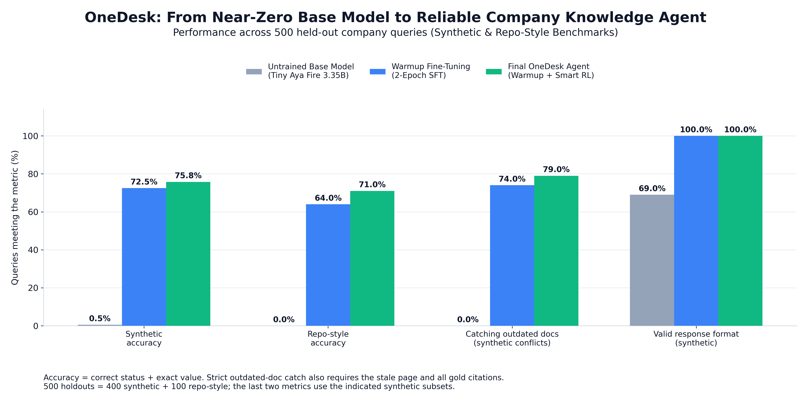
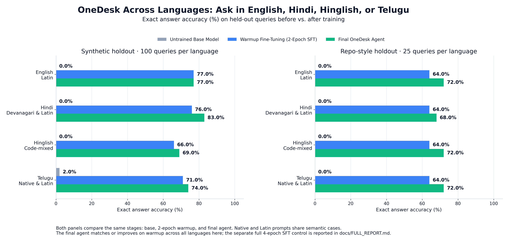
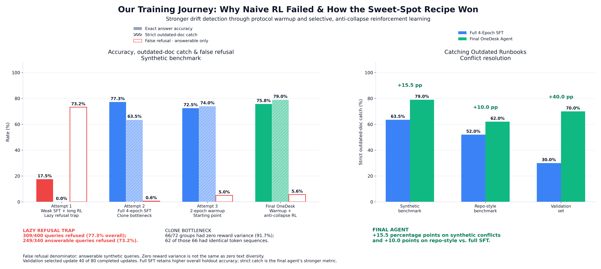
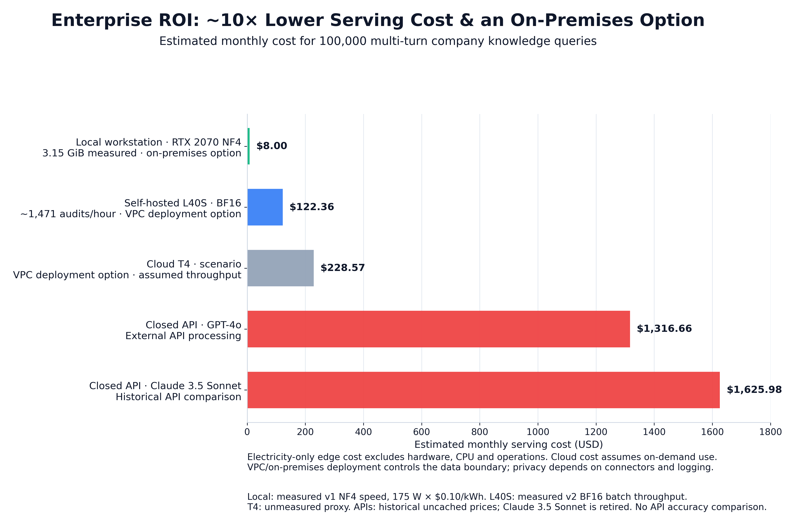

# OneDesk: One Multilingual Workspace to Query Your Company’s Knowledge Base

*Track 3 · Agentic Fine-Tuning · `CohereLabs/tiny-aya-fire` (3.35B) with CuratorKIT, AgentTune and AuditKIT*

## The problem

Company knowledge is split across Notion wikis, GitHub pull requests, Slack threads and SQL databases, and the newest-looking document is often a trap: a stale runbook that wasn't updated after yesterday's hotfix, or a `[STAGING-ONLY]` configuration page. Employees ask in English, Hindi (Devanagari and Latin), Hinglish and Telugu (native and Latin).

**Why a small local model?** A ~3B model can run inside company infrastructure, so private code, incidents and database schemas never leave it.

**The catch:** out of the box it can't do the job. The untrained model returns no valid final answer in 30% of episodes, calls the wrong tools, and breaks multi-step SQL, unit-conversion and math chains. It scores **0.4%** exact accuracy on our 500-task benchmark.

**Can a small, locally deployable 3.35B model learn to produce valid tool calls, find the current production answer, cite verified evidence, flag the outdated page, and refuse when a source is missing, using real tool calls instead of memorized answers?**

## Results



Combined performance across all **500 held-out queries** (400 synthetic + 100 repo-style; see [docs/FULL_REPORT.md](docs/FULL_REPORT.md) for separate split tables and 95% bootstrap CIs):

| Metric (Combined 500-Query Holdout) | Untrained Base | Warmup SFT (2-ep) | Full SFT (4-ep) | **OneDesk (Final RL)** |
| --- | --- | --- | --- | --- |
| **Strict stale-doc catch** (`n=250` conflicts) | 0.0% | 70.4% | 61.2% | **75.6% (+14.4 pp vs Full SFT)** |
| **Exact answer accuracy** (`n=500` all tasks) | 0.4% | 70.8% | **77.0%** | 74.8% |
| **Valid tool & response format** (`n=500`) | 70.0% | **100.0%** | **100.0%** | **100.0%** |
| **Verified citation F1** (`n=425` cited tasks) | 0.0% | 88.3% | **93.2%** | 87.6% |
| **Required-chain compliance** (`n=425` answerable) | 0.0% | 93.2% | **97.6%** | 84.0% |

OneDesk improves strict stale-document catch over full 4-epoch SFT by **+14.4 pp pooled** (**+15.5 pp [+5.5, +26.0]** on synthetic and **+10.0 pp [+2.0, +20.4]** on repo-style), while reaching **100% valid tool-call and response formatting**. Full SFT stays slightly ahead on overall accuracy (`77.0%` vs `74.8%`) and exhaustive 3-server chain compliance, and all benchmark data is synthetic.

The warmup, full-SFT, and final OneDesk checkpoints reach **100.0% valid final format** and **100.0% AuditKIT tool-call schema validity** on both holdouts.

The final adapter runs locally in NF4 (**3.33 GiB reserved VRAM**, 20-task timing sample). Self-hosted L40S serving is **$1.22 per 1k audits**, versus **$13.46** in the historical uncached GPT-4o same-string token scenario; cached billing is detailed below.

## Submission info

> **Where to look:** **Skim:** [Results](#results), then [Section 4 (Experiments)](#4-experiments-run-what-failed-and-how-we-found-the-winning-recipe) · **Verify:** [Section 7 (Repo Layout & Run Instructions)](#7-repo-layout--run-instructions) · **Depth:** Expand the `<details>` blocks below or read [`docs/FULL_REPORT.md`](docs/FULL_REPORT.md).

|  |  |
| --- | --- |
| Track | 3, problem statements 1, 2, 4, 5, 6, 9 |
| Model to use | [onedesk-tiny-aya-fire-v2-1-warmup-grpo-best-val](https://huggingface.co/Revanth-ml/onedesk-tiny-aya-fire-v2-1-warmup-grpo-best-val) |
| Public Space | [Revanth-ml/OneDesk](https://huggingface.co/spaces/Revanth-ml/OneDesk) |
| Collections | [Models](https://huggingface.co/collections/Revanth-ml/onedesk-models-and-experimental-controls-6af97221a617ddc3326204a6) · [Data](https://huggingface.co/collections/Revanth-ml/onedesk-data-and-experiment-evidence-6af97225c0f1dc548b9ba8ce) |
| Full report | [docs/FULL_REPORT.md](docs/FULL_REPORT.md) |
| Work before the hackathon | None |

Detailed submission reference: [docs/SUBMISSION_DOSSIER.md](docs/SUBMISSION_DOSSIER.md).

## 1. Problem Statement & Approach

A Hinglish employee asks for `loyalty-api`’s actual production `batch_size_mb`: the runbook says 154, a newer staging-only distractor says 286, and the production Slack update says 16. This `train_sft-0000-hinglish` protocol example shows the tool calls, cited answer and stale-page flag; the first query is shortened for readability.

> **Employee (Hinglish):** “Bhai, `loyalty-api` ka actual production `batch_size_mb` kya hai? Runbook aur deployment updates match karke outdated page flag karo.”<br>
> **In English:** What is `loyalty-api`’s actual production `batch_size_mb`? Compare the runbook with deployment updates and flag the outdated page.

```xml
<tool_call>{"server":"notion-mcp","tool":"search_notion","arguments":{"query":"loyalty-api batch_size_mb"}}</tool_call>
<tool_call>{"server":"slack-mcp","tool":"search_slack","arguments":{"query":"loyalty-api batch_size_mb"}}</tool_call>
<final_answer>{"status":"conflict_resolved","value":16,"cites":["NOTION-V2-TR-105","SLACK-V2-TR-105"],"stale_source":"NOTION-V2-TR-105"}</final_answer>
```


| Script style | Frozen example |
| --- | --- |
| en:latin | What is the active production batch_size_mb for loyalty-api? Compare the runbook with deployment records and flag any outdated page. |
| te:native | loyalty-api కోసం ప్రస్తుతం production లో batch_size_mb ఎంత? రన్‌బుక్‌ను deployment ఆధారాలతో పోల్చి పాత పేజీని గుర్తించండి. |

All six script styles: [full report](docs/FULL_REPORT.md#six-language-and-script-styles--verbatim-frozen-prompts).



## 2. Hackathon Repos Used


| Toolkit | Role and features |
| --- | --- |
| **CuratorKIT 0.1.21** | `DataSample` + `ExactDeduplicator.run`: **1,955 → 1,700** tasks; 255 injected exact duplicates rejected. |
| **AgentTune 1.1.4** | `Step`/`Trajectory` serialization, `SFTTrainerBase` warmup and `TrlAgenticGrpo` lifecycle with executed live MCP rollouts. |
| **AuditKIT 1.1.7** | 580 episodes/checkpoint: trajectory import, outcome/citation scorers and native tool-selection, validity and redundancy metrics. |

Compatibility fixes:

- Bridge AgentTune’s missing `_generate_single_turn` hook to TRL 0.23.1 live rollouts.
- Load dependency-light `agenttune.agentic` leaf modules instead of eager optional stacks.
- Explicit BF16 autocast for unwrapped PEFT decoder log-probability scoring.

## 3. Data Creation, Curation & Evaluation Strategy

We generated deterministic Python facts for **60 services and 80 incidents**; no LLM invented gold facts.
Question templates cover **six language/script styles**, and **CuratorKIT 0.1.21** deduplicated **1,955 → 1,700 tasks**.
A live tool-executing oracle verified outcomes and evidence before trajectory export; training and holdout cases are disjoint.

| Scenario | Required behavior |
| --- | --- |
| Consistent | Verify production agreement while ignoring staging/sibling distractors. |
| Conflicting / Outdated | Find newer production evidence, cite it and flag the stale page. |
| Database & Calculation Chains | Execute SQL, time/unit conversions and rounded incident-cost calculations. |
| Safe Refusal | Abstain for missing entities or an unavailable required source. |

- **Exact accuracy:** correct status plus normalized value.
- **Strict stale catch:** correct answer and stale-page flag; every gold source retrieved and cited.
- **Citation & tool-chain compliance:** verified citation F1, successful required-server calls and AuditKIT routing diagnostics.
- **Refusal calibration:** precision, recall, false-refusal rate on answerable tasks, and unplugged-DB recall separate necessary refusals from lazy RL abstention collapse.
- **Cluster-bootstrapped uncertainty:** 95% confidence intervals use 10,000 semantic-case bootstrap resamples, keeping all translations of a case in the same cluster.

<details>
<summary><strong>Deep dive: How the data was built (facts-first world, live oracle, CuratorKIT funnel & v1→v2 anti-shortcut constraints)</strong></summary>

### 3.1 Rationale: Why We Built a Custom Benchmark & Chose `CohereLabs/tiny-aya-fire`

Single-turn English API-syntax accuracy alone does not establish enterprise reliability. We needed one benchmark combining **contradictory silos** (a stale Notion runbook versus a newer GitHub PR or Slack hotfix), **scope traps** (a newer `[STAGING-ONLY]` record ranked above `[PROD]`), **SQL-to-time/unit/math chains**, and English, Hindi (Devanagari/Latin), Hinglish and Telugu (native/Latin) questions. We chose **`CohereLabs/tiny-aya-fire` (3.35B)** for South Asian-script text alongside Latin technical identifiers such as `loyalty-api` and `batch_size_mb`, at a size suited to an organization-controlled on-premises boundary: our **v1 NF4 adapter used 3.15 GiB peak reserved VRAM**. That edge measurement is separate from final v2 BF16 benchmark accuracy; tokenizer support is not itself evidence of answer correctness.

### 3.2 How We Created the Data: Facts-First World + Live Oracle + CuratorKIT Funnel

**No LLM invented gold facts.** The four components below separate fact generation, tool verification, language rendering and curation; the actual builder executes **facts → rendering → CuratorKIT → oracle verification/trajectory export**.

1. **Deterministic Python worlds** ([src/v2_world.py](src/v2_world.py); [src/v2_tasks.py](src/v2_tasks.py)): fixed **seed 42** creates the training world with **60 microservices and 80 incidents**; **seed 99** creates the synthetic holdout, with a separate constructed OSS repo-style world. Structured histories determine values, timestamps, source IDs and labels for **consistent**, **conflict/outdated-doc**, **incident** (`sla_penalty`, `payload_lb`, `payload_mib`, `config_audit`) and **abstain** tasks (missing entity or unplugged `db-mcp`).

2. **Live tool-executing oracle** ([src/v2_oracle.py](src/v2_oracle.py)): a deterministic discovery policy executes `notion-mcp`, `github-mcp`, `slack-mcp`, `db-mcp`, `time-mcp`, `unit-converter-mcp` and `math-mcp` as required, against each episode’s isolated in-memory SQLite snapshot. It uses task identity/request metadata, then discovers values and authority through returned observations—not hidden gold values or source labels. The builder checks predicted outcomes and retrieved gold IDs before export, reusing one verified semantic-case trajectory across its language variants. The **240** [AgentTune SFT trajectories](data_v2/train_sft_agenttune_trajectories.jsonl) carry measured `evidence_gated` oracle rewards: **`{"1.0": 60, "1.3": 112, "1.5": 68}`**. Expected abstentions are verified safe refusals, not tasks requiring an unavailable answer.

3. **Six-style multilingual rendering:** templates cover `en:latin`, `hi:native`, `hi:latin`, `hinglish:latin`, `te:native` and `te:latin`. Most cases have **four language/register versions**, with Hindi and Telugu alternating native/Latin templates—not six versions per case. The corpus has **425 rows per language group**; Hindi and Telugu each have **213 native / 212 Latin** rows. Four repo-style translations are omitted to retain exactly 100 rows from 26 cases. Template rendering and tool checks do not replace human linguistic review.

4. **CuratorKIT 0.1.21 deduplication** ([src/v2_dataset.py:curate](src/v2_dataset.py)): `curatorkit.schema.DataSample` and `ExactDeduplicator.run` process **1,955 candidate model-visible prompts**, rejecting **255 injected exact-duplicate controls** to freeze **1,700 oracle-verified tasks**. Controls add **15%** to the clean-row count; they are **13.0% of all candidates**. Every rejection is logged in [data_v2/curation_rejections.jsonl](data_v2/curation_rejections.jsonl); the [funnel](data_v2/curation_funnel.json) measures exact deduplication, not semantic paraphrase filtering or independent natural-data quality gains.

| Split (`data_v2/`) | Candidates → retained (rejected) | Semantic cases | Task mix (rows) | Purpose |
| --- | --- | --- | --- | --- |
| `train_sft_240.jsonl` | 276 → **240** (36) | 60 | 60 consistent, 60 conflict, 60 incident, 60 abstain | Supervised protocol warmup (60 steps) & four-epoch control |
| `train_grpo_stage1.jsonl` | 460 → **400** (60) | 100 | 100 per kind | Final live multi-turn GRPO Stage 1 (updates 1–40) |
| `train_grpo_stage2.jsonl` | 552 → **480** (72) | 120 | 120 per kind | Final live multi-turn GRPO Stage 2 (updates 41–80) |
| `val_train_80.jsonl` | 92 → **80** (12) | 20 | 20 per kind | Checkpoint selection & >40% predicted-abstention collapse guard |
| `holdout_synth_400_frozen.jsonl` | 460 → **400** (60) | 100 | 80 consistent, 200 conflict, 60 incident, 60 abstain | Primary synthetic holdout evaluation |
| `holdout_repo_style_100_frozen.jsonl` | 115 → **100** (15) | 26 | 20 consistent, 50 conflict, 15 incident, 15 abstain | Constructed repo-style holdout evaluation |
| **Total frozen corpus** | **1,955 → 1,700 (255)** | **426** (+20 unrendered reserved cases) | Balanced across four language groups; coverage of six script styles | 19 approved data-file hashes checked by `src.v2_2.manage.protected()` |

Task mixes describe frozen rows, not the final sampler’s accepted-update ratio. The 20 reserved training cases are outside these 1,700 rows. `SHA256SUMS` lists 15 artifacts; `protected()` additionally checks all **19 approved data files** without rewriting them.

### 3.3 Strict Curation Constraints We Imposed (`v1 → v2` Anti-Shortcut Hardening)

The audit of v1’s **85.25% (85.3% rounded)** SFT result found seven plausible confounds: reused SFT/GRPO cases, tool-spoiling prompts, `unknown-` missing-entity names, constant incident times/rates, an unused converter, implausible repo-style numbers, and single-result search. These are identified shortcuts, not measured causes of that score. V2 also varies incident times, rates and payloads, exercises kg→lb / decimal GB→MiB conversions, and enforces domain-valid configuration ranges.

1. **Blind tool routing:** user questions never name `github-mcp`, `slack-mcp`, `unit-converter-mcp` or `math-mcp`. Deployment-channel hints appear in retrieved runbooks; incident requests first require discovering service, timestamps or payload through SQLite. The prompt does not supply the tool sequence.

2. **Adversarial search ranking:** forgiving token-overlap search returns **up to three** own-entity/sibling records. Newer `[STAGING-ONLY]` records can rank above `[PROD]`, so “take the first hit” and “pick the newest timestamp” fail without scope filtering.

3. **Realistic refusal conditions:** absent services use plausible names without the `unknown-` prefix and are checked against the world’s service set. On unplugged-database tasks, `db-mcp` is actually absent from active schemas; the agent must respect the explicitly required source rather than substitute another silo.

4. **All 15 split-pair checks + modulo-3 partitioning:** [audit_splits](src/v2_dataset.py) and regression tests enforce **zero shared `case_id`**, **zero `(service, parameter)` pairs**, and **zero `incident_id`** across all six splits. Configuration integers use **train ≡ 1**, **synthetic holdout ≡ 2**, **repo-style holdout ≡ 0 (mod 3)**, preventing a training config integer from matching a holdout config answer. This rule does not make calculated incident costs or every scalar answer globally unique.

5. **CPU Text-Level Overlap Check** ([reports/submission/TEXT_LEAK_AUDIT.json](reports/submission/TEXT_LEAK_AUDIT.json)): **0/500 exact holdout prompt duplicates** against **1,120 training prompts**; mean nearest-train 5-word Jaccard is **0.0012 raw / 0.0012 entity-masked**. Independent structured checks find **zero `(service, parameter, gold_value)` tuple overlaps**. Shared system/tool instructions recur; **32/425 non-null holdout scalar answers repeat** on different facts. Low text overlap alone does not prove semantic independence.

6. **Tokenizer truncation preflight** ([data_v2/token_length_audit.json](data_v2/token_length_audit.json)): the cached Tiny Aya Fire tokenizer measured **min 979, mean 1,646.5, max 2,359 tokens** across 240 SFT conversations. The old **1,536-token** limit would truncate **136/240 (56.7%) of the full multilingual set**, not only native-script rows. We require **2,560 SFT tokens**, **zero truncated trajectories**, and **4,096 GRPO/evaluation context tokens**; generation is bounded to 192 tokens per turn and six tool calls.

</details>

## 4. Experiments Run, What Failed, and How We Found the Winning Recipe



### Lazy Refusal Trap

Only 15 SFT steps left a weak starting policy. Long RL then favored comparatively less-penalized refusal over malformed or stale answers. At 340 updates it refused **77.3%** of synthetic queries and caught **0%** of stale docs.

### Clone Bottleneck

Full four-epoch SFT reached **77.3% / 76.0%** holdout accuracy. Its RL pilot accepted only **6/72 groups (8.3%)**; 62 of 66 rejected zero-variance groups had identical token sequences. Strict synthetic stale catch was **63.5%**, exposing a gap beyond overall accuracy.

### Winning Recipe

Two-epoch protocol warmup followed by anti-collapse, positive-anchor G6 GRPO completed **80 active updates**, accepting **23.4%** of groups. Validation selected update **40** at **80.0%** accuracy, with no abstention-collapse guard triggered. Selected holdout accuracy reached **75.8% / 71.0%**, and strict stale catch **79.0% / 62.0%**.

| Checkpoint | Synthetic % [95% CI] | Repo-style % [95% CI] | Validation % [95% CI] |
| --- | --- | --- | --- |
| Base | 0.50 [0.00, 1.25] | 0.00 [0.00, 0.00] | 1.25 [0.00, 3.75] |
| Warmup SFT · 60 steps | 72.50 [65.25, 79.25] | 64.00 [46.53, 80.39] | 67.50 [48.75, 85.00] |
| Final OneDesk · GRPO update 40 | 75.75 [68.50, 82.50] | 71.00 [55.45, 84.31] | 80.00 [63.75, 93.75] |
| Full 4-Epoch SFT · 120 steps | 77.25 [70.00, 84.00] | 76.00 [61.39, 88.89] | 73.75 [56.25, 90.00] |

[Full seven-checkpoint, multilingual and AuditKIT tables](docs/FULL_REPORT.md).

### Enterprise ROI & Privacy



Serving scenario: **100,000 multi-turn audits/month**; local electricity excludes hardware and operations.
Local timing uses **20 distinct final-adapter NF4 cases**; L40S throughput comes from **580 recorded BF16 episodes**.
**Hackathon compute used:** ~**12.05 L40S GPU-hours + 2.35 A100 minutes ≈ $21.80** at list rates ([recorded compute lower bound](reports/submission/COMPUTE_ACCOUNTING.json)).

| Serving option | USD / 1k audits | USD / 100k audits | Basis |
| --- | --- | --- | --- |
| Local workstation · RTX 2070 NF4 | $0.10 | $9.55 | Measured final v2.1 NF4 (`7.84 out tok/s`, `3.33 GiB` VRAM); electricity only (`175W × $0.10/kWh`) |
| Self-hosted L40S · BF16 | $1.22 | $122.36 | Measured HF Jobs BF16 (`67.5 out tok/s`, `67.98 GPU-h/100k` at `$1.80/h`) |
| Cloud T4-small · NF4 scenario | $2.23 | $223.03 | Unmeasured T4; token-adjusted local NF4 proxy at `$0.40/h` |
| Closed API · GPT-4o (prefix cached) | $10.58 | $1,057.93 | `o200k_base` counts (`4,794` in / `148` out) with 50% eligible prefix-cache discount |
| Closed API · GPT-4o (uncached) | $13.46 | $1,345.96 | Historical uncached `$2.50/M` input + `$10/M` output |

<details>
<summary><strong>Throughput, GPU hours, live NF4 timing and caching method</strong></summary>

| Serving option | Sample volume | Pricing basis (GPU/hr or token rate) | Tokens/sec throughput | GPU runtime hours (1k /100k audits) | Cost /1k audits | Cost /100k audits |
| --- | --- | --- | --- | --- | --- | --- |
| Local workstation · RTX 2070 NF4 | 20 | $0 API; 175 W × $0.10/kWh; 3.33 GiB reserved; Measured final v2.1 adapter, 20 episodes, batch 1 | 7.84 out / 239.5 total tok/s | 5.456 / 545.65 hrs | **$0.10** | **$9.55** |
| Self-hosted L40S · BF16 | 580 | $1.80/GPU-hour | 67.53 out / 2,110.6 total tok/s (generation); 61.99 / 1,937.4 wall; 1,471 audits/hr | 0.680 / 67.98 hrs | **$1.22** | **$122.36** |
| Cloud T4-small · NF4 scenario | 500 saved; timing proxy | $0.40/GPU-hour | 7.64 out / 239.5 total tok/s (**proxy**) | 5.576 / 557.58 hrs | **$2.23** | **$223.03** |
| GPT-4o · eligible prefix caching | 500 saved; offline pricing | $2.50/M new in · $1.25/M cache · $10/M out | Provider-managed; **not measured**; 3.24 turns/audit | N/A · external API | **$10.58** | **$1,057.93** |
| GPT-4o · uncached baseline | 500 saved; offline pricing | $2.50/M input · $10/M output | Provider-managed; **not measured**; 3.24 turns/audit | N/A · external API | **$13.46** | **$1,345.96** |

**Volume rationale:** 100,000 audits/month is about 3,333/day—for example, roughly 200 service owners or scheduled agents running 17 configuration/incident checks per day. This is a deployment load scenario, not observed enterprise traffic or 100,000 independent incidents.

**Workload:** 100,000 company audits/month, with 1,000-audit unit costs. Exact replay of **500 saved holdouts / 1,620 assistant turns** gives **4,653.332 Cohere input / 153.322 visible output tokens per audit**; the identical strings encode as **4,793.714 input / 147.536 output in `o200k_base`**. Of the OpenAI-encoded input, **1,881.468** tokens/audit are newly introduced and **2,912.246** repeat an earlier input prefix; **2,304.256** qualify under the historical ≥1,024-token / 128-token-block rule.

**Timing basis:** the L40S log covers **580 episodes** (500 holdouts + 80 validation), **1,419.402 seconds full wall / 1,302.923 seconds generation**, and **87,984 generated tokens**. Its **67.53 output / 2,110.62 logical total tok/s** generation rate differs from **61.99 output / 1,937.42 total tok/s** end-to-end; runtime costs use the full wall clock. Replaying all 580 inputs yields **2,661,997** logical input tokens. Startup, idle capacity, API quality equivalence and operations are outside the serving projection.

**Live final-adapter NF4 check:** RTX 2070, FP16 compute, greedy batch 1, six-call limit, 192 generated tokens/turn, 4,096 context tokens; **16 synthetic + 4 repo-style tasks**, balanced five per kind, cover **20 distinct semantic cases**. After one excluded warmup episode, the 20 episodes used **392.865 wall seconds**, **391.615 generation seconds**, **90,993 input / 3,082 generated tokens**, and **3.332 GiB peak reserved VRAM**. Sample exact-outcome accuracy is **75.0%**, versus **80.0%** for the same 20 saved BF16 episodes; this is not a 500-task NF4 quality estimate. The table projects the measured sample runtime; T4 instead adjusts final holdout logical-token volume to edge speed and remains a proxy.

**Caching and billing:** GPT-4o costs use `o200k_base` counts of the saved strings and historical token prices; cached costs assume eligible in-TTL hits, not observed usage. Provider message framing differs from the Cohere template, so these are offline estimates, not API invoices. Historical Claude 3.5 at $3/M ordinary input, $0.30/M cache reads, $3.75/M 5-minute writes and $15/M output gives **$16.59 uncached / $11.25 cached per 1k**, or **$1,659.42 / $1,124.50 per 100k**, using an explicitly non-native `o200k_base` token proxy with charged writes.

[Full audit, per-hour prices and benchmark provenance](reports/submission/ROI_VERIFIED_BENCHMARK.json); per-turn counts are in `ROI_TOKEN_TURNS.jsonl`. Electricity uses **175 W × $0.10/kWh**, not a power meter. T4 remains an unmeasured token-adjusted edge proxy; on-premises/VPC privacy depends on connector and logging controls. Historical schedules: [OpenAI caching](https://openai.com/index/api-prompt-caching/), [Claude caching](https://platform.claude.com/docs/en/build-with-claude/prompt-caching), [HF Jobs rates](https://huggingface.co/docs/hub/en/jobs-pricing).

</details>

## 5. Models, Datasets & Public HF Collections

- **Primary Final Model:** [Revanth-ml/onedesk-tiny-aya-fire-v2-1-warmup-grpo-best-val](https://huggingface.co/Revanth-ml/onedesk-tiny-aya-fire-v2-1-warmup-grpo-best-val) (base: [CohereLabs/tiny-aya-fire](https://huggingface.co/CohereLabs/tiny-aya-fire), rev `73500c80`).
- **Public Model Collection (all 9 artifacts & controls):** [Revanth-ml/onedesk-models-and-experimental-controls](https://huggingface.co/collections/Revanth-ml/onedesk-models-and-experimental-controls-6af97221a617ddc3326204a6).
- **Public Data Collection (frozen benchmark & rollout journals):** [Revanth-ml/onedesk-data-and-experiment-evidence](https://huggingface.co/collections/Revanth-ml/onedesk-data-and-experiment-evidence-6af97225c0f1dc548b9ba8ce).
- **Licenses:** model weights/adapters `CC-BY-NC-4.0` · synthetic data `CC-BY-4.0` ([LICENSE-DATA.md](LICENSE-DATA.md)) · code `Apache-2.0` ([LICENSE](LICENSE)).

[Nine-row revision table, six split hashes and all 19 protected-file checksums](docs/FULL_REPORT.md#5-models-used-and-their-licenses).

## 6. With More Credits: Approach, Before and After Results

**Targets, not measured results:**

| Priority | Measured before | Next change | Future target |
| --- | --- | --- | --- |
| Complete evidence | Chain: **86.47% / 74.12%** | Enforce three-server completeness; harder audit trails | **>96%** chain compliance |
| Unplugged DB | Recall: **21.43% / 42.86%** | Oversample unavailable-source contrasts | Fewer missed/false refusals |
| Overall accuracy | **75.75% / 71.00%** | Matched-compute warmup/reward/sampling sweep | **83%+**, aspirational |
| Confirmation | One selected recipe | Multiple seeds; fresh source-backed cohort | Replicated paired gains |

## 7. Repo Layout & Run Instructions

Formerly DriftGuard-MCP, hence the `DriftGuard*` class names in `src/v2_2/`. Unrelated to the commercial OneDesk helpdesk software.

**Regression suite: 126 passed** — 120 core benchmark/training tests + 6 submission/audit verification tests.

```text
├── src/              # v1/, v2/, v2_1/, v2_2/ runtimes; provenance-listed sources stay here
├── data_v2/          # Frozen 1,700 tasks, worlds and SHA-256 manifest
├── checkpoints/      # v1/, v2/, v2_1/, v2_2/ adapters and metadata
├── reports/          # v1/, v2/, v2_1/, v2_2/, submission/ evidence
├── figures/          # Benchmark charts and static architecture diagrams
├── docs/             # Full report, dossier, hf_cards/ and archive/data_v1/
└── tests/            # v1/, v2/, v2_1/, v2_2/: 126 regression tests
```

Canonical commands use `src.v2_2`; legacy imports remain supported. See [repository layout and source-provenance notes](docs/REPOSITORY_LAYOUT.md), including the two pre-existing source-checksum mismatches.

From the project root with the pinned toolkits/dependencies installed; use fresh output paths. The training/evaluation modules expose Python functions, so the commands below call those functions directly; GPU stages need suitable CUDA hardware.

```bash
# CPU data curation: new directory, never overwrite frozen data_v2/.
python -c "from src.v2_dataset import build; build('data_rebuild')"

# GPU: two-epoch SFT warmup, then live 40+40-update GRPO.
python - <<'PYTHON'
from src.v2_2.training import run_sft, run_grpo
adapter, metadata = run_sft('runs/repro_sft')
run_grpo(adapter, 'runs/repro_grpo', metadata)
PYTHON

# GPU: AuditKIT on validation and both frozen holdouts.
python - <<'PYTHON'
from peft import PeftModel
from src.v2_2.backend import load_base
from src.v2_2.evaluate_auditkit import evaluate
model, tokenizer = load_base()
model = PeftModel.from_pretrained(model, 'runs/repro_grpo/best_val_adapter')
evaluate(model, tokenizer, 'runs/repro_eval',
         splits=('validation', 'test_synth', 'repo_style'))
PYTHON

# Download selected weights, then run one local NF4 example (GPU).
python - <<'PYTHON'
from huggingface_hub import snapshot_download
snapshot_download('Revanth-ml/onedesk-tiny-aya-fire-v2-1-warmup-grpo-best-val',
    revision='016676680121b4dd90ec6026978de7ee1cdb1271',
    local_dir='checkpoints/v2_2/grpo_best_val_adapter')
PYTHON
python -m src.v2_2.local_demo --adapter checkpoints/v2_2/grpo_best_val_adapter

# CPU audit and complete regression suite.
python scripts/text_leak_check.py
python scripts/verify_roi_billing.py --local-files-only
CUDA_VISIBLE_DEVICES='' python -m pytest tests -q

# Local GPU timing of the final adapter on 20 distinct cases.
python scripts/benchmark_v2_1_roi.py
```

## 8. Honest Limitations & Teammates Tagged

- Constructed fixtures, modulo-3 configuration values and correlated template translations; no verified live-OSS transfer. Scalar answers recur across different facts, as the [text audit](reports/submission/TEXT_LEAK_AUDIT.json) reports.
- Overall GRPO-over-warmup holdout gain intervals include zero; repeated validation selection and one run need fresh confirmation.
- Prefer **full SFT for overall accuracy**, selected **GRPO for strict stale catch**; chain completeness, incident reasoning and unplugged-DB handling still need work.
- Warmup length, group size and temperature changed together; zero variance does not prove full-distribution entropy collapse.
- Final-adapter local NF4 speed/memory is measured on 20 stratified episodes; full v2 accuracy results are BF16. ROI excludes hardware/operations, uses historical same-string API price estimates, and does not establish equal API accuracy; privacy requires appropriate connectors and logging.
- Model weights retain noncommercial terms; third-party licenses apply. The public Space distinguishes recorded evidence from opt-in live runs; future targets remain unmeasured.

**Teammates tagged:** [@Revanth-ml](https://huggingface.co/Revanth-ml).
