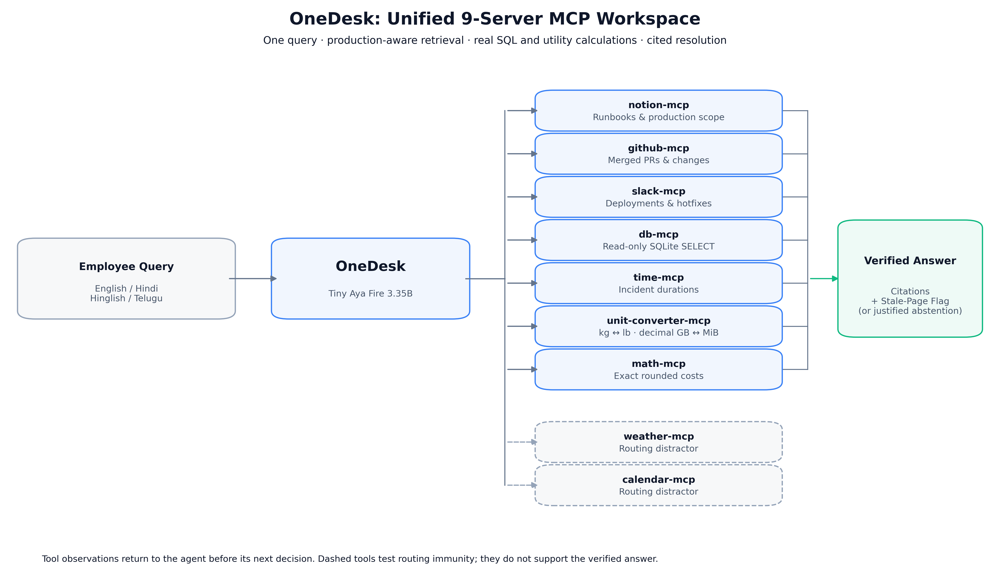
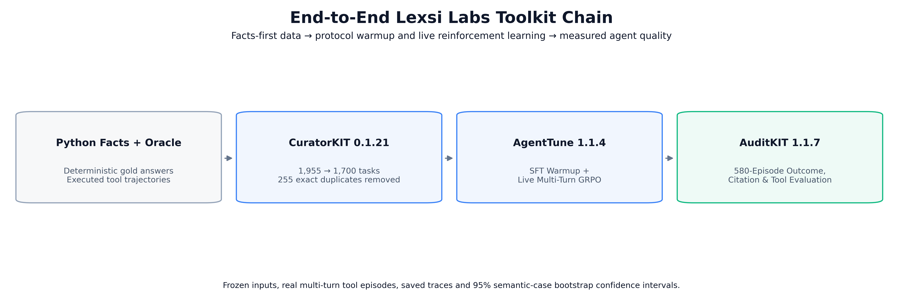

# OneDesk: One Multilingual Workspace to Query Your Entire Company’s Knowledge Base

*Turning a 3.35B Local Model (`CohereLabs/tiny-aya-fire`) into a Unified Enterprise Assistant Across Notion, GitHub, Slack, and Live SQL Databases — Track 3: Agentic Fine-Tuning*

## ⚡ For Judges: 60-Second Overview

| What matters | OneDesk |
| --- | --- |
| The vision | One internal workspace: ask in English, Hindi (Devanagari/Latin), Hinglish or Telugu (native/Latin), and reconcile company wikis, code PRs, chat threads and databases into a current, cited answer. |
| The core challenge | A wiki may be stale after yesterday’s PR or hotfix; the newest document may be `[STAGING-ONLY]`. OneDesk checks production scope, reconciles evidence, flags outdated pages, runs SQL/time/unit/math chains, and handles unavailable sources. |
| Headline results | Base → final: **0.5% → 75.8% synthetic accuracy**, **0.0% → 71.0% repo-style accuracy**, and **100% valid final response format** on all 500 holdouts. Strict outdated-doc catch: **79.0%**, beating four-epoch SFT’s 63.5% by **15.5 percentage points** on synthetic conflicts. |
| On-premises & affordable | A local NF4 deployment measured **3.15 GiB VRAM** with $0 API fees (v1 adapter). The measured L40S serving scenario costs **$1.22/1,000 audits**, about 10.8× below the historical GPT-4o token-price scenario. On-premises deployment keeps model processing local; connector/logging controls define the privacy boundary. |
| What we built | A facts-first multilingual benchmark, real AgentTune SFT/live GRPO, CuratorKIT deduplication, AuditKIT evaluation, and a documented diagnosis and recovery from RL abstention collapse. |


**Read the charts:** exact accuracy means the right structured status **and** exact normalized value. Strict outdated-doc catch additionally requires the correct stale-page ID and all gold sources retrieved and cited. Values are rounded for presentation; exact results and 95% intervals follow below.

## 1. Problem Statement and Approach, in Brief

### How Company Teams Use OneDesk

An engineer checks a runbook, another announces a hotfix in Slack, and production settings change through a GitHub PR. Meanwhile an operations teammate needs an incident cost from SQL. Finding the answer requires knowing which source applies, which deployment is current, and whether a document is even about production. Global teams ask those questions in different languages and scripts.

OneDesk gives that workflow one interface. Its small multilingual agent searches across the available tools, checks scope and timestamps, and returns a compact answer with evidence IDs the employee can follow.

> **Employee query, Hinglish:** “Bhai, `loyalty-api` ka actual production `batch_size_mb` kya hai? Runbook aur deployment updates match karke outdated page flag karo.”

1. **Wiki lookup.** The production Notion runbook says **154 MB** and identifies Slack `#deployments` as its tracking channel. A newer staging page says **286 MB**; the agent must ignore it for this production request.
2. **Deployment verification.** Follow the observed tracking hint to Slack, or check GitHub and Slack when the deployment trail spans both. In this frozen example, the production Slack record updates the value to **16 MB**.
3. **Verified answer.** Return **16**, cite `NOTION-V2-TR-105` and `SLACK-V2-TR-105`, and flag the Notion page as outdated. The next team member can see why the answer differs from the wiki.

Compact protocol example for `train_sft-0000-hinglish`:

```xml
<tool_call>{"server":"notion-mcp","tool":"search_notion","arguments":{"query":"loyalty-api batch_size_mb"}}</tool_call>
<tool_call>{"server":"slack-mcp","tool":"search_slack","arguments":{"query":"loyalty-api batch_size_mb"}}</tool_call>
<final_answer>{"status":"conflict_resolved","value":16,"cites":["NOTION-V2-TR-105","SLACK-V2-TR-105"],"stale_source":"NOTION-V2-TR-105"}</final_answer>
```

These values come from the frozen `train_sft-0000-hinglish` example; the first search query is shortened for this compact illustration. Cross-channel tasks require an additional PR/hotfix check; incident tasks begin by discovering their service or timestamps in SQL.

### Unified 9-Server MCP Workspace



`db-mcp.query_db(sql)` executes actual SELECT queries against an episode-isolated, in-memory SQLite snapshot. The model receives rows or SQLite errors as its next observation. Time, conversion and arithmetic tools perform actual deterministic calculations. Search returns up to three ranked records, mixing production, newer staging-only records and siblings. The model’s structured tool turns are executed and fed back before it chooses the next action.

### Six language and script styles — verbatim frozen prompts

| Style | Example prompt |
| --- | --- |
| en:latin | What is the active production batch_size_mb for loyalty-api? Compare the runbook with deployment records and flag any outdated page. |
| hi:native | loyalty-api का वर्तमान production batch_size_mb क्या है? दस्तावेज़ और deployment records की तुलना करें और पुराने पन्ने को पहचानें। |
| hi:latin | audit-stream ka production circuit_breaker_pct nirdhaarit kijiye; likhit nirdesh aur naveen tainaati soochna mein antar ho to bataaiye. |
| hinglish:latin | Bhai, loyalty-api ka actual production batch_size_mb kya hai? Runbook aur deployment updates match karke outdated page flag karo. |
| te:native | loyalty-api కోసం ప్రస్తుతం production లో batch_size_mb ఎంత? రన్‌బుక్‌ను deployment ఆధారాలతో పోల్చి పాత పేజీని గుర్తించండి. |
| te:latin | audit-stream kosam amalulo unna circuit_breaker_pct ni cheppu; patram mariyu tainaati vivaraalu veruga unte paatha page chupinchu. |


## 2. Hackathon Repos Used: Which Ones, For What, and Which Features



| Toolkit | Features actually used | Code and output |
| --- | --- | --- |
| **CuratorKIT 0.1.21** · `d6f2e44e` | `DataSample`, `ExactDeduplicator.run`: **1,955 candidates → 1,700 tasks**, with all **255 exact duplicate controls** rejected and logged. | `src/v2_dataset.py:curate`; `data_v2/curation_funnel.json`, `curation_rejections.jsonl` |
| **AgentTune 1.1.4** · `e56a1094` | `Step`, `Trajectory`, `TrajectoryDataset`; `SFTTrainerBase` via `DriftGuardSFTTrainer`; `TrlAgenticGrpo` wrapper with `MCPGRPOTrainer` for executed multi-turn MCP rollouts. | `src_v2_2/toolkits.py`, `agenttune_sft_backend.py`, `agenttune_grpo_backend.py`, `training.py` |
| **AuditKIT 1.1.7** · `fe6083e7` | `episodes_from_agenttune`, `FunctionScorer`, `ToolCallF1(arg_mode="name")`, `ToolCallValidity`, `RedundantToolCalls`; matched **580-episode checkpoint comparisons** (80 validation + 500 holdouts). | `src_v2_2/evaluate_auditkit.py`, `evaluation_core.py`; JSON summaries and raw episodes |

**Compatibility engineering:** we bridged AgentTune’s `_generate_single_turn` expectation to the installed TRL 0.23.1 live-rollout hook; loaded dependency-light `agenttune.agentic` leaf modules to avoid unrelated optional imports; and added explicit BF16 autocast around unwrapped PEFT decoder scoring. AgentTune retains its data/train/save lifecycle, TRL owns optimization, and our backend supplies full tool episodes and assistant-only loss masks. Issue-ready details and exact commits are in [SUBMISSION_DOSSIER.md](SUBMISSION_DOSSIER.md#5-chaining-the-three-lexsi-labs-repositories--upstream-findings).

## 3. Data Creation, Curation & Evaluation Strategy

### Facts first, then language

We built a company world with **60 microservices**, **80 production incidents**, configuration histories, runbooks and deployment trails. Structured Python facts come first, so every gold value, timestamp and evidence ID is deterministic. The oracle executes the same tools available to the model and verifies its trajectories before text templates render each query in four language/register groups and six script styles.

| Scenario | What the agent must do |
| --- | --- |
| Consistent knowledge | Verify that the production wiki and deployment agree, despite staging-only and sibling distractors. |
| Conflicting / outdated documents | Find the latest production setting in GitHub or Slack, compare it with the runbook, and flag/cite the stale page. Some trails span all three sources. |
| Database & calculation chains | Discover incident fields through read-only SQLite, then compute hours or convert kg→lb / decimal GB→MiB, and use math for the exact rounded cost. Config-audit incidents discover the service before checking its deployment. |
| Safe refusal | Abstain when the entity does not exist or the explicitly required SQL server is unplugged, rather than inventing evidence or silently substituting another source. |

### Tested split separation and context sizing

Across the **six splits and 1,700 rendered tasks**, tests enforce **zero shared case IDs**, **zero shared `(service, parameter)` pairs**, and **zero shared incident IDs**. The train world contains 320 semantic cases: 300 allocated to the four train/validation pools and 20 reserved. Holdout worlds use separate namespaces.

The token audit found a maximum **2,359 tokens**; a 1,536-token limit would truncate **136/240** SFT conversations. We therefore used **2,560 tokens for SFT**, asserted **zero truncated trajectories**, and allowed **4,096 context tokens at evaluation**, with 192 generated tokens per turn and six tool calls.

### Four dimensions of evaluation

1. **Exact answer accuracy:** the expected status and exact normalized scalar agree.
2. **Strict outdated-doc catch:** the answer is right, the outdated page is flagged, and every gold source was actually retrieved **and** cited.
3. **Verified citations and tool chains:** citation F1 credits only retrieved evidence; required-chain checks identify missing utilities or deployment channels; AuditKIT checks tool selection, validity and redundancy.
4. **Refusal calibration:** precision/recall distinguish necessary refusals from refusing answerable questions and missing an unplugged-source constraint.

We bootstrap **10,000 times by semantic case**, keeping translated versions together. The validation, synthetic and repo-style cohorts contain **20**, **100** and **26** semantic cases respectively.

## 4. Experiments Run, What Failed, and How We Found the Winning Recipe


### Too little warmup: the lazy refusal trap

A deliberately compact **15-step SFT** reached **15.0% synthetic accuracy**. We then ran **340 GRPO updates**. In unsuccessful rollout groups, a lazy `abstain` could get a smaller penalty than a malformed tool attempt or stale answer. That made refusal comparatively attractive. The final policy refused **309/400 synthetic queries (77.3%)**, including **249/340 answerable queries (73.2%)**. Strict outdated-doc catch fell to **0%**.

RL initially helped: at update 120, validation rose **22.50% → 43.75%** (+21.25 pp, 95% CI **[+6.25, +38.75]**) and synthetic holdout rose **15.00% → 26.25%** (+11.25 pp **[+5.00, +18.00]**). Continuing without a collapse-aware selection rule lost that gain.

### Too little rollout variety: the clone bottleneck

Four epochs of SFT (**120 steps**) produced a strong baseline: **77.3% synthetic / 76.0% repo-style accuracy**. But its RL pilot found only **6 useful groups out of 72 (8.3% acceptance)**. Of 66 groups with zero reward variance, **62 had completely identical assistant-token sequences**. A strong imitation model left little useful variation in that pilot. Its strict outdated-doc catch was **63.5% synthetic**, even though overall accuracy was high.

### The working recipe: protocol warmup + selective anti-collapse RL

We stopped SFT at **two epochs / 60 steps**, reaching **72.5% synthetic accuracy** with **100% valid final format**. We then sampled six rollouts per group at a higher exploration temperature, penalized false refusals, rewarded useful evidence gathering, and updated only when rewards varied and an answerable group contained a **positive evidence or success anchor**. A positive anchor need not be a completely correct answer.

The five-update smoke accepted **5/9 groups (55.6%)**. The complete run accepted **80/342 (23.4%)**—**2.8×** the historical four-epoch pilot’s acceptance rate—and completed **40 + 40 updates**. Validation at updates 20/40/60/80 was **73.75 / 80.00 / 76.25 / 78.75%**. We selected **update 40** by validation; predicted validation abstention was **25.0%**, matching its true prevalence, and no >40% collapse guard fired.

The selected OneDesk agent reached **75.8% synthetic**, **71.0% repo-style** and **80.0% validation** accuracy. Strict outdated-doc catch reached **79.0% synthetic / 62.0% repo-style**: **+15.5 pp [+5.5, +26.0]** and **+10.0 pp [+1.96, +20.41]** over the full four-epoch control. Stage 2’s final update 80 was saved separately; the published headline belongs to the selected update 40.

### Master results — exact accuracy (%) with 95% case-bootstrap intervals

| Checkpoint | Synthetic · n=400 | Repo-style · n=100 | Validation · n=80 |
| --- | --- | --- | --- |
| Base | 0.50 [0.00, 1.25] | 0.00 [0.00, 0.00] | 1.25 [0.00, 3.75] |
| Weak SFT · 15 steps | 15.00 [10.50, 20.00] | 16.00 [7.52, 25.74] | 22.50 [7.50, 40.00] |
| Early RL · 120 updates | 26.25 [18.75, 34.50] | 26.00 [11.00, 43.14] | 43.75 [23.75, 62.50] |
| Collapsed RL · 340 updates | 17.50 [11.00, 24.75] | 15.00 [3.09, 30.30] | 26.25 [8.72, 46.25] |
| Warmup SFT · 60 steps | 72.50 [65.25, 79.25] | 64.00 [46.53, 80.39] | 67.50 [48.75, 85.00] |
| Final OneDesk · selected update 40 | 75.75 [68.50, 82.50] | 71.00 [55.45, 84.31] | 80.00 [63.75, 93.75] |
| Full SFT · 120 steps | 77.25 [70.00, 84.00] | 76.00 [61.39, 88.89] | 73.75 [56.25, 90.00] |

### Multilingual breakdown — exact accuracy (%)

**Synthetic holdout**

| Language | Base | Warmup SFT | Full 4-epoch SFT | Final OneDesk |
| --- | --- | --- | --- | --- |
| en | 0.0 | 77.0 | 77.0 | 77.0 |
| hi | 0.0 | 76.0 | 82.0 | 83.0 |
| hinglish | 0.0 | 66.0 | 79.0 | 69.0 |
| te | 2.0 | 71.0 | 71.0 | 74.0 |

**Repo-style holdout**

| Language | Base | Warmup SFT | Full 4-epoch SFT | Final OneDesk |
| --- | --- | --- | --- | --- |
| en | 0.0 | 64.0 | 76.0 | 72.0 |
| hi | 0.0 | 64.0 | 76.0 | 68.0 |
| hinglish | 0.0 | 64.0 | 76.0 | 72.0 |
| te | 0.0 | 64.0 | 76.0 | 72.0 |

### AuditKIT tool-calling table

| Cohort | Model | Tool precision % | Recall % | F1 % | Validity % | Redundancy % ↓ | Verified cite F1 % | Required chain % |
| --- | --- | --- | --- | --- | --- | --- | --- | --- |
| Synthetic | Base | 7.0 | 7.0 | 7.0 | — | — | 0.0 | 0.0 |
| Synthetic | Full SFT | 96.0 | 96.3 | 96.1 | 100.0 | 0.0 | 92.6 | 97.4 |
| Synthetic | Final OneDesk | 93.2 | 87.9 | 89.9 | 100.0 | 0.0 | 88.3 | 86.5 |
| Repo-style | Base | 7.0 | 7.0 | 7.0 | — | — | 0.0 | 0.0 |
| Repo-style | Full SFT | 96.3 | 96.1 | 96.1 | 100.0 | 0.0 | 95.6 | 98.8 |
| Repo-style | Final OneDesk | 93.3 | 84.8 | 88.0 | 100.0 | 0.0 | 84.6 | 74.1 |

In the AuditKIT table, — means the native metric is absent from that saved headline, rather than a zero score.

Full SFT is the strongest overall-accuracy control; OneDesk’s selected RL agent is strongest on the **complete stale-document detection contract**. The master table and separate chain metric make that distinction visible.

### Enterprise ROI & Privacy


| Deployment option | Monthly / 100,000 audits | Per 1,000 audits | Basis |
| --- | --- | --- | --- |
| Local workstation · RTX 2070 NF4 | $8.00 | $0.08 | Electricity only: 175 W, $0.10/kWh; measured v1 NF4 speed |
| Self-hosted L40S · BF16 | $122.36 | $1.22 | Measured offline BF16 throughput; $1.80/GPU-hour |
| Cloud T4 · scenario | $228.57 | $2.29 | Unmeasured T4; edge-latency proxy at $0.50/GPU-hour |
| Closed API · GPT-4o | $1,316.66 | $13.17 | Historical uncached rates: $2.50/M input + $10/M output |
| Closed API · Claude 3.5 Sonnet | $1,625.98 | $16.26 | Historical $3/M input + $15/M output; retired endpoint |

For the selected agent, saved multi-turn holdout traces average **4,653.332 input tokens** and **153.322 decoded output tokens** per audit. The API scenario applies historical uncached rates to that volume. The L40S result uses the recorded **1,419.402 seconds / 580 evaluation episodes**, about **1,471 audits/hour**, at **$1.80/hour**. Local electricity assumes **175 W × $0.10/kWh** and the recorded v1 RTX 2070 runtime; it has no API token bill. On-premises deployment can keep model processing and evidence inside company infrastructure. A self-hosted cloud model can instead be deployed under an organization’s VPC controls.

## 5. Models Used and Their Licenses

| Model family / artifact | Purpose | License |
| --- | --- | --- |
| `CohereLabs/tiny-aya-fire` · 3.35B dense open weights | Base student and all fresh SFT starts; pinned revision `73500c80fcb6c8bea3e830c21d5d2920249a0e1a` | CC BY-NC 4.0 |
| Warmup, selected GRPO, final-update and full SFT LoRA adapters | Trained rank-16 / alpha-32 adapters on the pinned base | CC BY-NC 4.0; retain base attribution and terms |
| V1 adapter/merged model, v1 pilot and v2 weak/collapsed controls | Historical experiments and negative-result controls | CC BY-NC 4.0; scores refer to their own cohorts |

Gold facts are generated deterministically in Python, rather than by a teacher model.

## 6. Datasets and Benchmarks Used and Their Licenses

| Frozen data_v2 artifact | Rows | Semantic cases | SHA-256 |
| --- | --- | --- | --- |
| `train_sft_240.jsonl` | 240 | 60 | `96402f7d8ce8f05ee98aee212f1af9ac7a2b51fef1098e2beda3e395b90e1932` |
| `train_grpo_stage1.jsonl` | 400 | 100 | `b44e67d78d2abc921583c535a10c3a2bd790aca8fd43723e87151c0c962b7768` |
| `train_grpo_stage2.jsonl` | 480 | 120 | `8d7f5236f1fad9450f5ae3ecb81e83b9acda96f01d548225787b7f7eb5754977` |
| `val_train_80.jsonl` | 80 | 20 | `4eb608f1391596afe2ad62f67e9c5a68e5b396838b8c97f130638d9510f3b254` |
| `holdout_synth_400_frozen.jsonl` | 400 | 100 | `82b92badc6f1fdc71bba41a876db4adf9f19633108b26331297227a7587ac50b` |
| `holdout_repo_style_100_frozen.jsonl` | 100 | 26 | `c6d808482bb85143b08eda51e6703f13f9f0817dd0b30a90ca3cd2d81e8b3469` |

**Total: 1,700 rendered tasks.** Our original synthetic benchmark data is licensed under **CC-BY-4.0**; attribution: **OneDesk contributors / Revanth-ml**. Original project code is licensed under **Apache-2.0**. See [dataset licensing](LICENSE-DATA.md) and the [code license](LICENSE). Model weights and adapters remain **CC BY-NC 4.0**; third-party code retains its own license. The frozen data and its checksum manifest remain unchanged.

## 7. Model Artifacts Public, as an HF Collection

**Publication status:** Public collections and repositories are linked below.

**Model Collection:** [Revanth-ml/onedesk-models-and-experimental-controls](https://huggingface.co/collections/Revanth-ml/onedesk-models-and-experimental-controls-6af97221a617ddc3326204a6)

| Artifact | Hugging Face repository | Pinned weight revision |
| --- | --- | --- |
| Historical v1 SFT adapter | [Revanth-ml/onedesk-tiny-aya-fire-sft](https://huggingface.co/Revanth-ml/onedesk-tiny-aya-fire-sft) | `b0d0d072311e62e31eb6258ad8ce987e8bf7926d` |
| Historical v1 SFT merged | [Revanth-ml/onedesk-tiny-aya-fire-sft-merged](https://huggingface.co/Revanth-ml/onedesk-tiny-aya-fire-sft-merged) | `9747926dfe35d4a7ff10761c8caec3c1714496b2` |
| Historical v1 GRPO pilot | [Revanth-ml/onedesk-tiny-aya-fire-grpo-pilot](https://huggingface.co/Revanth-ml/onedesk-tiny-aya-fire-grpo-pilot) | `1eae42be5b7a3e8eeeb8408078537b4b0b243732` |
| V2 weak SFT | [Revanth-ml/onedesk-tiny-aya-fire-v2-sft](https://huggingface.co/Revanth-ml/onedesk-tiny-aya-fire-v2-sft) | `f8bd317a9f84746328af7d078a49cc08a64f0086` |
| V2 collapsed RL — negative-result control | [Revanth-ml/onedesk-tiny-aya-fire-v2-grpo](https://huggingface.co/Revanth-ml/onedesk-tiny-aya-fire-v2-grpo) | `c313816cc3ae46c4e3dd5ebc1d61cbff22ec05c4` |
| Full four-epoch SFT control | [Revanth-ml/onedesk-tiny-aya-fire-v2-1-sft](https://huggingface.co/Revanth-ml/onedesk-tiny-aya-fire-v2-1-sft) | `bf94f4cc6ec420752205859e6d63c7f83b85f14d` |
| OneDesk protocol warmup · 60 steps | [Revanth-ml/onedesk-tiny-aya-fire-v2-1-warmup-sft](https://huggingface.co/Revanth-ml/onedesk-tiny-aya-fire-v2-1-warmup-sft) | `72aafc56b1506a81a7cb12930e95f8f2f17d03d5` |
| OneDesk final agent · validation-selected update 40 | [Revanth-ml/onedesk-tiny-aya-fire-v2-1-warmup-grpo-best-val](https://huggingface.co/Revanth-ml/onedesk-tiny-aya-fire-v2-1-warmup-grpo-best-val) | `016676680121b4dd90ec6026978de7ee1cdb1271` |
| OneDesk final-update ablation · update 80 | [Revanth-ml/onedesk-tiny-aya-fire-v2-1-warmup-grpo-final](https://huggingface.co/Revanth-ml/onedesk-tiny-aya-fire-v2-1-warmup-grpo-final) | `b006ec346e48807afd23030abf17b599adfcf71f` |

Use the **warmup GRPO best-val** repository for the selected final agent. The final-update adapter is an ablation with no separate full holdout evaluation; its card does not borrow update 40’s scores.

## 8. Data Artifacts Public, as an HF Collection

**Data Collection:** [Revanth-ml/onedesk-data-and-experiment-evidence](https://huggingface.co/collections/Revanth-ml/onedesk-data-and-experiment-evidence-6af97225c0f1dc548b9ba8ce)

| Repository | Contents |
| --- | --- |
| [Revanth-ml/onedesk-mcp-v2-data](https://huggingface.co/datasets/Revanth-ml/onedesk-mcp-v2-data) | Frozen benchmark |
| [Revanth-ml/onedesk-mcp-warmup-runs](https://huggingface.co/datasets/Revanth-ml/onedesk-mcp-warmup-runs) | Recorded experiment artifacts |
| [Revanth-ml/onedesk-mcp-v2-runs](https://huggingface.co/datasets/Revanth-ml/onedesk-mcp-v2-runs) | Recorded experiment artifacts |
| [Revanth-ml/onedesk-mcp-v2-1-runs](https://huggingface.co/datasets/Revanth-ml/onedesk-mcp-v2-1-runs) | Recorded experiment artifacts |
| [Revanth-ml/onedesk-mcp-training-runs](https://huggingface.co/datasets/Revanth-ml/onedesk-mcp-training-runs) | Recorded experiment artifacts |
| [Revanth-ml/onedesk-mcp-grpo-runs](https://huggingface.co/datasets/Revanth-ml/onedesk-mcp-grpo-runs) | Recorded experiment artifacts |

The frozen data repository contains the benchmark JSONL and manifests. Run repositories contain provenance, raw trajectories, evaluation summaries and training diagnostics. Human-readable model and dataset cards are available under [hf_cards/](hf_cards/).

## 9. With More Credits: Approach, Before and After Results

**Next experiment — targets, not measured results.** Extra credits would fund a controlled sweep and a fresh confirmation cohort, focusing on missing three-server evidence and unplugged-DB errors. The following “after” column is an explicit research target; it is not an extrapolated or achieved score.

| Priority | Measured starting point | Proposed change | Target after a future run |
| --- | --- | --- | --- |
| Complete deployment trail | Final chain compliance: **86.47% synthetic / 74.12% repo-style** | Require all task-authoritative deployment evidence in successful conflict traces; add hard three-source examples | **>96% chain compliance**, without reducing exact accuracy |
| Unplugged database handling | Final unplugged recall: **21.43% synthetic / 42.86% repo-style** | Oversample source-unavailable cases and contrast “missing entity” versus “source offline” | Higher unplugged recall with fewer false refusals; verify on fresh cases |
| Overall answer accuracy | Final: **75.75% synthetic / 71.00% repo-style** | Sweep reward/chain balance, warmup length and sampling under matched compute; retain validation-only selection | **83%+ accuracy** as an aspirational target, not a prediction |
| Scientific confirmation | One completed selected recipe; repeated validation use | Multiple random seeds and an untouched, source-backed evaluation cohort | Replicated paired improvements and narrower uncertainty |

### Reproducibility commands

These commands rebuild documentation and run CPU-only regression checks; they do not start training or inference. The publish command is shown separately and changes remote visibility only when explicitly invoked.

```bash
.venv/bin/python scripts/build_clean_charts.py
.venv/bin/python scripts/build_clean_report.py
.venv/bin/python scripts/prepare_hf_repos.py --dry-run
CUDA_VISIBLE_DEVICES='' .venv/bin/python -m pytest tests tests_v2 tests_v2_1 tests_v2_2 -q
.venv/bin/python -c "from src_v2_2.manage import protected; print(protected())"

# When ready: publish existing artifacts/cards and create public collections.
.venv/bin/python scripts/prepare_hf_repos.py --publish
# Optional rename (same account; recorded original revisions stay documented):
# .venv/bin/python scripts/prepare_hf_repos.py --publish --rename-prefix onedesk
```

**Teammates tagged:** [@Revanth-ml](https://huggingface.co/Revanth-ml).

**Detailed reference:** [SUBMISSION_DOSSIER.md](SUBMISSION_DOSSIER.md). Saved evidence: [full seven-checkpoint comparison](reports_v2_2/downloads/warmup-20261113T084035Z/comparison/EXPERIMENT_REPORT.md), [paired trade-offs](reports_v2_2/downloads/warmup-20261113T084035Z/comparison/FINDINGS.md), and [chart source values](figures/CHART_DATA.json). Published artifacts use `onedesk` repository names; immutable task IDs and historical provenance retain their original experiment identifiers.

## 10. Honest Limitations

- **Benchmark scope:** the Notion/GitHub/Slack records and repo-style examples are constructed fixtures, not live company integrations or independently verified historical Git changes. SQL and utility calls execute for real, but the nine logical MCP interfaces run in-process over local snapshots.
- **Artificial split and language structure:** configuration integers are divided by modulo-3 residue across worlds. Disjoint identifiers prevent tested case overlap, but shared templates and structural shortcuts remain possible. Native/Latin prompts are template translations, not independent human-reviewed language datasets.
- **Selection and uncertainty:** translations are clustered, validation has only 20 semantic cases, and checkpoints were repeatedly selected on it. Overall GRPO-minus-warmup holdout gains have paired 95% intervals that include zero: **+3.25 pp [−2.50, +9.00] synthetic**, **+7.00 pp [−5.00, +20.00] repo-style**. A fresh confirmation set and multiple seeds are needed.
- **Which checkpoint to choose:** full four-epoch SFT has higher overall accuracy (**77.25% / 76.00%**). Selected OneDesk GRPO is better on strict stale catch (**79.00% / 62.00%**), but required-chain compliance fell from warmup **93.82% / 90.59%** to **86.47% / 74.12%**. It still misses some unplugged sources and unnecessarily refuses some answerable tasks. The rule checks server calls, not causal use of every observation.
- **Exploration explanation:** shorter warmup, G4→G6 and higher temperatures changed together. Zero reward variance is not identical text, and identical sampled sequences are not a full-distribution entropy measurement. The recipe avoided the earlier abstention collapse in this run; no universal causal fix is claimed.
- **Cost and privacy:** local 3.15 GiB and speed measurements are from the v1 NF4 adapter, while v2 quality/throughput was measured in BF16. T4 throughput and API accuracy were not measured; API prices are historical, Claude 3.5 Sonnet is retired, and costs exclude hardware amortization/operations. Privacy depends on the deployment, access controls, connectors and logs; it is not guaranteed by the model.
- **Licenses and scope:** model weights and adapters retain CC BY-NC 4.0 noncommercial terms; original synthetic data is CC-BY-4.0 and original project code is Apache-2.0. Third-party licenses still apply. No public Gradio application is established by these artifacts. Future 83%+/96% numbers are targets only.
