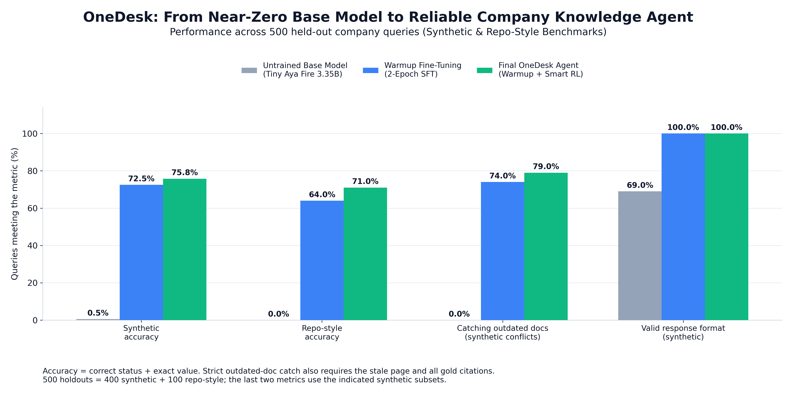
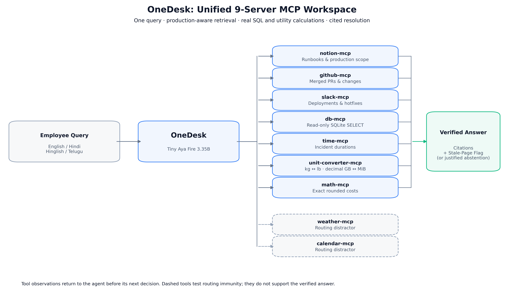
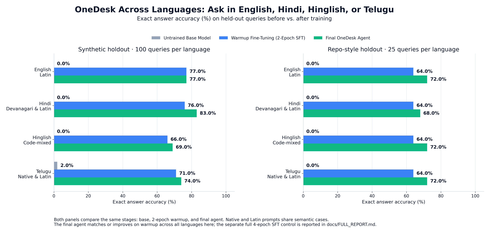
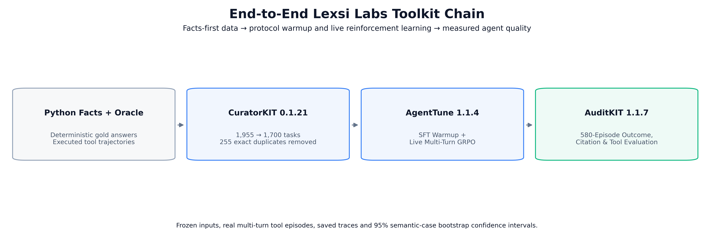
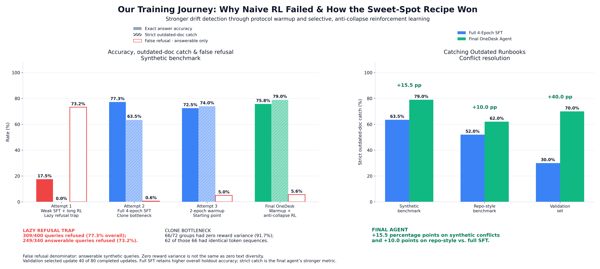
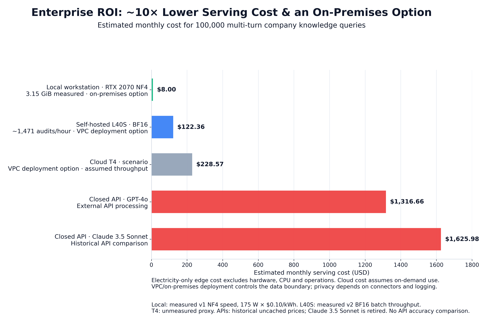

# OneDesk: One Multilingual Workspace to Query Your Entire Company’s Knowledge Base

*Turning a 3.35B Local Model (`CohereLabs/tiny-aya-fire`) into a Unified Enterprise Assistant Across Notion, GitHub, Slack, and Live SQL Databases — Track 3: Agentic Fine-Tuning*

## Submission info

| Artifact | Public link |
| --- | --- |
| Interactive Space | [Revanth-ml/OneDesk](https://huggingface.co/spaces/Revanth-ml/OneDesk) |

## ⚡ For Judges: 60-Second Overview

| What matters | OneDesk |
| --- | --- |
| The vision | One internal workspace: ask in English, Hindi (Devanagari/Latin), Hinglish or Telugu (native/Latin), and reconcile company wikis, code PRs, chat threads and databases into a current, cited answer. |
| The core challenge | A wiki may be stale after yesterday’s PR or hotfix; the newest document may be `[STAGING-ONLY]`. OneDesk checks production scope, reconciles evidence, flags outdated pages, runs SQL/time/unit/math chains, and handles unavailable sources. |
| Headline results | Base → final: **0.5% → 75.8% synthetic accuracy**, **0.0% → 71.0% repo-style accuracy**, and **100% valid final response format** on all 500 holdouts. Strict outdated-doc catch: **79.0%**, beating four-epoch SFT’s 63.5% by **15.5 percentage points** on synthetic conflicts. |
| On-premises & affordable | Final-adapter NF4 timing uses **3.33 GiB reserved VRAM** on 20 local tasks; $0 API fees. L40S is **$1.22/1k audits** at **$1.80/GPU-hour**; the detailed table includes cached/uncached API scenarios and measured throughput. Connector/logging controls define the privacy boundary. |
| What we built | A facts-first multilingual benchmark, real AgentTune SFT/live GRPO, CuratorKIT deduplication, AuditKIT evaluation, and a documented diagnosis and recovery from RL abstention collapse. |



**Read the charts:** exact accuracy means the right structured status **and** exact normalized value. Strict outdated-doc catch additionally requires the correct stale-page ID and all gold sources retrieved and cited. Values are rounded for presentation; exact results and 95% intervals follow below.

## 1. Problem Statement and Approach, in Brief

### How Company Teams Use OneDesk

An engineer checks a runbook, another announces a hotfix in Slack, and production settings change through a GitHub PR. Meanwhile an operations teammate needs an incident cost from SQL. Finding the answer requires knowing which source applies, which deployment is current, and whether a document is even about production. Global teams ask those questions in different languages and scripts.

OneDesk gives that workflow one interface. Its small multilingual agent searches across the available tools, checks scope and timestamps, and returns a compact answer with evidence IDs the employee can follow.

> **Employee (Hinglish):** “Bhai, `loyalty-api` ka actual production `batch_size_mb` kya hai? Runbook aur deployment updates match karke outdated page flag karo.”<br>
> **In English:** What is `loyalty-api`’s actual production `batch_size_mb`? Compare the runbook with deployment updates and flag the outdated page.

1. **Wiki lookup.** The production Notion runbook says **154 MB** and identifies Slack `#deployments` as its tracking channel. A newer staging page says **286 MB**; the agent must ignore it for this production request.
2. **Deployment verification.** Follow the observed tracking hint to Slack, or check GitHub and Slack when the deployment trail spans both. In this frozen example, the production Slack record updates the value to **16 MB**.
3. **Verified answer.** Return **16**, cite `NOTION-V2-TR-105` and `SLACK-V2-TR-105`, and flag the Notion page as outdated. The next team member can see why the answer differs from the wiki.

Compact protocol example for `train_sft-0000-hinglish`:

```xml
<tool_call>{"server":"notion-mcp","tool":"search_notion","arguments":{"query":"loyalty-api batch_size_mb"}}</tool_call>
<tool_call>{"server":"slack-mcp","tool":"search_slack","arguments":{"query":"loyalty-api batch_size_mb"}}</tool_call>
<final_answer>{"status":"conflict_resolved","value":16,"cites":["NOTION-V2-TR-105","SLACK-V2-TR-105"],"stale_source":"NOTION-V2-TR-105"}</final_answer>
```

These values come from the frozen `train_sft-0000-hinglish` example; the first search query is shortened for this compact illustration. Cross-channel tasks require an additional PR/hotfix check; incident tasks begin by discovering their service or timestamps in SQL.

### Unified 9-Server MCP Workspace



`db-mcp.query_db(sql)` executes actual SELECT queries against an episode-isolated, in-memory SQLite snapshot. The model receives rows or SQLite errors as its next observation. Time, conversion and arithmetic tools perform actual deterministic calculations. Search returns up to three ranked records, mixing production, newer staging-only records and siblings. The model’s structured tool turns are executed and fed back before it chooses the next action.

### Six language and script styles — verbatim frozen prompts

| Style | Example prompt |
| --- | --- |
| en:latin | What is the active production batch_size_mb for loyalty-api? Compare the runbook with deployment records and flag any outdated page. |
| hi:native | loyalty-api का वर्तमान production batch_size_mb क्या है? दस्तावेज़ और deployment records की तुलना करें और पुराने पन्ने को पहचानें। |
| hi:latin | audit-stream ka production circuit_breaker_pct nirdhaarit kijiye; likhit nirdesh aur naveen tainaati soochna mein antar ho to bataaiye. |
| hinglish:latin | Bhai, loyalty-api ka actual production batch_size_mb kya hai? Runbook aur deployment updates match karke outdated page flag karo. |
| te:native | loyalty-api కోసం ప్రస్తుతం production లో batch_size_mb ఎంత? రన్‌బుక్‌ను deployment ఆధారాలతో పోల్చి పాత పేజీని గుర్తించండి. |
| te:latin | audit-stream kosam amalulo unna circuit_breaker_pct ni cheppu; patram mariyu tainaati vivaraalu veruga unte paatha page chupinchu. |



## 2. Hackathon Repos Used: Which Ones, For What, and Which Features



| Toolkit | Features actually used | Code and output |
| --- | --- | --- |
| **CuratorKIT 0.1.21** · `d6f2e44e` | `DataSample`, `ExactDeduplicator.run`: **1,955 candidates → 1,700 tasks**, with all **255 exact duplicate controls** rejected and logged. | `src/v2_dataset.py:curate`; `data_v2/curation_funnel.json`, `curation_rejections.jsonl` |
| **AgentTune 1.1.4** · `e56a1094` | `Step`, `Trajectory`, `TrajectoryDataset`; `SFTTrainerBase` via `DriftGuardSFTTrainer`; `TrlAgenticGrpo` wrapper with `MCPGRPOTrainer` for executed multi-turn MCP rollouts. | `src/v2_2/toolkits.py`, `agenttune_sft_backend.py`, `agenttune_grpo_backend.py`, `training.py` |
| **AuditKIT 1.1.7** · `fe6083e7` | `episodes_from_agenttune`, `FunctionScorer`, `ToolCallF1(arg_mode="name")`, `ToolCallValidity`, `RedundantToolCalls`; matched **580-episode checkpoint comparisons** (80 validation + 500 holdouts). | `src/v2_2/evaluate_auditkit.py`, `evaluation_core.py`; JSON summaries and raw episodes |

**Compatibility engineering:** we bridged AgentTune’s `_generate_single_turn` expectation to the installed TRL 0.23.1 live-rollout hook; loaded dependency-light `agenttune.agentic` leaf modules to avoid unrelated optional imports; and added explicit BF16 autocast around unwrapped PEFT decoder scoring. AgentTune retains its data/train/save lifecycle, TRL owns optimization, and our backend supplies full tool episodes and assistant-only loss masks. Issue-ready details and exact commits are in [SUBMISSION_DOSSIER.md](SUBMISSION_DOSSIER.md#5-chaining-the-three-lexsi-labs-repositories--upstream-findings).

## 3. Data Creation, Curation & Evaluation Strategy

### 3.1 Rationale: Why We Built a Custom Benchmark & Chose `CohereLabs/tiny-aya-fire`

Single-turn English API-syntax accuracy alone does not establish enterprise reliability. We needed one benchmark combining **contradictory silos** (a stale Notion runbook versus a newer GitHub PR or Slack hotfix), **scope traps** (a newer `[STAGING-ONLY]` record ranked above `[PROD]`), **SQL-to-time/unit/math chains**, and English, Hindi (Devanagari/Latin), Hinglish and Telugu (native/Latin) questions. We chose **`CohereLabs/tiny-aya-fire` (3.35B)** for South Asian-script text alongside Latin technical identifiers such as `loyalty-api` and `batch_size_mb`, at a size suited to an organization-controlled on-premises boundary: our **v1 NF4 adapter used 3.15 GiB peak reserved VRAM**. That edge measurement is separate from final v2 BF16 benchmark accuracy; tokenizer support is not itself evidence of answer correctness.

### 3.2 How We Created the Data: Facts-First World + Live Oracle + CuratorKIT Funnel

**No LLM invented gold facts.** The four components below separate fact generation, tool verification, language rendering and curation; the actual builder executes **facts → rendering → CuratorKIT → oracle verification/trajectory export**.

1. **Deterministic Python worlds** ([src/v2_world.py](../src/v2_world.py); [src/v2_tasks.py](../src/v2_tasks.py)): fixed **seed 42** creates the training world with **60 microservices and 80 incidents**; **seed 99** creates the synthetic holdout, with a separate constructed OSS repo-style world. Structured histories determine values, timestamps, source IDs and labels for **consistent**, **conflict/outdated-doc**, **incident** (`sla_penalty`, `payload_lb`, `payload_mib`, `config_audit`) and **abstain** tasks (missing entity or unplugged `db-mcp`).

2. **Live tool-executing oracle** ([src/v2_oracle.py](../src/v2_oracle.py)): a deterministic discovery policy executes `notion-mcp`, `github-mcp`, `slack-mcp`, `db-mcp`, `time-mcp`, `unit-converter-mcp` and `math-mcp` as required, against each episode’s isolated in-memory SQLite snapshot. It uses task identity/request metadata, then discovers values and authority through returned observations—not hidden gold values or source labels. The builder checks predicted outcomes and retrieved gold IDs before export, reusing one verified semantic-case trajectory across its language variants. The **240** [AgentTune SFT trajectories](../data_v2/train_sft_agenttune_trajectories.jsonl) carry measured `evidence_gated` oracle rewards: **`{"1.0": 60, "1.3": 112, "1.5": 68}`**. Expected abstentions are verified safe refusals, not tasks requiring an unavailable answer.

3. **Six-style multilingual rendering:** templates cover `en:latin`, `hi:native`, `hi:latin`, `hinglish:latin`, `te:native` and `te:latin`. Most cases have **four language/register versions**, with Hindi and Telugu alternating native/Latin templates—not six versions per case. The corpus has **425 rows per language group**; Hindi and Telugu each have **213 native / 212 Latin** rows. Four repo-style translations are omitted to retain exactly 100 rows from 26 cases. Template rendering and tool checks do not replace human linguistic review.

4. **CuratorKIT 0.1.21 deduplication** ([src/v2_dataset.py:curate](../src/v2_dataset.py)): `curatorkit.schema.DataSample` and `ExactDeduplicator.run` process **1,955 candidate model-visible prompts**, rejecting **255 injected exact-duplicate controls** to freeze **1,700 oracle-verified tasks**. Controls add **15%** to the clean-row count; they are **13.0% of all candidates**. Every rejection is logged in [data_v2/curation_rejections.jsonl](../data_v2/curation_rejections.jsonl); the [funnel](../data_v2/curation_funnel.json) measures exact deduplication, not semantic paraphrase filtering or independent natural-data quality gains.

| Split (`data_v2/`) | Candidates → retained (rejected) | Semantic cases | Task mix (rows) | Purpose |
| --- | --- | --- | --- | --- |
| `train_sft_240.jsonl` | 276 → **240** (36) | 60 | 60 consistent, 60 conflict, 60 incident, 60 abstain | Supervised protocol warmup (60 steps) & four-epoch control |
| `train_grpo_stage1.jsonl` | 460 → **400** (60) | 100 | 100 per kind | Final live multi-turn GRPO Stage 1 (updates 1–40) |
| `train_grpo_stage2.jsonl` | 552 → **480** (72) | 120 | 120 per kind | Final live multi-turn GRPO Stage 2 (updates 41–80) |
| `val_train_80.jsonl` | 92 → **80** (12) | 20 | 20 per kind | Checkpoint selection & >40% predicted-abstention collapse guard |
| `holdout_synth_400_frozen.jsonl` | 460 → **400** (60) | 100 | 80 consistent, 200 conflict, 60 incident, 60 abstain | Primary synthetic holdout evaluation |
| `holdout_repo_style_100_frozen.jsonl` | 115 → **100** (15) | 26 | 20 consistent, 50 conflict, 15 incident, 15 abstain | Constructed repo-style holdout evaluation |
| **Total frozen corpus** | **1,955 → 1,700 (255)** | **426** (+20 unrendered reserved cases) | Balanced across four language groups; coverage of six script styles | 19 approved data-file hashes checked by `src.v2_2.manage.protected()` |

Task mixes describe frozen rows, not the final sampler’s accepted-update ratio. The 20 reserved training cases are outside these 1,700 rows. `SHA256SUMS` lists 15 artifacts; `protected()` additionally checks all **19 approved data files** without rewriting them.

### 3.3 Strict Curation Constraints We Imposed (`v1 → v2` Anti-Shortcut Hardening)

The audit of v1’s **85.25% (85.3% rounded)** SFT result found seven plausible confounds: reused SFT/GRPO cases, tool-spoiling prompts, `unknown-` missing-entity names, constant incident times/rates, an unused converter, implausible repo-style numbers, and single-result search. These are identified shortcuts, not measured causes of that score. V2 also varies incident times, rates and payloads, exercises kg→lb / decimal GB→MiB conversions, and enforces domain-valid configuration ranges.

1. **Blind tool routing:** user questions never name `github-mcp`, `slack-mcp`, `unit-converter-mcp` or `math-mcp`. Deployment-channel hints appear in retrieved runbooks; incident requests first require discovering service, timestamps or payload through SQLite. The prompt does not supply the tool sequence.

2. **Adversarial search ranking:** forgiving token-overlap search returns **up to three** own-entity/sibling records. Newer `[STAGING-ONLY]` records can rank above `[PROD]`, so “take the first hit” and “pick the newest timestamp” fail without scope filtering.

3. **Realistic refusal conditions:** absent services use plausible names without the `unknown-` prefix and are checked against the world’s service set. On unplugged-database tasks, `db-mcp` is actually absent from active schemas; the agent must respect the explicitly required source rather than substitute another silo.

4. **All 15 split-pair checks + modulo-3 partitioning:** [audit_splits](../src/v2_dataset.py) and regression tests enforce **zero shared `case_id`**, **zero `(service, parameter)` pairs**, and **zero `incident_id`** across all six splits. Configuration integers use **train ≡ 1**, **synthetic holdout ≡ 2**, **repo-style holdout ≡ 0 (mod 3)**, preventing a training config integer from matching a holdout config answer. This rule does not make calculated incident costs or every scalar answer globally unique.

5. **CPU Text-Level Overlap Check** ([reports/submission/TEXT_LEAK_AUDIT.json](../reports/submission/TEXT_LEAK_AUDIT.json)): **0/500 exact holdout prompt duplicates** against **1,120 training prompts**; mean nearest-train 5-word Jaccard is **0.0012 raw / 0.0012 entity-masked**. Independent structured checks find **zero `(service, parameter, gold_value)` tuple overlaps**. Shared system/tool instructions recur; **32/425 non-null holdout scalar answers repeat** on different facts. Low text overlap alone does not prove semantic independence.

6. **Tokenizer truncation preflight** ([data_v2/token_length_audit.json](../data_v2/token_length_audit.json)): the cached Tiny Aya Fire tokenizer measured **min 979, mean 1,646.5, max 2,359 tokens** across 240 SFT conversations. The old **1,536-token** limit would truncate **136/240 (56.7%) of the full multilingual set**, not only native-script rows. We require **2,560 SFT tokens**, **zero truncated trajectories**, and **4,096 GRPO/evaluation context tokens**; generation is bounded to 192 tokens per turn and six tool calls.

### 3.4 Evaluation Strategy: Metrics Chosen and Why

- **Exact Answer Accuracy (`exact_outcome`, 500 holdouts):** both the expected status (`answered`, `conflict_resolved`, `abstain`) and normalized scalar must match. The right number with the wrong conflict/refusal status is still an operational error; dumping several numbers cannot satisfy a single-scalar answer.
- **Strict Outdated-Doc Catch (`stale_catch`, 250 conflicts):** exact outcome **plus the exact stale-page ID plus every gold source actually retrieved and cited**. This tests whether the agent caught and grounded the documentation drift, rather than guessing the updated value or merely collecting evidence.
- **Verified Citation & Tool-Chain Compliance (425 evidence/answerable tasks):** citation F1 credits retrieved-and-cited gold IDs while penalizing unsupported IDs; required-chain compliance checks successful required-server calls, including time/conversion/math utilities. These detect correct-looking unsupported answers and skipped calculations. AuditKIT’s native tool-selection precision/recall/F1, validity and redundancy diagnose routing/schema errors and wasted calls; valid final format is tracked separately. Tool calls per successful task measure efficiency without rewarding premature failure.
- **Refusal Calibration:** abstention precision penalizes false refusals of answerable questions; recall checks necessary refusals, with unplugged-source recall isolated. An agent that refuses everything can appear cautious while failing the job—the failure our collapsed-RL control exposes.

Reported 95% intervals use **10,000 semantic-case cluster bootstrap resamples**, keeping correlated language versions together: **20 validation / 100 synthetic / 26 repo-style cases**. Confidence intervals describe these frozen cohorts, not independent translations or verified live-enterprise generalization.

## 4. Experiments Run, What Failed, and How We Found the Winning Recipe



### Too little warmup: the lazy refusal trap

A deliberately compact **15-step SFT** reached **15.0% synthetic accuracy**. We then ran **340 GRPO updates**. In unsuccessful rollout groups, a lazy `abstain` could get a smaller penalty than a malformed tool attempt or stale answer. That made refusal comparatively attractive. The final policy refused **309/400 synthetic queries (77.3%)**, including **249/340 answerable queries (73.2%)**. Strict outdated-doc catch fell to **0%**.

RL initially helped: at update 120, validation rose **22.50% → 43.75%** (+21.25 pp, 95% CI **[+6.25, +38.75]**) and synthetic holdout rose **15.00% → 26.25%** (+11.25 pp **[+5.00, +18.00]**). Continuing without a collapse-aware selection rule lost that gain.

### Too little rollout variety: the clone bottleneck

Four epochs of SFT (**120 steps**) produced a strong baseline: **77.3% synthetic / 76.0% repo-style accuracy**. But its RL pilot found only **6 useful groups out of 72 (8.3% acceptance)**. Of 66 groups with zero reward variance, **62 had completely identical assistant-token sequences**. A strong imitation model left little useful variation in that pilot. Its strict outdated-doc catch was **63.5% synthetic**, even though overall accuracy was high.

### The working recipe: protocol warmup + selective anti-collapse RL

We stopped SFT at **two epochs / 60 steps**, reaching **72.5% synthetic accuracy** with **100% valid final format**. We then sampled six rollouts per group at a higher exploration temperature, penalized false refusals, rewarded useful evidence gathering, and updated only when rewards varied and an answerable group contained a **positive evidence or success anchor**. A positive anchor need not be a completely correct answer.

The five-update smoke accepted **5/9 groups (55.6%)**. The complete run accepted **80/342 (23.4%)**—**2.8×** the historical four-epoch pilot’s acceptance rate—and completed **40 + 40 updates**. Validation at updates 20/40/60/80 was **73.75 / 80.00 / 76.25 / 78.75%**. We selected **update 40** by validation; predicted validation abstention was **25.0%**, matching its true prevalence, and no >40% collapse guard fired.

The selected OneDesk agent reached **75.8% synthetic**, **71.0% repo-style** and **80.0% validation** accuracy. Strict outdated-doc catch reached **79.0% synthetic / 62.0% repo-style**: **+15.5 pp [+5.5, +26.0]** and **+10.0 pp [+1.96, +20.41]** over the full four-epoch control. Stage 2’s final update 80 was saved separately; the published headline belongs to the selected update 40.

### Master results — exact accuracy (%) with 95% case-bootstrap intervals

| Checkpoint | Synthetic · n=400 | Repo-style · n=100 | Validation · n=80 |
| --- | --- | --- | --- |
| Base | 0.50 [0.00, 1.25] | 0.00 [0.00, 0.00] | 1.25 [0.00, 3.75] |
| Weak SFT · 15 steps | 15.00 [10.50, 20.00] | 16.00 [7.52, 25.74] | 22.50 [7.50, 40.00] |
| Early RL · 120 updates | 26.25 [18.75, 34.50] | 26.00 [11.00, 43.14] | 43.75 [23.75, 62.50] |
| Collapsed RL · 340 updates | 17.50 [11.00, 24.75] | 15.00 [3.09, 30.30] | 26.25 [8.72, 46.25] |
| Warmup SFT · 60 steps | 72.50 [65.25, 79.25] | 64.00 [46.53, 80.39] | 67.50 [48.75, 85.00] |
| Final OneDesk · selected update 40 | 75.75 [68.50, 82.50] | 71.00 [55.45, 84.31] | 80.00 [63.75, 93.75] |
| Full SFT · 120 steps | 77.25 [70.00, 84.00] | 76.00 [61.39, 88.89] | 73.75 [56.25, 90.00] |

### Multilingual breakdown — exact accuracy (%)

**Synthetic holdout**

| Language | Base | Warmup SFT | Full 4-epoch SFT | Final OneDesk |
| --- | --- | --- | --- | --- |
| en | 0.0 | 77.0 | 77.0 | 77.0 |
| hi | 0.0 | 76.0 | 82.0 | 83.0 |
| hinglish | 0.0 | 66.0 | 79.0 | 69.0 |
| te | 2.0 | 71.0 | 71.0 | 74.0 |

**Repo-style holdout**

| Language | Base | Warmup SFT | Full 4-epoch SFT | Final OneDesk |
| --- | --- | --- | --- | --- |
| en | 0.0 | 64.0 | 76.0 | 72.0 |
| hi | 0.0 | 64.0 | 76.0 | 68.0 |
| hinglish | 0.0 | 64.0 | 76.0 | 72.0 |
| te | 0.0 | 64.0 | 76.0 | 72.0 |

### AuditKIT tool-calling table

| Cohort | Model | Tool precision % | Recall % | F1 % | Validity % | Redundancy % ↓ | Verified cite F1 % | Required chain % |
| --- | --- | --- | --- | --- | --- | --- | --- | --- |
| Synthetic | Base | 7.0 | 7.0 | 7.0 | — | — | 0.0 | 0.0 |
| Synthetic | Full SFT | 96.0 | 96.3 | 96.1 | 100.0 | 0.0 | 92.6 | 97.4 |
| Synthetic | Final OneDesk | 93.2 | 87.9 | 89.9 | 100.0 | 0.0 | 88.3 | 86.5 |
| Repo-style | Base | 7.0 | 7.0 | 7.0 | — | — | 0.0 | 0.0 |
| Repo-style | Full SFT | 96.3 | 96.1 | 96.1 | 100.0 | 0.0 | 95.6 | 98.8 |
| Repo-style | Final OneDesk | 93.3 | 84.8 | 88.0 | 100.0 | 0.0 | 84.6 | 74.1 |

In the AuditKIT table, — means the native metric is absent from that saved headline, rather than a zero score.

Format percentages count valid structured final answers. AuditKIT records **100% tool-call validity for the warmup, final, and full-SFT checkpoints** on both holdouts; the early 15-step SFT scores **99.3–99.5%**, and Stage 1 scores **99.75%** on synthetic. Pooled means use metric-specific denominators; paired confidence intervals remain split-specific.

Full SFT is the strongest overall-accuracy control; OneDesk’s selected RL agent is strongest on the **complete stale-document detection contract**. The master table and separate chain metric make that distinction visible.

### Enterprise ROI & Privacy



| Serving option | Sample volume | Pricing basis (GPU/hr or token rate) | Tokens/sec throughput | GPU runtime hours (1k /100k audits) | Cost /1k audits | Cost /100k audits |
| --- | --- | --- | --- | --- | --- | --- |
| Local workstation · RTX 2070 NF4 | 20 | $0 API; 175 W × $0.10/kWh; 3.33 GiB reserved; Measured final v2.1 adapter, 20 episodes, batch 1 | 7.84 out / 239.5 total tok/s | 5.456 / 545.65 hrs | **$0.10** | **$9.55** |
| Self-hosted L40S · BF16 | 580 | $1.80/GPU-hour | 67.53 out / 2,110.6 total tok/s (generation); 61.99 / 1,937.4 wall; 1,471 audits/hr | 0.680 / 67.98 hrs | **$1.22** | **$122.36** |
| Cloud T4-small · NF4 scenario | 500 saved; timing proxy | $0.40/GPU-hour | 7.64 out / 239.5 total tok/s (**proxy**) | 5.576 / 557.58 hrs | **$2.23** | **$223.03** |
| GPT-4o · eligible prefix caching | 500 saved; offline pricing | $2.50/M new in · $1.25/M cache · $10/M out | Provider-managed; **not measured**; 3.24 turns/audit | N/A · external API | **$10.58** | **$1,057.93** |
| GPT-4o · uncached baseline | 500 saved; offline pricing | $2.50/M input · $10/M output | Provider-managed; **not measured**; 3.24 turns/audit | N/A · external API | **$13.46** | **$1,345.96** |

**Volume rationale:** 100,000 audits/month is about 3,333/day—for example, roughly 200 service owners or scheduled agents running 17 configuration/incident checks per day. This is a deployment load scenario, not observed enterprise traffic or 100,000 independent incidents.

**Workload:** 100,000 company audits/month, with 1,000-audit unit costs. Exact replay of **500 saved holdouts / 1,620 assistant turns** gives **4,653.332 Cohere input / 153.322 visible output tokens per audit**; the identical strings encode as **4,793.714 input / 147.536 output in `o200k_base`**. Of the OpenAI-encoded input, **1,881.468** tokens/audit are newly introduced and **2,912.246** repeat an earlier input prefix; **2,304.256** qualify under the historical ≥1,024-token / 128-token-block rule.

**Timing basis:** the L40S log covers **580 episodes** (500 holdouts + 80 validation), **1,419.402 seconds full wall / 1,302.923 seconds generation**, and **87,984 generated tokens**. Its **67.53 output / 2,110.62 logical total tok/s** generation rate differs from **61.99 output / 1,937.42 total tok/s** end-to-end; runtime costs use the full wall clock. Replaying all 580 inputs yields **2,661,997** logical input tokens. Startup, idle capacity, API quality equivalence and operations are outside the serving projection.

**Live final-adapter NF4 check:** RTX 2070, FP16 compute, greedy batch 1, six-call limit, 192 generated tokens/turn, 4,096 context tokens; **16 synthetic + 4 repo-style tasks**, balanced five per kind, cover **20 distinct semantic cases**. After one excluded warmup episode, the 20 episodes used **392.865 wall seconds**, **391.615 generation seconds**, **90,993 input / 3,082 generated tokens**, and **3.332 GiB peak reserved VRAM**. Sample exact-outcome accuracy is **75.0%**, versus **80.0%** for the same 20 saved BF16 episodes; this is not a 500-task NF4 quality estimate. The table projects the measured sample runtime; T4 instead adjusts final holdout logical-token volume to edge speed and remains a proxy.

**Caching and billing:** GPT-4o costs use `o200k_base` counts of the saved strings and historical token prices; cached costs assume eligible in-TTL hits, not observed usage. Provider message framing differs from the Cohere template, so these are offline estimates, not API invoices. Historical Claude 3.5 at $3/M ordinary input, $0.30/M cache reads, $3.75/M 5-minute writes and $15/M output gives **$16.59 uncached / $11.25 cached per 1k**, or **$1,659.42 / $1,124.50 per 100k**, using an explicitly non-native `o200k_base` token proxy with charged writes.

[Full audit, per-hour prices and benchmark provenance](../reports/submission/ROI_VERIFIED_BENCHMARK.json); per-turn counts are in `ROI_TOKEN_TURNS.jsonl`. Electricity uses **175 W × $0.10/kWh**, not a power meter. T4 remains an unmeasured token-adjusted edge proxy; on-premises/VPC privacy depends on connector and logging controls. Historical schedules: [OpenAI caching](https://openai.com/index/api-prompt-caching/), [Claude caching](https://platform.claude.com/docs/en/build-with-claude/prompt-caching), [HF Jobs rates](https://huggingface.co/docs/hub/en/jobs-pricing).

## 5. Models Used and Their Licenses

| Model family / artifact | Purpose | License |
| --- | --- | --- |
| `CohereLabs/tiny-aya-fire` · 3.35B dense open weights | Base student and all fresh SFT starts; pinned revision `73500c80fcb6c8bea3e830c21d5d2920249a0e1a` | CC BY-NC 4.0 |
| Warmup, selected GRPO, final-update and full SFT LoRA adapters | Trained rank-16 / alpha-32 adapters on the pinned base | CC BY-NC 4.0; retain base attribution and terms |
| V1 adapter/merged model, v1 pilot and v2 weak/collapsed controls | Historical experiments and negative-result controls | CC BY-NC 4.0; scores refer to their own cohorts |

Gold facts are generated deterministically in Python, rather than by a teacher model.

### Datasets and Benchmarks Used and Their Licenses

| Frozen data_v2 artifact | Rows | Semantic cases | SHA-256 |
| --- | --- | --- | --- |
| `train_sft_240.jsonl` | 240 | 60 | `96402f7d8ce8f05ee98aee212f1af9ac7a2b51fef1098e2beda3e395b90e1932` |
| `train_grpo_stage1.jsonl` | 400 | 100 | `b44e67d78d2abc921583c535a10c3a2bd790aca8fd43723e87151c0c962b7768` |
| `train_grpo_stage2.jsonl` | 480 | 120 | `8d7f5236f1fad9450f5ae3ecb81e83b9acda96f01d548225787b7f7eb5754977` |
| `val_train_80.jsonl` | 80 | 20 | `4eb608f1391596afe2ad62f67e9c5a68e5b396838b8c97f130638d9510f3b254` |
| `holdout_synth_400_frozen.jsonl` | 400 | 100 | `82b92badc6f1fdc71bba41a876db4adf9f19633108b26331297227a7587ac50b` |
| `holdout_repo_style_100_frozen.jsonl` | 100 | 26 | `c6d808482bb85143b08eda51e6703f13f9f0817dd0b30a90ca3cd2d81e8b3469` |

**Total: 1,700 rendered tasks.** Our original synthetic benchmark data is licensed under **CC-BY-4.0**; attribution: **OneDesk contributors / Revanth-ml**. Original project code is licensed under **Apache-2.0**. See [dataset licensing](../LICENSE-DATA.md) and the [code license](../LICENSE). Model weights and adapters remain **CC BY-NC 4.0**; third-party code retains its own license. The frozen data and its checksum manifest remain unchanged.

### Model Artifacts Public, as an HF Collection

**Publication status:** Public collections and repositories are linked below.

**Model Collection:** [Revanth-ml/onedesk-models-and-experimental-controls](https://huggingface.co/collections/Revanth-ml/onedesk-models-and-experimental-controls-6af97221a617ddc3326204a6)

| Artifact | Hugging Face repository | Pinned weight revision |
| --- | --- | --- |
| Historical v1 SFT adapter | [Revanth-ml/onedesk-tiny-aya-fire-sft](https://huggingface.co/Revanth-ml/onedesk-tiny-aya-fire-sft) | `b0d0d072311e62e31eb6258ad8ce987e8bf7926d` |
| Historical v1 SFT merged | [Revanth-ml/onedesk-tiny-aya-fire-sft-merged](https://huggingface.co/Revanth-ml/onedesk-tiny-aya-fire-sft-merged) | `9747926dfe35d4a7ff10761c8caec3c1714496b2` |
| Historical v1 GRPO pilot | [Revanth-ml/onedesk-tiny-aya-fire-grpo-pilot](https://huggingface.co/Revanth-ml/onedesk-tiny-aya-fire-grpo-pilot) | `1eae42be5b7a3e8eeeb8408078537b4b0b243732` |
| V2 weak SFT | [Revanth-ml/onedesk-tiny-aya-fire-v2-sft](https://huggingface.co/Revanth-ml/onedesk-tiny-aya-fire-v2-sft) | `f8bd317a9f84746328af7d078a49cc08a64f0086` |
| V2 collapsed RL — negative-result control | [Revanth-ml/onedesk-tiny-aya-fire-v2-grpo](https://huggingface.co/Revanth-ml/onedesk-tiny-aya-fire-v2-grpo) | `c313816cc3ae46c4e3dd5ebc1d61cbff22ec05c4` |
| Full four-epoch SFT control | [Revanth-ml/onedesk-tiny-aya-fire-v2-1-sft](https://huggingface.co/Revanth-ml/onedesk-tiny-aya-fire-v2-1-sft) | `bf94f4cc6ec420752205859e6d63c7f83b85f14d` |
| OneDesk protocol warmup · 60 steps | [Revanth-ml/onedesk-tiny-aya-fire-v2-1-warmup-sft](https://huggingface.co/Revanth-ml/onedesk-tiny-aya-fire-v2-1-warmup-sft) | `72aafc56b1506a81a7cb12930e95f8f2f17d03d5` |
| OneDesk final agent · validation-selected update 40 | [Revanth-ml/onedesk-tiny-aya-fire-v2-1-warmup-grpo-best-val](https://huggingface.co/Revanth-ml/onedesk-tiny-aya-fire-v2-1-warmup-grpo-best-val) | `016676680121b4dd90ec6026978de7ee1cdb1271` |
| OneDesk final-update ablation · update 80 | [Revanth-ml/onedesk-tiny-aya-fire-v2-1-warmup-grpo-final](https://huggingface.co/Revanth-ml/onedesk-tiny-aya-fire-v2-1-warmup-grpo-final) | `b006ec346e48807afd23030abf17b599adfcf71f` |

Use the **warmup GRPO best-val** repository for the selected final agent. The final-update adapter is an ablation with no separate full holdout evaluation; its card does not borrow update 40’s scores.

### Data Artifacts Public, as an HF Collection

**Data Collection:** [Revanth-ml/onedesk-data-and-experiment-evidence](https://huggingface.co/collections/Revanth-ml/onedesk-data-and-experiment-evidence-6af97225c0f1dc548b9ba8ce)

| Repository | Contents |
| --- | --- |
| [Revanth-ml/onedesk-mcp-v2-data](https://huggingface.co/datasets/Revanth-ml/onedesk-mcp-v2-data) | Frozen benchmark |
| [Revanth-ml/onedesk-mcp-warmup-runs](https://huggingface.co/datasets/Revanth-ml/onedesk-mcp-warmup-runs) | Recorded experiment artifacts |
| [Revanth-ml/onedesk-mcp-v2-runs](https://huggingface.co/datasets/Revanth-ml/onedesk-mcp-v2-runs) | Recorded experiment artifacts |
| [Revanth-ml/onedesk-mcp-v2-1-runs](https://huggingface.co/datasets/Revanth-ml/onedesk-mcp-v2-1-runs) | Recorded experiment artifacts |
| [Revanth-ml/onedesk-mcp-training-runs](https://huggingface.co/datasets/Revanth-ml/onedesk-mcp-training-runs) | Recorded experiment artifacts |
| [Revanth-ml/onedesk-mcp-grpo-runs](https://huggingface.co/datasets/Revanth-ml/onedesk-mcp-grpo-runs) | Recorded experiment artifacts |

The frozen data repository contains the benchmark JSONL and manifests. Run repositories contain provenance, raw trajectories, evaluation summaries and training diagnostics. Human-readable model and dataset cards are available under [docs/hf_cards/](hf_cards).

## 6. With More Credits: Approach, Before and After Results

**Next experiment — targets, not measured results.** Extra credits would fund a controlled sweep and a fresh confirmation cohort, focusing on missing three-server evidence and unplugged-DB errors. The following “after” column is an explicit research target; it is not an extrapolated or achieved score.

| Priority | Measured starting point | Proposed change | Target after a future run |
| --- | --- | --- | --- |
| Complete deployment trail | Final chain compliance: **86.47% synthetic / 74.12% repo-style** | Require all task-authoritative deployment evidence in successful conflict traces; add hard three-source examples | **>96% chain compliance**, without reducing exact accuracy |
| Unplugged database handling | Final unplugged recall: **21.43% synthetic / 42.86% repo-style** | Oversample source-unavailable cases and contrast “missing entity” versus “source offline” | Higher unplugged recall with fewer false refusals; verify on fresh cases |
| Overall answer accuracy | Final: **75.75% synthetic / 71.00% repo-style** | Sweep reward/chain balance, warmup length and sampling under matched compute; retain validation-only selection | **83%+ accuracy** as an aspirational target, not a prediction |
| Scientific confirmation | One completed selected recipe; repeated validation use | Multiple random seeds and an untouched, source-backed evaluation cohort | Replicated paired improvements and narrower uncertainty |

## 7. Repo Layout & Run Instructions

Formerly DriftGuard-MCP, hence the `DriftGuard*` class names in `src/v2_2/`. Unrelated to the commercial OneDesk helpdesk software.

**Regression suite: 126 passed** — 120 core benchmark/training tests + 6 submission/audit verification tests.

### Reproducibility commands

These commands rebuild documentation and run CPU-only regression checks; they do not start training or inference. The publish command is shown separately and changes remote visibility only when explicitly invoked.

```bash
.venv/bin/python scripts/build_clean_charts.py
.venv/bin/python scripts/build_clean_report.py
.venv/bin/python scripts/prepare_hf_repos.py --dry-run
CUDA_VISIBLE_DEVICES='' .venv/bin/python -m pytest tests -q
.venv/bin/python -c "from src_v2_2.manage import protected; print(protected())"

# When ready: publish existing artifacts/cards and create public collections.
.venv/bin/python scripts/prepare_hf_repos.py --publish
# Optional rename (same account; recorded original revisions stay documented):
# .venv/bin/python scripts/prepare_hf_repos.py --publish --rename-prefix onedesk
```

**Teammates tagged:** [@Revanth-ml](https://huggingface.co/Revanth-ml).

**Detailed reference:** [SUBMISSION_DOSSIER.md](SUBMISSION_DOSSIER.md). Saved evidence: [full seven-checkpoint comparison](../reports/v2_2/downloads/warmup-20261113T084035Z/comparison/EXPERIMENT_REPORT.md), [paired trade-offs](../reports/v2_2/downloads/warmup-20261113T084035Z/comparison/FINDINGS.md), and [chart source values](../figures/CHART_DATA.json). Published artifacts use `onedesk` repository names; immutable task IDs and historical provenance retain their original experiment identifiers.

## 8. Honest Limitations

- **Benchmark scope:** the Notion/GitHub/Slack records and repo-style examples are constructed fixtures, not live company integrations or independently verified historical Git changes. SQL and utility calls execute for real, but the nine logical MCP interfaces run in-process over local snapshots.
- **Artificial split and language structure:** configuration integers are divided by modulo-3 residue across worlds. Disjoint identifiers prevent tested case overlap, but shared templates and structural shortcuts remain possible. Native/Latin prompts are template translations, not independent human-reviewed language datasets.
- **Selection and uncertainty:** translations are clustered, validation has only 20 semantic cases, and checkpoints were repeatedly selected on it. Overall GRPO-minus-warmup holdout gains have paired 95% intervals that include zero: **+3.25 pp [−2.50, +9.00] synthetic**, **+7.00 pp [−5.00, +20.00] repo-style**. A fresh confirmation set and multiple seeds are needed.
- **Which checkpoint to choose:** full four-epoch SFT has higher overall accuracy (**77.25% / 76.00%**). Selected OneDesk GRPO is better on strict stale catch (**79.00% / 62.00%**), but required-chain compliance fell from warmup **93.82% / 90.59%** to **86.47% / 74.12%**. It still misses some unplugged sources and unnecessarily refuses some answerable tasks. The rule checks server calls, not causal use of every observation.
- **Exploration explanation:** shorter warmup, G4→G6 and higher temperatures changed together. Zero reward variance is not identical text, and identical sampled sequences are not a full-distribution entropy measurement. The recipe avoided the earlier abstention collapse in this run; no universal causal fix is claimed.
- **Cost and privacy:** final-adapter local NF4 timing/memory is measured on 20 stratified tasks; complete v2 quality results use BF16. The historical 3.15 GiB measurement belongs to v1. T4 throughput and API accuracy were not measured; API prices are historical, Claude 3.5 Sonnet is retired, and costs exclude hardware amortization/operations. Privacy depends on the deployment, access controls, connectors and logs; it is not guaranteed by the model.
- **Licenses and scope:** model weights and adapters retain CC BY-NC 4.0 noncommercial terms; original synthetic data is CC-BY-4.0 and original project code is Apache-2.0. Third-party licenses still apply. The public OneDesk Space provides recorded traces; live MCP inference requires owner-configured gated-model access. Future 83%+/96% numbers are targets only.

## Appendix: All 19 Protected Dataset Checksums

| File | SHA-256 |
| --- | --- |
| [`AUDIT.json`](../data_v2/AUDIT.json) | `5316e6e04bb476181e826ba9a23229440595f9e892ac628cd50b8be00fe1e35b` |
| [`DATA_REVIEW.md`](../data_v2/DATA_REVIEW.md) | `db2435e2ec48c3731c055ded02dd6d9b9e94167c48f452cf3cd040e58eae475b` |
| [`REVIEW_SAMPLES.md`](../data_v2/REVIEW_SAMPLES.md) | `0962fb5dabbb7fc58f667f27d27fb9fa81f8beef8e3a4ca775ce2e661e352748` |
| [`SHA256SUMS`](../data_v2/SHA256SUMS) | `e5da4b5882086a56061cf33202caf5c32ff13f35e3f1e262c4dd2edd8bba670a` |
| [`SOURCE_SHA256SUMS`](../data_v2/SOURCE_SHA256SUMS) | `ed792d6c48cc7fab43e3d886b9f9ef37f21711ffbd0b68a04e52a575c5d88bd4` |
| [`case_pool_manifest.json`](../data_v2/case_pool_manifest.json) | `51612d5c14ed2a9fcf930825d042da23ad59870665ced07a54a0c6c558b3e0e3` |
| [`curation_funnel.json`](../data_v2/curation_funnel.json) | `a1e8630f4cc9244ee96d2ab41ab811918417da1b510ee987b54bb9902dcef3da` |
| [`curation_rejections.jsonl`](../data_v2/curation_rejections.jsonl) | `622e3bf8fce40796c64c6b3683bba441e096272ebf02fb83e3a430ae45f5acf2` |
| [`holdout_repo_style_100_frozen.jsonl`](../data_v2/holdout_repo_style_100_frozen.jsonl) | `c6d808482bb85143b08eda51e6703f13f9f0817dd0b30a90ca3cd2d81e8b3469` |
| [`holdout_synth_400_frozen.jsonl`](../data_v2/holdout_synth_400_frozen.jsonl) | `82b92badc6f1fdc71bba41a876db4adf9f19633108b26331297227a7587ac50b` |
| [`token_length_audit.json`](../data_v2/token_length_audit.json) | `936b456679fed055e3e2f1953011bbe3d86be296788972d55d8a52d998cf1d41` |
| [`train_grpo_stage1.jsonl`](../data_v2/train_grpo_stage1.jsonl) | `b44e67d78d2abc921583c535a10c3a2bd790aca8fd43723e87151c0c962b7768` |
| [`train_grpo_stage2.jsonl`](../data_v2/train_grpo_stage2.jsonl) | `8d7f5236f1fad9450f5ae3ecb81e83b9acda96f01d548225787b7f7eb5754977` |
| [`train_sft_240.jsonl`](../data_v2/train_sft_240.jsonl) | `96402f7d8ce8f05ee98aee212f1af9ac7a2b51fef1098e2beda3e395b90e1932` |
| [`train_sft_agenttune_trajectories.jsonl`](../data_v2/train_sft_agenttune_trajectories.jsonl) | `63265574e26aad81ee4d136b461eacd7fcf8dcd283a87231bcb181a7e2db1674` |
| [`val_train_80.jsonl`](../data_v2/val_train_80.jsonl) | `4eb608f1391596afe2ad62f67e9c5a68e5b396838b8c97f130638d9510f3b254` |
| [`world_repo_style.json`](../data_v2/world_repo_style.json) | `e0cc20b5d5ccc5e1dc6ab8042390077d4fc040760c9aae74508e95e665a19df6` |
| [`world_test_synth.json`](../data_v2/world_test_synth.json) | `664177831119ebd56744a45791a43510600294bcca87d4176b4f45c50eab3985` |
| [`world_train.json`](../data_v2/world_train.json) | `664c892b8cf7971a8da92a6f2e5f1e6e1ece0103e73479af4e20c427a4cf68cb` |
