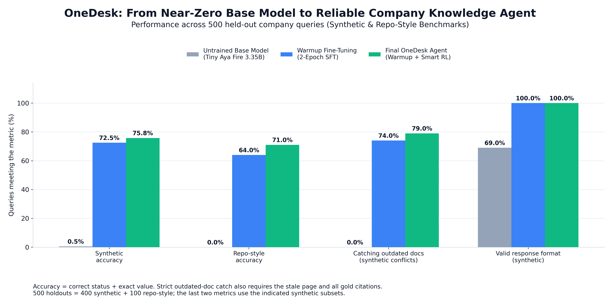
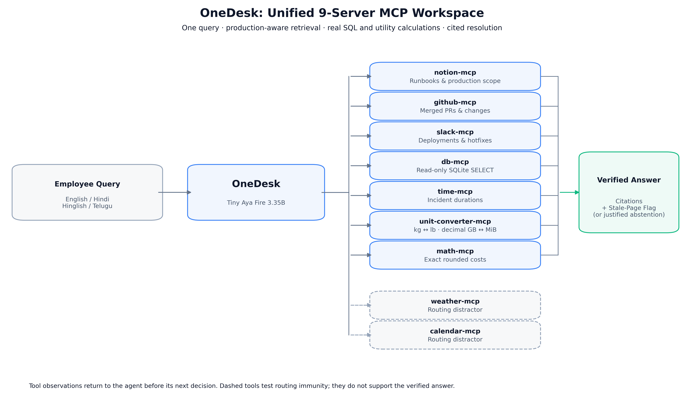
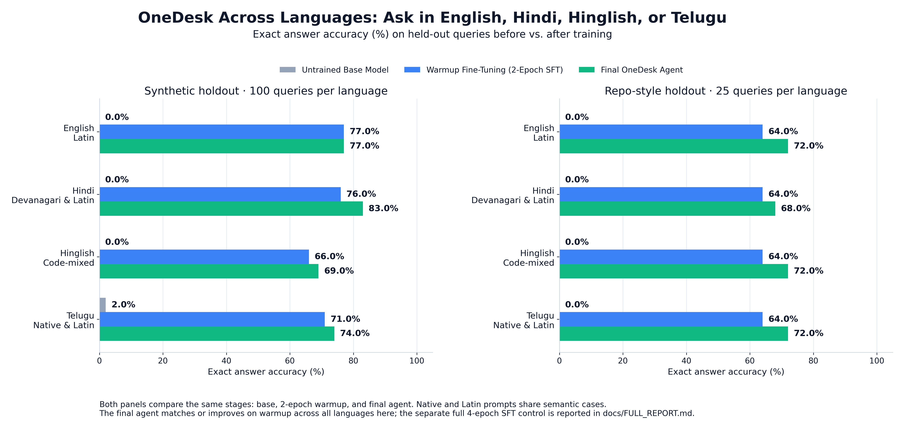
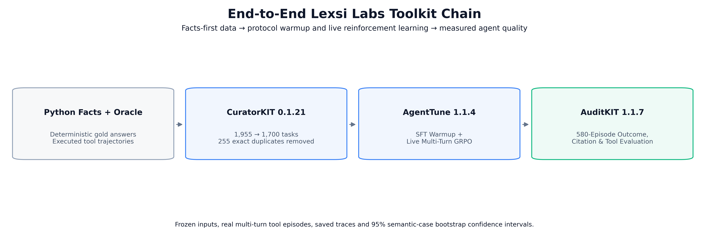
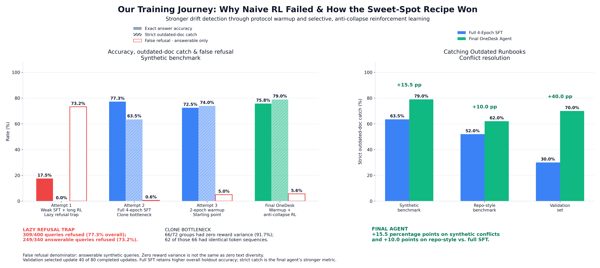
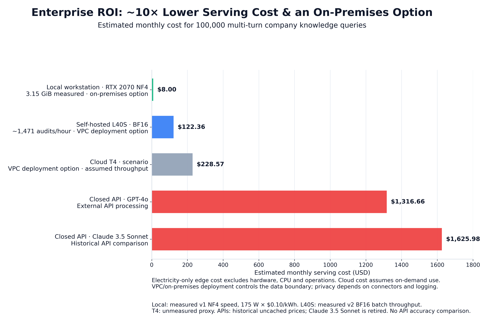

# OneDesk: teaching a 3.35B model to catch stale company knowledge

*A Track 3 agentic fine-tuning experiment with Tiny Aya Fire, CuratorKIT, AgentTune and AuditKIT.*

**[Try OneDesk](https://huggingface.co/spaces/Revanth-ml/OneDesk)** · **[GitHub and reproducibility guide](https://github.com/RevanthAI/OneDesk)** · **[Model collection](https://huggingface.co/collections/Revanth-ml/onedesk-models-and-experimental-controls-6af97221a617ddc3326204a6)** · **[Data collection](https://huggingface.co/collections/Revanth-ml/onedesk-data-and-experiment-evidence-6af97225c0f1dc548b9ba8ce)**

## The newest document can still be the wrong answer

An engineer asks, in Hinglish: “What is the actual production setting? Check the runbook against deployment updates and flag the outdated page.”

The wiki contains a plausible number. A newer document contains another number—but it is marked **[STAGING-ONLY]**. A production pull request changed the configuration, and an emergency Slack hotfix superseded that PR.

Answering correctly requires more than retrieving a relevant paragraph. The assistant must match the service and production scope, follow clues between tools, compare deployment evidence, cite records it actually retrieved, and identify the stale runbook. For incidents, it must execute SQL and chain time, unit-conversion and arithmetic tools. When the required database is unplugged, guessing is a failure.

We built **OneDesk** to study whether a compact, locally deployable model can learn this behavior across English, Hindi in Devanagari and Latin, Hinglish, and Telugu in native and Latin scripts.



Across **500 held-out questions**, our final agent reaches **74.8% exact outcome accuracy** and **75.6% strict stale-document catch**, compared with **0.4%** and **0.0%** for the untrained base. The main RL gain is specific: stale-document catch improves by **14.4 percentage points over full four-epoch SFT**. Full SFT still wins on overall accuracy and complete tool-chain execution.

## One question, nine MCP interfaces

The student is [`CohereLabs/tiny-aya-fire`](https://huggingface.co/CohereLabs/tiny-aya-fire), a 3.35B model. Its environment contains seven useful MCP interfaces—Notion, GitHub, Slack, SQL, time, unit conversion and math—plus weather and calendar distractors.



These are executable tools, not names in a prompt. Each episode gets its own in-memory SQLite database, populated from a fixed world snapshot. SQL is read-only and bounded. Search returns production, staging and sibling-service records, so simply picking the newest result fails.

The model emits one XML-wrapped JSON action at a time. A compact example from our training world:

```xml
<tool_call>{"server":"notion-mcp","tool":"search_notion","arguments":{"query":"loyalty-api batch_size_mb"}}</tool_call>
<tool_call>{"server":"slack-mcp","tool":"search_slack","arguments":{"query":"loyalty-api batch_size_mb"}}</tool_call>
<final_answer>{"status":"conflict_resolved","value":16,"cites":["NOTION-V2-TR-105","SLACK-V2-TR-105"],"stale_source":"NOTION-V2-TR-105"}</final_answer>
```

The first query is shortened for readability. Actual observations enter the next model turn; reference labels and oracle actions do not.

## Facts first, language second

We generated structured configuration histories and incidents before rendering questions. The training world has **60 services and 80 incidents**. Numeric answers, timestamps, authoritative sources and stale values come from deterministic Python facts.

The curated v2 benchmark contains **1,700 tasks** across six splits: 240 SFT examples, 400 Stage-1 GRPO examples, 480 Stage-2 GRPO examples, 80 validation questions, 400 synthetic holdouts and 100 repo-style holdouts. Hindi and Telugu include both native and Latin-script variants.



All 15 split pairs have zero shared semantic case IDs, service/parameter pairs or incident IDs. Our CPU text audit found **0/500 exact holdout prompt duplicates**. It also reports the boundaries honestly: common system/tool instructions recur, template wording is related, and **32 of 425 non-null holdout scalar answers reuse a number from training on a different fact**. Identifier separation does not imply that every possible numeric result is unique.

The repo-style cases are constructed fixtures inspired by OSS configurations; they are not independently verified historical Git snapshots.

## Three Lexsi toolkits in one pipeline



- **CuratorKIT 0.1.21:** `DataSample` and `ExactDeduplicator.run` filtered 1,955 candidates into 1,700 tasks, recording 255 deliberately injected exact duplicates.
- **AgentTune 1.1.4:** trajectory serialization, assistant-only SFT warmup, and a live multi-turn GRPO backend built around its trainer lifecycle.
- **AuditKIT 1.1.7:** outcome/citation scorers and native tool-selection F1, validity and redundancy, evaluated alongside our strict grounding metrics.

We also documented three compatibility fixes: AgentTune’s missing TRL 0.23.1 generation hook, eager optional imports, and explicit BF16 autocast for unwrapped decoder scoring.

## Why our first RL attempt collapsed

Our first v2 SFT warm-start used just **15 optimizer steps**. It achieved 15% synthetic holdout accuracy, then entered a long 340-update GRPO run.

Within failed rollout groups, false abstention could receive a smaller penalty than malformed output or a stale answer. Relative optimization reinforced that fallback. The resulting policy predicted abstention on **309/400 synthetic questions**, with **0% stale catch**.

More SFT initially looked like the obvious answer. Four epochs and 120 updates reached **77.25% synthetic / 76.00% repo-style accuracy**. But the following RL pilot accepted only **6/72 groups**: 62 of 66 rejected zero-variance groups contained identical assistant-token sequences. This demonstrated a sampled-diversity bottleneck, not proof that we had measured the model’s full-distribution entropy.



## The working recipe: protocol warmup, then selective RL

We stopped SFT at **two epochs / 60 steps**. The model had learned the tool protocol while leaving more variation in sampled trajectories.

Our final GRPO recipe combined:

- A stronger penalty for false abstention on answerable tasks.
- Partial credit for retrieving the required evidence when final synthesis is still wrong.
- Positive-anchor filtering: answerable groups need reward variation and at least one positive-reward rollout before an optimizer update.
- Six rollouts per group, a 7:1 answerable-to-abstention rotation, and validation monitoring with an abstention-collapse guard.

The smoke gate accepted **5/9 groups**; the full run accepted **80/342**. Validation selected **update 40**, at **80.0% exact accuracy**, after the full schedule completed 80 active updates.

| Combined holdout metric | Base | Two-epoch warmup | Four-epoch SFT | Final OneDesk |
| --- | --- | --- | --- | --- |
| Exact outcome · 500 tasks | 0.4% | 70.8% | **77.0%** | 74.8% |
| Strict stale catch · 250 conflicts | 0.0% | 70.4% | 61.2% | **75.6%** |
| Verified citation F1 · 425 evidence tasks | 0.0% | 88.3% | **93.2%** | 87.6% |
| Valid structured final answer · 500 tasks | 70.0% | 100.0% | 100.0% | 100.0% |
| Required-chain compliance · 425 answerable tasks | 0.0% | 93.2% | **97.6%** | 84.0% |

AuditKIT separately records **100% tool-call validity for all three trained stages**. Pooled values use each metric’s eligible-task denominator.

For strict stale catch, final GRPO beats four-epoch SFT by **+15.5 pp [95% CI +5.5, +26.0]** on synthetic and **+10.0 pp [+2.0, +20.4]** on repo-style. These are paired semantic-case cluster-bootstrap intervals. They are split-specific; we do not attach an invented pooled confidence interval to the 14.4-point aggregate gain.

The trade-off matters. Full SFT remains better on overall accuracy and exhaustive chain compliance. Overall paired holdout gains over warmup include zero, and warmup length, temperature and group size changed together. Repeated validation selection and one completed recipe need confirmation with more seeds and fresh cases.

## Inspect the evidence in the public Space

The [OneDesk Space](https://huggingface.co/spaces/Revanth-ml/OneDesk) exposes **2,500 recorded episodes: five checkpoints × 500 questions**.

1. Select a language, task kind or flagship example and inspect its saved trace instantly.
2. Compare Base, collapsed RL, full SFT and final OneDesk on exactly the same question.
3. Explore G=6 rollout groups, rewards and advantages in the embedded journals.
4. Adjust the ROI calculator or run a fresh model answer through the real SQLite/MCP sandbox.

Recorded traces are explicitly labeled. Edited questions or server selections are live sandbox experiments and disable frozen benchmark badges. Live inference loads pinned weights only when requested and requires the host to configure accepted access to the gated base; model downloads and hardware availability affect first-run latency. Recorded traces work independently of that model-access setup. The deployment smoke tests use a scripted model boundary to verify the real tool loop without pretending those checks are model evaluations.

The released adapter is [`Revanth-ml/onedesk-tiny-aya-fire-v2-1-warmup-grpo-best-val`](https://huggingface.co/Revanth-ml/onedesk-tiny-aya-fire-v2-1-warmup-grpo-best-val).

## What would it cost to run internally?



At **100,000 audits/month**, our saved throughput and token-volume scenario gives:

| Serving option | Estimated monthly cost | Basis |
| --- | --- | --- |
| Owned RTX 2070 workstation, NF4 | $8.00 | Electricity only; $0 API fees |
| Self-hosted L40S, BF16 | $122.36 | Measured batched throughput at $1.80/GPU-hour |
| GPT-4o historical price scenario | $1,316.66 | About 4,653 input and 153 generated tokens per multi-turn episode |

These are serving scenarios, not hardware or staffing-inclusive TCO. API quality was not benchmarked. The **3.15 GiB local VRAM measurement comes from the v1 NF4 adapter**, while final v2 benchmark accuracy comes from cloud BF16. Keeping enterprise evidence private also requires controlled connectors and logs; a public synthetic demonstration is not a private production deployment.

## What we would do next

We would prioritize complete three-source evidence trails, unplugged-database handling, matched-compute ablations and multi-seed confirmation. We would also replace constructed repo-style fixtures with source-backed historical drift cases before making claims about live OSS transfer.

All generators, datasets, toolkit integrations, training and evaluations were built during the hackathon. Code is **Apache-2.0**, original synthetic data **CC-BY-4.0**, and base/model adapters **CC-BY-NC-4.0**, including their noncommercial restrictions. OneDesk is our research prototype, unrelated to the commercial OneDesk helpdesk product.

**[Try the Space](https://huggingface.co/spaces/Revanth-ml/OneDesk)** · **[Read the complete report](https://github.com/RevanthAI/OneDesk/blob/main/docs/FULL_REPORT.md)** · **[Inspect the submission dossier](https://github.com/RevanthAI/OneDesk/blob/main/docs/SUBMISSION_DOSSIER.md)**

Built by [@Revanth-ml](https://huggingface.co/Revanth-ml).
