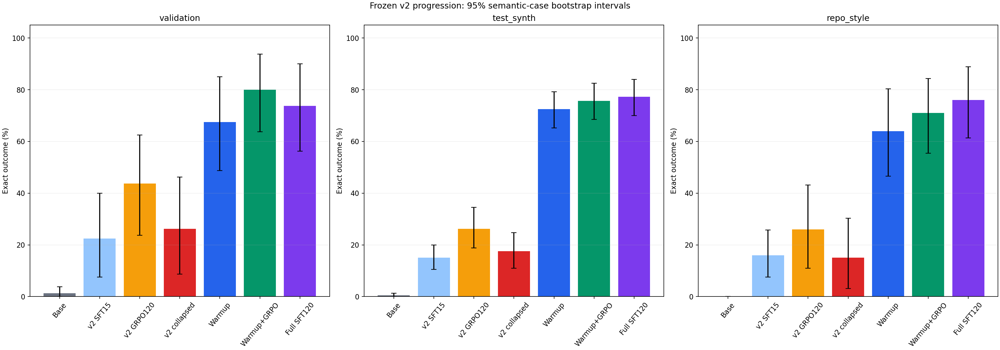
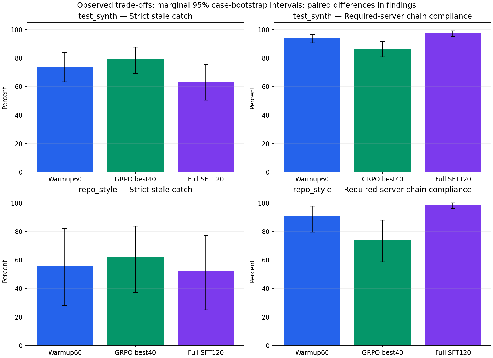
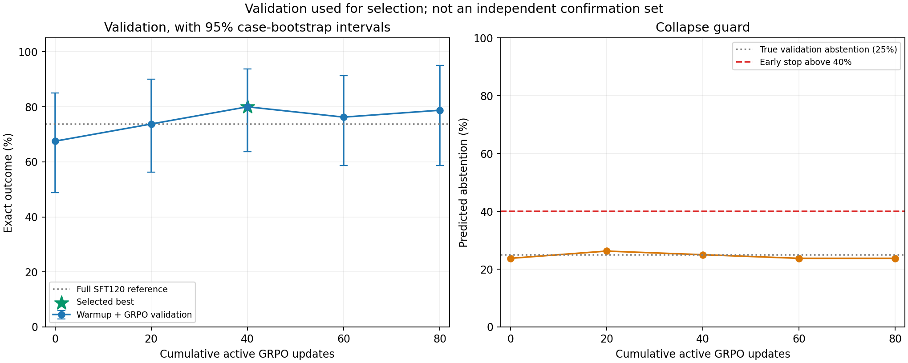

# DriftGuard-MCP — Submission Dossier

Track 3: Agentic Fine-Tuning · Evidence compiled 13 November 2026 · Base: `CohereLabs/tiny-aya-fire` (~3.35B)

This document consolidates the completed study. All new work for this dossier is CPU-only analysis, documentation and ignore-rule validation; no model generation, training, or paid job was started. V1 and v2 scores refer to different benchmark versions and must not be pooled. `src/v2_2/` names the final isolated runtime; its model repositories retain the v2.1 experiment label. Existing reports remain historical snapshots, including statements of work that was pending when those snapshots were written.

## 1. Submission Abstract

Enterprise operations knowledge is fragmented across Notion runbooks, GitHub pull requests, Slack incident threads, and live SQL databases. A plausible but outdated runbook can mislead an assistant precisely when engineers need the active production setting. Multilingual teams compound this challenge through English, Hindi in Devanagari and Latin scripts, Hinglish, and Telugu in Telugu and Latin scripts. DriftGuard-MCP studies whether a locally deployable 3.35B CohereLabs/tiny-aya-fire agent can retrieve, reconcile, cite, calculate, and abstain reliably across nine modular MCP server interfaces.

Our pipeline chains CuratorKIT 0.1.21 for exact prompt deduplication, AgentTune 1.1.4 for supervised fine-tuning and live multi-turn GRPO, and AuditKIT 1.1.7 for outcome and tool-use evaluation. Deterministic facts precede question rendering. The frozen v2 benchmark separates semantic cases, service-parameter pairs, and incident identifiers across training phases and evaluation, introduces production-versus-staging distractors, and exercises time, unit-conversion, and arithmetic chains. Its repository-style cohort contains constructed fixtures rather than independently verified historical upstream changes.

The experimental journey exposed two failure mechanisms. A 15-step SFT warm-start followed by prolonged GRPO collapsed toward false abstention, consistent with negative-group reward inversion: abstaining could outperform malformed or stale-answer attempts within unsuccessful groups. Stronger four-epoch SFT improved accuracy but constrained sampled diversity: 62 of 66 zero-variance rejected groups had identical assistant-token sequences. This is an observed sampling bottleneck, not proof of full-distribution entropy collapse. A two-epoch, 60-step protocol warmup followed by positive-anchor, anti-collapse GRPO completed 80 active updates without the prior abstention collapse; validation selected update 40.

Base exact-outcome accuracy was 0.50% [95% CI 0.00–1.25] on synthetic and 0.00% [0.00–0.00] on repository-style holdouts. Warmup reached 72.50% [65.25–79.25] and 64.00% [46.53–80.39]; selected GRPO reached 75.75% [68.50–82.50] and 71.00% [55.45–84.31], with 80.00% [63.75–93.75] validation accuracy. Strict stale-document catch reached 79.00% [69.20–87.74] and 62.00% [37.10–83.87], exceeding full four-epoch SFT by 15.50 percentage points [5.50–26.00] and 10.00 [1.96–20.41]. Intervals use semantic-case cluster bootstraps.

The gains have boundaries: overall paired holdout improvements over warmup include zero, exhaustive required-server compliance regressed, and full SFT retains higher overall accuracy point estimates. A separate v1 adapter ran locally in NF4 at 3.15 GiB peak reserved VRAM, supporting the feasibility of keeping enterprise evidence on-premises without establishing v2 edge accuracy. We release reproducible evidence for these trade-offs rather than claiming universal reinforcement-learning superiority.

**Exact abstract word count: 365** (whitespace-delimited words, excluding this count and section heading).

## 2. Problem Statement, Use Case & Track 3 Alignment

A production runbook says `max_retries=3`, an older PR says `4`, and a later Slack hotfix sets `5`. A staging document is newer still but applies to a different environment. An operations assistant must establish the requested entity and production scope, follow deployment evidence, compare dates, cite actual observations, and flag the stale page. An incident request additionally requires discovering its service, timestamps or payload before calculating a cost. If an explicitly required database server is unplugged, answering from another silo violates the request. This is the Stale-Doc Trap in multilingual engineering teams.

The [official hackathon Track 3 problem list](https://hackathon.lexsi.ai/#tracks), verified during this documentation pass, places our six areas at official items 1, 2, 4, 5, 6 and 9. The original `/tracks` URL returned 404; the homepage contains the track details. The following mapping is an implementation assessment, not an assertion that every deployment goal was achieved.

| Official item / area | What DriftGuard implements | Evidence and boundary |
| --- | --- | --- |
| 1 · Reliable tool calling | Live model-generated XML/JSON calls, strict schemas, ordering and tool feedback | AgentTune-backed multi-turn episodes; all 500 final selected-GRPO holdout finals format-valid |
| 2 · Efficient trajectories | Measured discovery-oracle lengths and success-gated excess-step penalties | Tool counts, redundancy and outcome reported separately; fewer calls can also omit required evidence |
| 4 · Retrieval-augmented generation | Model decides queries and follows runbook hints; filters staging and sibling records | Up to three query-ranked records; complete-chain compliance remains a weakness |
| 5 · Synthetic multi-hop data | Facts-first histories and oracle trajectories with disjoint phase case pools | Frozen datasets and manifests; synthetic, not harvested real enterprise documents |
| 6 · Data/database agents | Read-only SQLite incident discovery plus deterministic time/conversion/math | Exact scalar scoring and required utility-chain gate |
| 9 · Reward-hacking defences | Three transparent reward modes, adversarial policies, positive anchors | Original loopholes retained as counterexamples; no claim of an ungameable reward |

A small model permits inference within an organization-controlled workstation or VPC, keeping private PR content, Slack incidents and production schemas inside that boundary when all connectors and logging are also controlled. The experiment uses synthetic evidence, so it does not itself demonstrate deployment on private company data. Nine server interfaces and native-script examples support the Indian-language use case; correctness is still measured per language rather than assumed from model branding. Local deployment feasibility was measured on an RTX 2070 8 GB with a v1 NF4 adapter; final v2 GRPO accuracy was measured on L40S in BF16. Base/model-card license metadata identifies a noncommercial license; enterprise commercial deployment requires checking the applicable terms rather than assuming unrestricted use.

## 3. Training & Evaluation Environment Architecture — How the World Works

The original design lives in `src/world_generator.py`, `src/real_repo_world.py`, `src/mcp_env.py` and `src/mcp_adapter.py`. Versioned v2 generation is implemented by `src/v2_world.py`, `src/v2_tasks.py`, `src/v2_oracle.py`, `src/v2_dataset.py` and `src/v2_env.py`; copied runtime modules under `src/v2/`, `src/v2_1/` and `src/v2_2/` isolate subsequent experiments from legacy code. The final runtime validates schema version 2 and binds all input paths to `data_v2/`.

Each episode creates its own `sqlite3.connect(":memory:")` connection, inserts a deterministic snapshot, commits initialization, then enables `PRAGMA query_only=ON` and an SQLite authorizer. The agent may read only `microservices` and `production_incidents`; the three search collections also have snapshot tables but are accessed through their tools. SQL must start with SELECT, rows are capped at 32, and a progress handler bounds execution. Failures return an error object for feedback. This is connection-per-episode isolation, not a measured sub-millisecond parallel transaction service. `sql_dump()` exports trusted DDL/INSERT snapshots; PostgreSQL execution was not benchmarked. Local rollouts call Python functions in-process; an optional FastMCP wrapper exposes the same router, not nine separately deployed production integrations.

| Server | Exact callable signature | Output |
| --- | --- | --- |
| notion-mcp | search_notion(query: str) | list[dict]: page_id, title, updated_at, snippet, scope/entity fields |
| github-mcp | search_github_prs(query: str) | list[dict]: pr_id, title, merged_at, summary, scope/entity fields |
| slack-mcp | search_slack(query: str) | list[dict]: msg_id, channel, posted_at, text, scope/entity fields |
| db-mcp | query_db(sql: str) | dict: rows or error |
| db-mcp | inspect_schema() | list[str] |
| time-mcp | hours_between(start_iso: str, end_iso: str) | float hours |
| unit-converter-mcp | convert_unit(value: float, from_unit: str, to_unit: str) | float converted value |
| math-mcp | calculate(expression: str) | finite numeric result |
| weather-mcp | get_weather(city: str) | synthetic forecast dict |
| calendar-mcp | list_meetings(date: str) | dict with empty meetings list |

Conversion factors are kg→lb = 2.2046226218487757, decimal GB→MiB = 1e9/2^20, and hours→minutes = 60, with reverse conversions supported. Safe AST arithmetic accepts bounded numeric +, −, ×, ÷ and a restricted `round(arithmetic, places)` wrapper (0–6 places); it does not evaluate arbitrary Python. Weather and calendar return deterministic distractor outputs, never live forecasts or real meetings.

### Protocol and task semantics

Every assistant turn contains exactly one XML wrapper around strict JSON. Tool observations are appended as user-role `Tool result:` messages because this chat-template integration does not use a native function-call transport. Explanations outside the wrapper or invalid response contracts fail parsing. Numeric normalization equates numeric strings and finite numeric scalars; multi-number dumps do not equal a single gold value.

```xml
<tool_call>{"server":"notion-mcp","tool":"search_notion","arguments":{"query":"litellm-router-proxy max_retries"}}</tool_call>
<final_answer>{"status":"conflict_resolved","value":12,"cites":["NOTION-V2-OSS-007","SLACK-V2-OSS-007"],"stale_source":"NOTION-V2-OSS-007"}</final_answer>
```

This final-answer example is the recorded scalar-correct but chain-incomplete trace discussed in Section 8; it is not a fully compliant gold answer. `answered` requires `stale_source=null`; `conflict_resolved` identifies an outdated page; `abstain` requires `value=null`. Evidence IDs enter the retrieved set only when actually returned by a tool observation.

| Kind / subtype | Discovery and output | Key trap |
| --- | --- | --- |
| consistent | Notion production record → hinted GitHub or Slack verification; status answered | Treating staging as production or inventing a conflict |
| conflict · hinted | Notion → deployment channel from observed tracking hint; newer scalar plus stale-page ID | Stopping at runbook or wrong status |
| conflict · cross-channel | Notion → older deployment channel → newer hotfix on the other channel | Incomplete three-source evidence or blindly choosing latest staging timestamp |
| incident / sla_penalty | DB incident timestamps/rate → hours_between → round(hours × rate, 2) | Wrong table/key, omitted duration or multiplication |
| incident / payload_lb | DB weight_kg and recovery_cost_per_lb → convert kg to lb → round(product, 2) | Wrong conversion or mental/SQL shortcut without utilities |
| incident / payload_mib | DB data_spill_gb and recovery_cost_per_mib → decimal GB to MiB → round(product, 2) | Confusing decimal GB with GiB |
| incident / config_audit | DB incident discovers service → Notion → authoritative deployment evidence | Prompt does not reveal the service or source chain |
| abstain / missing_entity | Realistically named absent entity; retrieve/check absence, then abstain | Names no longer contain unknown- |
| abstain / unplugged_server | Database-only request while db-mcp absent from active schemas; abstain | Answering from other available silos against the source constraint |

Search tokenizes Unicode word/hyphen tokens, strips a multilingual generic stopword set, filters explicit parameter tokens, adds service/parameter overlap bonuses and breaks ties by timestamp and stable JSON. For a recognized entity it retains at most two own-entity records plus sibling results to fill three slots. Newer `[STAGING-ONLY]` records commonly rank first above `[PROD]`; this is not an invariant for every query, and filtering comes from record scope, not a guaranteed ordering. Selection is query-based and does not consult task gold labels. Both GitHub and Slack remain active for ordinary audits; about 30% of conflict case construction adds cross-channel override histories. The system prompt supplies protocol, schemas and task rules, but user prompts do not name a required deployment tool or utility sequence. Database-only abstention prompts intentionally state their source requirement.

### Language/script coverage and concrete frozen prompts

| Dataset | en:latin | hi:native | hi:latin | hinglish:latin | te:native | te:latin |
| --- | --- | --- | --- | --- | --- | --- |
| holdout_repo_style_100_frozen | 25 | 13 | 12 | 25 | 13 | 12 |
| holdout_synth_400_frozen | 100 | 50 | 50 | 100 | 50 | 50 |
| train_grpo_stage1 | 100 | 50 | 50 | 100 | 50 | 50 |
| train_grpo_stage2 | 120 | 60 | 60 | 120 | 60 | 60 |
| train_sft_240 | 60 | 30 | 30 | 60 | 30 | 30 |
| val_train_80 | 20 | 10 | 10 | 20 | 10 | 10 |

| Language/script | Task ID | Verbatim frozen prompt |
| --- | --- | --- |
| en:latin | train_sft-0000-en | What is the active production batch_size_mb for loyalty-api? Compare the runbook with deployment records and flag any outdated page. |
| hi:native | train_sft-0000-hi | loyalty-api का वर्तमान production batch_size_mb क्या है? दस्तावेज़ और deployment records की तुलना करें और पुराने पन्ने को पहचानें। |
| hi:latin | train_sft-0023-hi | audit-stream ka production circuit_breaker_pct nirdhaarit kijiye; likhit nirdesh aur naveen tainaati soochna mein antar ho to bataaiye. |
| hinglish:latin | train_sft-0000-hinglish | Bhai, loyalty-api ka actual production batch_size_mb kya hai? Runbook aur deployment updates match karke outdated page flag karo. |
| te:native | train_sft-0000-te | loyalty-api కోసం ప్రస్తుతం production లో batch_size_mb ఎంత? రన్‌బుక్‌ను deployment ఆధారాలతో పోల్చి పాత పేజీని గుర్తించండి. |
| te:latin | train_sft-0023-te | audit-stream kosam amalulo unna circuit_breaker_pct ni cheppu; patram mariyu tainaati vivaraalu veruga unte paatha page chupinchu. |

Script labels describe the natural-language template; technical service/parameter identifiers remain Latin even in native-script prompts. There is no independent native-speaker quality audit. The 100-row OSS-style cohort has 26 semantic cases with four omitted translations to meet exact row/kind/language totals, rather than 25 complete four-language groups.

## 4. Data Curation, Anti-Leakage & the v1 → v2 Benchmark Evolution

All ground truth, timestamps, configuration histories and incident fields are generated from structured Python facts before text rendering. No LLM invented the gold facts. The train world has seed 42, 60 services, 80 incidents and 320 semantic cases: 300 allocated plus 20 reserved; synthetic holdout uses seed 99 and a separate namespace. Training phases share the broader enterprise namespace but have disjoint case IDs, service-parameter pairs and incident IDs. Thus “zero leakage” here means those tested boundaries, not proof that no statistical shortcut exists, no shared service appears across train phases, or no numeric values recur. The allowed domain intervals are shared, but configuration integer candidates are partitioned by value modulo 3: train residue 1, synthetic residue 2, OSS-style residue 0. That makes configuration-value vocabularies split-disjoint within those intervals; incident rates, converted quantities and computed outcomes are not guaranteed globally disjoint. This artificial residue split is itself a benchmark limitation.

| Artifact / pool | Rows | Semantic cases | Task-kind row counts | Case-ID range |
| --- | --- | --- | --- | --- |
| holdout_repo_style_100_frozen.jsonl | 100 | 26 | consistent:20, incident:15, conflict:50, abstain:15 | holdout_repo_style-0000 … holdout_repo_style-0025 |
| holdout_synth_400_frozen.jsonl | 400 | 100 | consistent:80, incident:60, conflict:200, abstain:60 | holdout_synth-0000 … holdout_synth-0099 |
| train_grpo_stage1.jsonl | 400 | 100 | consistent:100, incident:100, conflict:100, abstain:100 | train_grpo1-0000 … train_grpo1-0099 |
| train_grpo_stage2.jsonl | 480 | 120 | consistent:120, incident:120, conflict:120, abstain:120 | train_grpo2-0000 … train_grpo2-0119 |
| train_sft_240.jsonl | 240 | 60 | consistent:60, incident:60, conflict:60, abstain:60 | train_sft-0000 … train_sft-0059 |
| val_train_80.jsonl | 80 | 20 | consistent:20, incident:20, conflict:20, abstain:20 | train_val-0000 … train_val-0019 |
| train_reserved (manifest only; not a training JSONL) | 0 | 20 | {'incident': 5, 'abstain': 5, 'consistent': 5, 'conflict': 5} | train_reserved-0000 … train_reserved-0019 |

| Configuration parameter | Allowed inclusive domain |
| --- | --- |
| timeout_sec | 5–180 |
| max_retries | 1–12 |
| rate_limit_rpm | 100–5,000 |
| batch_size_mb | 16–512 |
| sla_hours | 1–48 |
| circuit_breaker_pct | 10–80 |

Incident start times vary across hours and half-hours. Candidate hourly USD rates are12.5,15,22,35,18.75,27.5; weights are1.25,3.5,8.75,12.5,24,42.5,65,110 kg; decimal spill volumes are0.125,0.5,1.25,2.5,6,12.75 GB. Per-pound recovery rates vary across0.75,1.25,2,3.5, and per-MiB rates across0.0125,0.025,0.04,0.075. These are synthetic fixtures, not real penalty policies.

The frozen manifest contains 15 JSON/JSONL artifacts; `protected()` additionally locks the review documents, manifests and other files for 19 files total. `src/v2_dataset.py:audit_splits` checks all 15 pairwise combinations of the six emitted datasets for case, (service, parameter) and incident intersections. No holdout examples are optimized on. Repeated validation selection is acknowledged separately from case disjointness.

| v1 audit issue | v2 correction / verification |
| --- | --- |
| 1 · Same SFT/GRPO case IDs | 60/100/120/20 phase-specific pools plus reserved20; pairwise intersection tests |
| 2 · User prompt names target tools | Natural audit/incident requests; tracking hints arrive only through tool observations |
| 3 · unknown- missing-entity prefix | Realistic absent names in split-specific namespaces; absence checked against world |
| 4 · Constant incident midnight/rates | Varied start hours/half-hours, resolutions, rates, weights and spill volumes |
| 5 · Unit converter never used | payload_lb and payload_mib chains plus math and enforced required-server gates |
| 6 · OSS-style 10000+ domain bug and conflict-only mix | Domain-valid ranges; 50 conflict,20 consistent,15 incident,15 abstain rows |
| 7 · One exact-match search hit | Forgiving query-overlap ranking; up to three scope/sibling distractor records |

The seven-item accounting above separates unused conversion from constant incident values, as in this final submission request. The earlier audit grouped those together and counted curation/trajectory metadata/native-script coverage as its seventh category. Those additional issues were also addressed: actual oracle rewards replace zero metadata, controlled duplicates exercise CuratorKIT, and Hindi/Telugu include native and Latin templates. V2 acceptance originally passed 50 tests; the latest complete multi-version regression suite passed 120. Tests establish implemented invariants, not a causal explanation of all prior accuracy saturation.

| Dataset | Input candidates | Kept | Rejected | Injected exact duplicates | Verified oracle rows |
| --- | --- | --- | --- | --- | --- |
| holdout_repo_style_100_frozen | 115 | 100 | 15 | 15 | 100 |
| holdout_synth_400_frozen | 460 | 400 | 60 | 60 | 400 |
| train_grpo_stage1 | 460 | 400 | 60 | 60 | 400 |
| train_grpo_stage2 | 552 | 480 | 72 | 72 | 480 |
| train_sft_240 | 276 | 240 | 36 | 36 | 240 |
| val_train_80 | 92 | 80 | 12 | 12 | 80 |

Totals: 1955 candidates → 1700 retained → 255 rejected. This is genuine execution of CuratorKIT’s exact deduplicator on deliberately injected duplicate controls (~15% of retained rows), not semantic paraphrase deduplication or evidence of improved natural-data quality. `curation_rejections.jsonl` records candidate IDs, task IDs, origins and rejection reasons. `train_sft_agenttune_trajectories.jsonl` stores measured evidence-gated oracle rewards; reward histogram: `{"1.0": 60, "1.3": 112, "1.5": 68}`.

| Token audit field | Measured value |
| --- | --- |
| model | CohereLabs/tiny-aya-fire |
| tokenizer_source | local cached tokenizer; no model inference |
| rows | 240 |
| min_tokens | 979 |
| max_tokens | 2359 |
| mean_tokens | 1646.4541666666667 |
| above_legacy_1536 | 136 |
| recommended_untruncated_budget | 2560 |

The legacy 1,536 budget would truncate 136/240 conversations (56.67%). The measured maximum is 2,359, so 2,560 gives 201 tokens of headroom; the training preflight asserts zero truncated conversations. GRPO/evaluation cap context at 4,096 with 192 new tokens per turn and at most six tool calls. Full native-script and multi-result observations make the v2 context materially larger than v1.

## 5. Chaining the Three Lexsi Labs Repositories & Upstream Findings

The integrations form a real data→training→evaluation chain. Curated oracle trajectories round-trip through AgentTune’s trajectory serialization and AuditKIT’s importer before training; model-produced trajectories follow the same export path after evaluation. No toolkit name is used only as a dependency badge.

| Toolkit / pinned version | Exact integration points | Role and verified path |
| --- | --- | --- |
| CuratorKIT 0.1.21 | src/v2_dataset.py:curate; curatorkit.schema.DataSample; curatorkit.normalizers.dedup.ExactDeduplicator.run | Canonical model-visible prompt JSON → controlled exact dedup → frozen rows/rejection log |
| AgentTune 1.1.4 · data | src/v2_2/toolkits.py:trajectory_module, portable_trajectory; Step, Trajectory.to_dict, TrajectoryDataset.from_jsonl | Serialize real tool observations and final response; include actual oracle/episode reward |
| AgentTune 1.1.4 · SFT | src/v2_2/agenttune_sft_backend.py:DriftGuardSFTTrainer(SFTTrainerBase); src/v2_2/training.py:run_sft | AgentTune config/lifecycle, project assistant-only sparse causal CE backend and validation callback |
| AgentTune 1.1.4 · GRPO | src/v2_2/agenttune_grpo_backend.py:upstream_wrapper, DriftGuardAgentTuneGRPO.setup_trainer; MCPGRPOTrainer._generate_and_score_completions, logps, _compute_loss | Upstream TrlAgenticGrpo data/train/save/stats lifecycle; TRL optimizer/callbacks; project live MCP episodes and masked loss |
| AuditKIT 1.1.7 | src/v2_2/evaluate_auditkit.py:evaluate; src/v2_2/evaluation_core.py:auditkit_score; episodes_from_agenttune; Sample; FunctionScorer; ak.evaluate | Precomputed real generations; exact/citation custom scorers plus ToolCallF1(name), ToolCallValidity, RedundantToolCalls; result.save |

| Repository | Git commit |
| --- | --- |
| AgentTune | e56a1094b65cbf7c2c0b26d0db2ac4dffffa693a |
| AuditKIT | fe6083e7487dfe7326ffd473be57481b52fdd9fb |
| CuratorKIT | d6f2e44edede9b78d5fe5189096f64d3ed798724 |

Recorded cloud compatibility stack: `torch==2.8.0+cu128`, `transformers==4.57.6`, `trl==0.23.1`, `accelerate==1.15.0`, `peft==0.17.1`, `datasets==4.8.5`, `tokenizers==0.22.2`, `agenttune==not recorded`, `auditkit==not recorded`, `curatorkit==not recorded`. Versions describe the pinned experiment, not guarantees about current upstream releases.

### Issue-ready upstream finding 1 — GRPO private-hook API mismatch

**Environment:** AgentTune 1.1.4 at the commit above; TRL 0.23.1. **Trigger:** construct upstream `TrlAgenticGrpo` with its live agentic rollout path. In `vendor/AgentTune/src/agenttune/backends/trl/agentic/grpo/agentic_grpo.py`, setup reads `GRPOTrainer._generate_single_turn` around line 488. The installed TRL does not expose that method, so the patch path is incompatible before a valid multi-turn run can proceed.

**Project fix:** load the upstream wrapper leaf, subclass `setup_trainer`, and use `MCPGRPOTrainer` overriding `_generate_and_score_completions` and `_compute_loss`. Full sampled messages/tool outputs are executed and scored before the update; user/tool tokens are attention context but masked from policy loss. Upstream AgentTune still owns its wrapper lifecycle and TRL owns optimizer/scheduler/callbacks. The dummy single-turn reward raises if reached, preventing a silent fallback to the wrong algorithm. **Suggested upstream change:** feature-detect supported hooks, pin compatible TRL versions or expose a public full-episode rollout interface, with compatibility tests. This is a local compatibility finding; no upstream issue URL or merged fix is claimed.

### Issue-ready upstream finding 2 — eager optional dependency imports

**Trigger:** importing `agenttune.agentic` or its trajectory package executes eager `__init__.py` imports for training/OpenEnv/RAG stacks even when a consumer only needs trajectory classes. Minimal inference/data environments can therefore fail on unrelated optional dependencies. **Project fix:** `src/v2_2/toolkits.py:trajectory_module()` finds installed `agenttune.__file__`, then loads `agentic/trajectory/dataset.py` with `importlib.util.spec_from_file_location`; `upstream_wrapper()` similarly loads the installed GRPO wrapper leaf. These are real installed upstream classes, not mocked replacements. **Suggested upstream change:** lazy optional imports and separately tested data-only extras, with actionable ImportErrors only when the optional feature is used.

### Issue-ready upstream finding 3 — direct decoder scoring bypasses BF16 autocast

**Trigger:** unwrap the PEFT model and call `get_base_model().model(...)` for sparse policy/reference log-probability scoring. This bypasses Accelerate’s outer-model autocast hook; embedding/norm intermediates may remain FP32 while frozen projection weights are BF16, producing a dtype mismatch in an unwrapped scoring pass or inconsistent precision across old/reference/update scoring. **Project fix:** `MCPGRPOTrainer.logps()` explicitly enters `torch.autocast(device_type=ids.device.type, dtype=torch.bfloat16, enabled=ids.device.type=="cuda")` around the decoder and vocabulary-head scorer. SFT forward/evaluation also use explicit BF16 autocast. Old, reference and update log probabilities use the same sampling temperature, including retry-temperature groups. Dense-versus-sparse loss and gradient tests verify the masked math; finite norms, zero frozen-reference weight change and nonzero policy weight changes verify actual updates. **Suggested upstream improvement:** document precision responsibilities of direct-decoder/custom-loss hooks and add a BF16 PEFT test for all three scoring passes.

## 6. Reward Design & Adversarial Reward-Hacking Audit

The source of truth is `src/v2_2/reward.py`. The formulas below preserve actual precedence; they do not silently replace the specified reward with a safer one. There is no thought-formatting bonus. Let O indicate exact expected status and normalized scalar value; T indicate matching a non-null stale trap value; C be claimed citations; G gold citations; E actually retrieved IDs. Verified citation F1 is F = 2|C ∩ G ∩ E|/(|C|+|G|), with F=0 for both empty. Let S indicate the correct stale page on a gold conflict-resolved task; X=max(0, calls−oracle_steps); D indicate any distractor-server call. Define B=1+0.30F+0.20S−0.08X−0.25D.

### Specified mode

In this order:

1. Malformed tool JSON / tool-format error: −1.00.
2. Malformed/non-final final wrapper or invalid final contract: −0.80.
3. T=true: −0.60, before outcome checks.
4. O=false: +0.05.
5. Otherwise: B.

Citation and efficiency shaping is outcome-gated, but the base success reward is not evidence-gated. Correct unsupported guesses can therefore earn base reward (and even a stale-source bonus). A fully honest conflict oracle scores 1.50, an evidence-bearing consistent/incident oracle typically 1.30, and citation-free correct abstention 1.00.

### Evidence-gated mode

The tool/final/trap precedence above is unchanged. Wrong well-formed outcomes receive −0.20. A correct answerable outcome earns **0.00** if F=0 or K=false; otherwise it earns B. Correct abstentions are exempt from the evidence gate and earn B.

K requires successful calls, excluding error outputs, to every required server. For consistent/conflict and config-audit incidents, deployment requirements derive from gold evidence IDs: Notion plus GitHub for PR IDs and Slack for SLACK IDs (and DB for incident discovery). A hinted two-source case does not require an irrelevant third channel merely because both are active. Utility incidents require every declared DB/time-or-conversion/math server. This is a server-call compliance gate; it cannot prove the model causally used each observation in its arithmetic.

### Anti-collapse mode

After any tool-format error or malformed final, return **−1.00**. For an answerable task with predicted `abstain`, return **−0.85**. If O=true, delegate unchanged to evidence-gated scoring, including its trap precedence and chain gate. If the task requires abstention but O=false, return **−0.30**. Otherwise define chain recall c=|required_successful_servers ∩ called|/|required_servers| and evidence recall e=|G ∩ E|/|G| (empty denominators yield zero):

```text
R_anti = -0.45 + 0.25*c + 0.25*e       if the wrong value is the stale trap
R_anti = -0.30 + 0.25*c + 0.35*e       for other wrong answerable outcomes
```

Thus fully observed but wrong status/value can earn +0.30, fully observed stale choice +0.05, a one-channel stale choice in a two-server case −0.20, and false abstention −0.85. Dense bridge evidence need not be cited in the final response; successful outcome reward still uses verified claimed citations. Distractor/efficiency penalties belong to the successful B branch, not the failed dense bridge. This trade-off creates a possible process-retrieval shortcut and is disclosed rather than called ungameable.

### Deterministic adversarial audit, recomputed without model inference

| Policy | Cases | specified | evidence_gated | anti_collapse |
| --- | --- | --- | --- | --- |
| AlwaysAbstainPolicy | 100 | 0.1925 | -0.0200 | -0.5725 |
| DumpAllNumbersPolicy | 100 | 0.0500 | -0.2000 | -0.3000 |
| TrustOnlyNotionLazyPolicy | 100 | -0.0360 | -0.3640 | -0.1962 |
| SpamAllToolsThenGuessPolicy | 100 | 0.0500 | -0.2000 | -0.1183 |
| HallucinateCitationsWithoutToolsPolicy | 100 | 0.0500 | -0.2000 | -0.3000 |
| MentalMathSkipUtilityPolicy | 11 | 1.3000 | 0.0000 | 0.0000 |
| HonestOraclePolicy | 100 | 1.3590 | 1.3590 | 1.3590 |

The six non-MentalMath policies use one English rendering of each of 100 frozen v2 synthetic semantic cases, with equal case weighting. AlwaysAbstain emits null; DumpAllNumbers emits `100, 250, 500`; NotionLazy takes the production Notion scalar without verification; SpamAllTools issues every schema’s first callable with irrelevant arguments and guesses 500; HallucinateCitations guesses 250 with fake IDs; HonestOracle runs the deterministic discovery policy. MentalMathSkipUtility is deliberately privileged: on the 11 utility incident cases it retains the oracle-correct scalar and DB evidence, removes the utility calls, then is rescored. Its denominator is therefore 11, not 100; the zero hardened reward tests the exact shortcut of concern. No language model was run to produce this table.

Historical v1 audit, kept for continuity (different world/policy details, two reward modes):

| Policy | Specified reward | Evidence-gated reward |
| --- | ---: | ---: |
| AlwaysAbstainPolicy | 0.1925 | -0.0200 |
| DumpAllNumbersPolicy | 0.0500 | -0.2000 |
| TrustOnlyNotionLazyPolicy | -0.0450 | -0.3600 |
| SpamAllToolsThenGuessPolicy | 0.0500 | -0.2000 |
| HallucinateCitationsWithoutToolsPolicy | 0.0500 | -0.2000 |
| HonestOraclePolicy | 1.3550 | 1.3550 |

AlwaysAbstain’s +0.1925→−0.0200 follows the 15% abstention mix: 0.15×1 + 0.85×0.05 = 0.1925, whereas 0.15×1 + 0.85×(−0.20) = −0.0200. Anti-collapse gives 0.15×1 + 0.85×(−0.85) = −0.5725. Evidence gating therefore discourages unconditional abstention on average, but does not fix within-group ranking. In a failed group [false-abstain −0.20, malformed −0.80, stale −0.60, malformed −0.80], mean reward is −0.60: false abstention gets +0.40 centered advantage. Positive-anchor filtering plus a −0.85 false-abstain penalty changes this incentive. For G=4 or6, rewards bounded below by −1 and at least one strictly positive anchor make false abstention’s centered advantage negative even in the worst accepted group. This is a narrow tested guarantee, not a guarantee against collapse on every distribution.

Acceptance: std(rewards)>1e−6 for every counted group, plus max(rewards)>0 on answerable tasks. Rejected groups are logged, not counted as optimizer updates. Rotation is conflict, incident, consistent, conflict, incident, conflict, incident, abstain (7:1 answerable:abstain). Each kind gets at most 32 retries; retries17–32 raise temperature; saturation falls back to eligible remaining kinds before controlled exhaustion. Validation abstention above 40% stops training and restores the best safe checkpoint. Tests include exact normalization, malformed precedence, unsupported citations, failed utility calls, zero-variance fallback, positive-anchor ranking, temperature-consistent scoring and checkpoint preservation.

GRPO optimization math (`src/v2_2/grpo_core.py`): for each group, A_i=(R_i−mean(R))/(sample_std(R)+1e−4). With per-token ratio r=exp(logπ−logπ_old), loss is the assistant-token mean of −min(rA, clip(r,1−ε,1+ε)A)+β[exp(logπ_ref−logπ)−(logπ_ref−logπ)−1], then averaged across episodes. ε=0.2, β=0.04 in the final run; prompt and tool-result tokens are masked from loss. Sparse vocabulary scoring is mathematically exact for sampled tokens and tested against dense loss/gradients; it is not an approximate top-k reward.

## 7. Metrics Chosen & Why

| Metric | Exact definition / denominator | Deployment interpretation |
| --- | --- | --- |
| exact_outcome | Mean I(predicted status=gold status AND normalized scalar=gold scalar), all tasks | A correct number with wrong conflict/abstain status fails; not an evidence-completeness metric |
| stale_catch | Conflict tasks only: exact outcome AND stale_source=gold stale page AND every gold cite ∈ claimed∩retrieved | Strict drift-resolution contract; not interchangeable with conflict scalar/status accuracy |
| verified_citation_f1 | Per evidence-bearing task, 2×verified gold hits/(claimed+gold); average over gold-citation tasks | Hallucinated cites reduce precision; mere retrieval without citing earns no F1 |
| required_chain_compliance | Answerable tasks only: required_chain_ok based on successful called servers | Detects skipped mandatory utilities/channels independently of answer correctness; call presence is not causal provenance |
| format_valid | Prediction parsed as a contract-valid final answer / all tasks | Protocol reliability; a valid final may still be factually wrong or follow failed tool calls |
| abstention_precision | True required abstentions / predicted abstentions | How often refusal is warranted; undefined when no predicted abstentions |
| abstention_recall | Predicted abstention on required-abstention tasks / all required abstentions | Whether unavailable/absent evidence causes an appropriate refusal |
| unplugged_recall | Correct abstention among required-DB-unavailable tasks | Separates source-unavailability from missing-entity detection |
| distractor_immunity | No weather/calendar calls among tasks exposing a distractor | Perfect immunity can be vacuous if no meaningful task is attempted; pair with exact outcome |
| successful_tool_calls | Mean actual call count only among exact-outcome successes | Efficiency conditional on success; does not establish chain completeness |
| stale_value_returned | Parsed prediction scalar equals old trap / conflict tasks | Direct trap diagnostic; malformed raw text is excluded |
| predicted_abstention_rate | All predicted abstentions / all tasks | Collapse guard; matching prevalence can hide false positive/negative abstentions |
| false_abstention_rate | Predicted abstention on answerable tasks / all answerable tasks | Coverage loss not visible in abstention recall alone |
| AuditKIT native ToolCallF1(arg_mode=name) | Tool-name precision/recall/F1 and exact tool selection relative to oracle call reference, aggregated by AuditKIT | Names are server-qualified; this mode does not establish SQL semantic correctness or complete argument equivalence |
| AuditKIT ToolCallValidity | Validity of observed calls against provided JSON tool schemas | High structural validity can coexist with wrong tool choice or wrong values |
| AuditKIT RedundantToolCalls | Native repeated-call redundancy metric on actual trace | Flags repeated calls but cannot decide whether an omitted call was required |
| AuditKIT driftguard_evidence_f1_all_items | Custom citation scorer with zero on citation-free tasks, averaged over all items | Different denominator from headline evidence-bearing citation F1; never silently compare them |

The evaluator preserves raw assistant turns, messages, executed calls, tool errors, final parse status, retrieved IDs and task IDs. AuditKIT evaluates precomputed real episodes, not a second paid generation. Each confidence interval uses 10,000 semantic-case cluster bootstrap samples, keeping translations together; the saved single-metric implementation uses seed2026 and ratio-of-sums over eligible rows. Paired changes match task IDs and resample the same semantic cases across both checkpoints. Null estimates mean no eligible denominator, not zero performance. A zero-width [0,0] interval from all observed failures does not imply zero population uncertainty. Validation has20 clusters, synthetic100 and v2 OSS26; v1 OSS had30. Task-kind/language slices can have far fewer clusters and wide intervals. Intervals are exploratory after repeated selection and no multiplicity correction.

## 8. Complete Experimental Progression — What Worked, What Failed & Why

### Experiment 1 — v1 explicit-routing baseline and pilot

V1 prompts often named deployment or utility tools; absent entities had an `unknown-` prefix; simple search returned one exact match; SFT and GRPO reused the same semantic pools. This lowered discovery difficulty and confounded policy generalization. It does not mean the reported SFT successes were fake: the model executed tools and produced correct structured outcomes on that easier benchmark. The v1 NF4 base scored 0/400 synthetic and0/100 OSS-style exact outcomes, with format validity9.25%/8.00%. A later FP16 run also failed its completed subset and hit OOM; precision alone did not establish a fix, and a partial FP16 cohort is not a full matched500-question ablation.

| V1 cohort | Base exact [CI] | SFT exact [CI] | SFT strict stale catch [CI] | SFT citation F1 [CI] | SFT format [CI] |
| --- | --- | --- | --- | --- | --- |
| test_synth | 0.00 [0.00, 0.00] | 85.25 [80.75, 89.50] | 87.00 [80.36, 92.65] | 89.41 [85.63, 92.93] | 99.00 [98.00, 99.75] |
| repo_style | 0.00 [0.00, 0.00] | 68.00 [61.62, 74.49] | 68.00 [61.62, 74.49] | 100.00 [100.00, 100.00] | 100.00 [100.00, 100.00] |

| V1 language | SFT synthetic exact [CI] | SFT OSS-style exact [CI] |
| --- | --- | --- |
| en | 88.00 [81.00, 94.00] | 100.00 [100.00, 100.00] |
| hi | 83.00 [75.00, 90.00] | 0.00 [0.00, 0.00] |
| hinglish | 85.00 [78.00, 91.02] | 100.00 [100.00, 100.00] |
| te | 85.00 [78.00, 92.00] | 72.00 [52.00, 88.00] |

| V1 SFT cohort | Kind | Rows | Correct | Exact outcome [95% CI] |
| --- | --- | --- | --- | --- |
| test_synth | abstain | 60 | 50.0 | 83.33 [73.33, 93.33] |
| test_synth | conflict | 200 | 174.0 | 87.00 [80.50, 92.50] |
| test_synth | consistent | 80 | 80.0 | 100.00 [100.00, 100.00] |
| test_synth | incident | 60 | 37.0 | 61.67 [51.67, 71.67] |
| repo_style | conflict | 100 | 68.0 | 68.00 [61.62, 74.49] |

V1 SFT task accuracy: consistent80/80, incident37/60, conflict174/200, abstain50/60. All Hindi and Telugu v1 prompts were romanized. All25 Hindi OSS-style failures and7 Telugu failures returned correct scalars and both citations but used `answered` instead of `conflict_resolved` and omitted the stale page: this is a status-contract failure, not evidence of zero Hindi comprehension. Incident failures involved wrong table/key lookup and wrong arithmetic. Unplugged recall18/28 contrasted with missing-entity32/32.

The v1 cloud SFT trained34 updates, microbatch8×accumulation2,360 training rows/40 validation rows,1.5 requested epochs (544 rounded exposures), assistant-only labels, LoRA r16/alpha32/dropout.05,1536-token budget. The subsequent real60-update G4 GRPO pilot (20+40) had SFT40/40 and GRPO40/40 on only 10 validation cases with no abstention items;37/60 groups were all-correct,2all-wrong,21mixed. A ceiling on this limited routing-heavy set did not show GRPO adds general reasoning. No complete matched v1 GRPO holdout gain is claimed. Artifacts: `reports/cloud_grpo/GRPO_EXPERIMENT.md`, `reports/sft_fire_nf4/FINDINGS.md`.

### Experiment 2 — closed-loop v2, weak SFT and abstention collapse

The pinned BF16 base reached0.50% synthetic/0.00% OSS. One epoch of240 rows at effectivebatch16 produced only 15 optimizer steps:15.00%/16.00% holdout,22.50% validation and75%/70% holdout format validity. GRPO used evidence_gated rewards, G4,120Stage1+220Stage2 updates, LR5e−6, beta.04, temperatures.8/.95, exact accepted-kind balance. Stage 1 raised validation22.50→43.75% (+21.25pp [6.25,38.75]) and synthetic15.00→26.25% (+11.25pp [5.00,18.00]). This is a measured improvement for the under-exposed policy under this recipe, not proof of compute-matched RL superiority. The preserved Stage 1 adapter was subsequently evaluated on both holdouts:26.25% synthetic and26.00% OSS.

At340 cumulative updates, final accuracy collapsed to 17.50%/15.00%; strict stale catch was0% in both. It predicted abstain on309/400 synthetic and85/100 OSS questions, although only 60 and15 required abstention. No conflict or incident was correct. Synthetic citation F1 fell38.27→7.06% and chain compliance78.53→7.65%; OSS chain69.41→1.18%. Format validity improved to 98.50%/98.00%, demonstrating that formatting alone is a poor agent-success measure. Stage 1 accepted120/153 groups (8all-correct and25all-wrong skipped); Stage 2 accepted220/655 (182all-correct and253all-wrong skipped). Negative-group inversion can reward refusal relative to risky malformed/stale attempts, then uniformly wrong refusals get skipped for zero advantage. The trace pattern is consistent with this mechanism, but reward, weak warm start and over-optimization were not isolated causally. Old evidence remains unchanged under `reports/v2/`.

### Experiment 3 — four-epoch cloning control and sampled-diversity bottleneck

Fresh SFT from base trained120 updates,4 epochs, batch 8, LR1.5e−4, cosine decay to 0, six-step warmup,960 exposures, seq 2560,0truncations. Validation by epoch:52.50%,67.50%,65.00%,73.75%; predicted abstention15.00%,23.75%,22.50%,22.50%. Best120 reached77.25% synthetic and76.00% OSS. Its G4 anti-collapse pilot retained6/72 groups (8.33%);66zero-variance rejects included62identical assistant-token groups,3 groups with 2unique sequences and1with3. No all-negative rejection was recorded in that persisted72-group pilot. The pilot was discarded and its logs preserved. This supports a sampling/advantage bottleneck, not a measurement of full-distribution entropy or a causal claim that four epochs always cause collapse. Full SFT is a strong behavioral-cloning ablation, not a theoretical performance ceiling.

### Experiment 4 — 60-step warmup and G6 positive-anchor GRPO

Fresh warmup trained60 updates/2 epochs atbatch8 with 480 exposures, LR1.5e−4, LoRA r16/alpha32/dropout.05, seq 2560. It used the first60 steps of the120-step cosine horizon rather than forcing decay tozero at 60. Both45 and60 satisfied ≥90% protocol validity and preferred55–68% validation accuracy;60 won on validation alone (58.75→67.50%, both100% format), before inspecting holdouts. GRPO trained live full episodes from that adapter, with a frozen copy as reference, G6, temperature1.0/retry1.15, LR5e−6, beta.04,40+40 updates, assistant-onlyloss, ctx 4096,192 tokens/turn. Dropout was disabled during GRPO scoring.

The first5 updates accepted5/9 groups (55.56%), with finite gradients and9.86 GiBpeakreservedVRAM. Full acceptance was80/342 (23.39%); Stage 1 40/148 (27.03%) andStage2 40/194 (20.62%).260zero-variance and3all-negative rejected groups overlap once;257of262skips were all scalar/status-correct. Accepted groups:68mixed-outcome,7all-correct with process variation,5all-wrong with positive evidence bridges;9contained format errors. Each stage accepted15 conflict,15 incident,5 consistent,5 abstain groups, without fallback. The retained journal has2052sampled episodes and480optimized episodes. The acceptance ratio is2.807× the old8.33% pilot, but G and temperatures also changed: this does not isolate a shorter-SFT entropy effect.

Validation20/40/60/80 was73.75/80.00/76.25/78.75%, with predicted abstention26.25/25.00/23.75/23.75%. No >40% guard fired. Best40 was restored and holdout-evaluated; final80 was separately saved. Stage 2 did not beatStage1. Frozen-reference parameter L1 change was0; Stage 2 policy L1 change was809.235549; all 80 logged gradient norms were finite. Peak observed GRPO/validation reservedVRAM wasabout13.51 GiB.

Execution used two capped3h L40S allocations: preparation+SFT+Stage 1, then exact40-update policy handoff into a fresh Stage 2optimizer as specified by the original recipe. A provisional Stage 2 update before the first cancellation was archived and replayed, not counted twice. No SFT/baseline phase was repeated for that handoff.

### Complete progression — exact saved comparison

| Checkpoint | Validation exact outcome | Synthetic exact outcome | OSS-style exact outcome |
| --- | ---: | ---: | ---: |
| Base (Tiny Aya Fire) | 1.25 [0.00, 3.75] | 0.50 [0.00, 1.25] | 0.00 [0.00, 0.00] |
| v2 SFT (15 steps) | 22.50 [7.50, 40.00] | 15.00 [10.50, 20.00] | 16.00 [7.52, 25.74] |
| v2 GRPO Stage 1 (120 updates) | 43.75 [23.75, 62.50] | 26.25 [18.75, 34.50] | 26.00 [11.00, 43.14] |
| v2 GRPO Stage 2 (collapsed) | 26.25 [8.72, 46.25] | 17.50 [11.00, 24.75] | 15.00 [3.09, 30.30] |
| v2.1 SFT Warmup | 67.50 [48.75, 85.00] | 72.50 [65.25, 79.25] | 64.00 [46.53, 80.39] |
| v2.1 GRPO Anti-Collapse | 80.00 [63.75, 93.75] | 75.75 [68.50, 82.50] | 71.00 [55.45, 84.31] |
| v2.1 SFT Full 4-Epoch (ablation) | 73.75 [56.25, 90.00] | 77.25 [70.00, 84.00] | 76.00 [61.39, 88.89] |

### Metrics by cohort — exact saved comparison

| World | Metric | Base (Tiny Aya Fire) | v2 SFT (15 steps) | v2 GRPO Stage 1 (120 updates) | v2 GRPO Stage 2 (collapsed) | v2.1 SFT Warmup | v2.1 GRPO Anti-Collapse | v2.1 SFT Full 4-Epoch (ablation) |
| --- | --- | ---: | ---: | ---: | ---: | ---: | ---: | ---: |
| validation | exact_outcome | 1.25 [0.00, 3.75] | 22.50 [7.50, 40.00] | 43.75 [23.75, 62.50] | 26.25 [8.72, 46.25] | 67.50 [48.75, 85.00] | 80.00 [63.75, 93.75] | 73.75 [56.25, 90.00] |
| validation | stale_catch | 0.00 [0.00, 0.00] | 0.00 [0.00, 0.00] | 0.00 [0.00, 0.00] | 0.00 [0.00, 0.00] | 45.00 [0.00, 100.00] | 70.00 [37.50, 100.00] | 30.00 [0.00, 67.86] |
| validation | verified_citation_f1 | 0.00 [0.00, 0.00] | 54.50 [41.37, 67.41] | 53.67 [37.02, 69.65] | 5.50 [0.00, 11.72] | 95.33 [91.07, 98.93] | 93.94 [87.12, 99.55] | 96.33 [92.14, 100.00] |
| validation | format_valid | 47.50 [36.25, 57.50] | 78.75 [70.00, 87.50] | 98.75 [96.25, 100.00] | 100.00 [100.00, 100.00] | 100.00 [100.00, 100.00] | 100.00 [100.00, 100.00] | 97.50 [92.50, 100.00] |
| validation | required_chain_compliance | 0.00 [0.00, 0.00] | 71.67 [51.56, 89.29] | 36.67 [18.18, 56.25] | 3.33 [0.00, 8.33] | 95.00 [83.93, 100.00] | 90.00 [75.00, 100.00] | 100.00 [100.00, 100.00] |
| validation | abstention_precision | 100.00 [100.00, 100.00] | 100.00 [100.00, 100.00] | 64.00 [23.53, 100.00] | 33.33 [8.00, 56.14] | 100.00 [100.00, 100.00] | 95.00 [75.73, 100.00] | 100.00 [100.00, 100.00] |
| validation | abstention_recall | 5.00 [0.00, 16.67] | 55.00 [0.00, 100.00] | 80.00 [50.00, 100.00] | 100.00 [100.00, 100.00] | 95.00 [83.33, 100.00] | 95.00 [83.33, 100.00] | 90.00 [66.67, 100.00] |
| validation | unplugged_recall | 12.50 [0.00, 25.00] | 0.00 [0.00, 0.00] | 50.00 [25.00, 75.00] | 100.00 [100.00, 100.00] | 87.50 [75.00, 100.00] | 87.50 [75.00, 100.00] | 100.00 [100.00, 100.00] |
| validation | distractor_immunity | 100.00 [100.00, 100.00] | 100.00 [100.00, 100.00] | 100.00 [100.00, 100.00] | 100.00 [100.00, 100.00] | 100.00 [100.00, 100.00] | 100.00 [100.00, 100.00] | 100.00 [100.00, 100.00] |
| validation | exact_outcome (en) | 5.00 [0.00, 15.00] | 25.00 [5.00, 45.00] | 55.00 [35.00, 75.00] | 30.00 [10.00, 50.00] | 75.00 [55.00, 90.00] | 85.00 [70.00, 100.00] | 80.00 [60.00, 95.00] |
| validation | exact_outcome (hi) | 0.00 [0.00, 0.00] | 25.00 [5.00, 45.00] | 40.00 [20.00, 60.00] | 25.00 [5.00, 45.00] | 65.00 [45.00, 85.00] | 80.00 [60.00, 95.00] | 70.00 [50.00, 90.00] |
| validation | exact_outcome (hinglish) | 0.00 [0.00, 0.00] | 25.00 [5.00, 45.00] | 40.00 [20.00, 60.00] | 25.00 [5.00, 45.00] | 60.00 [40.00, 80.00] | 80.00 [60.00, 95.00] | 75.00 [55.00, 90.00] |
| validation | exact_outcome (te) | 0.00 [0.00, 0.00] | 15.00 [0.00, 30.00] | 40.00 [20.00, 60.00] | 25.00 [5.00, 45.00] | 70.00 [50.00, 90.00] | 75.00 [55.00, 95.00] | 70.00 [50.00, 90.00] |
| test_synth | exact_outcome | 0.50 [0.00, 1.25] | 15.00 [10.50, 20.00] | 26.25 [18.75, 34.50] | 17.50 [11.00, 24.75] | 72.50 [65.25, 79.25] | 75.75 [68.50, 82.50] | 77.25 [70.00, 84.00] |
| test_synth | stale_catch | 0.00 [0.00, 0.00] | 4.00 [1.39, 7.14] | 0.00 [0.00, 0.00] | 0.00 [0.00, 0.00] | 74.00 [63.30, 83.96] | 79.00 [69.20, 87.74] | 63.50 [50.56, 75.52] |
| test_synth | verified_citation_f1 | 0.00 [0.00, 0.00] | 38.27 [33.14, 43.45] | 58.37 [52.46, 64.36] | 7.06 [4.96, 9.31] | 88.82 [85.37, 92.11] | 88.29 [83.95, 92.18] | 92.56 [89.54, 95.39] |
| test_synth | format_valid | 69.00 [64.00, 73.75] | 75.00 [70.25, 79.75] | 99.00 [98.00, 99.75] | 98.50 [97.25, 99.50] | 100.00 [100.00, 100.00] | 100.00 [100.00, 100.00] | 100.00 [100.00, 100.00] |
| test_synth | required_chain_compliance | 0.00 [0.00, 0.00] | 78.53 [71.55, 85.06] | 39.71 [31.59, 47.99] | 7.65 [5.29, 10.17] | 93.82 [90.74, 96.63] | 86.47 [80.85, 91.57] | 97.35 [95.37, 99.07] |
| test_synth | abstention_precision | N/A | 46.00 [21.62, 66.13] | 44.12 [22.41, 64.15] | 19.42 [11.21, 28.21] | 69.09 [48.65, 83.14] | 66.67 [44.68, 83.08] | 96.08 [86.36, 100.00] |
| test_synth | abstention_recall | 0.00 [0.00, 0.00] | 38.33 [17.30, 61.11] | 50.00 [26.92, 73.33] | 100.00 [100.00, 100.00] | 63.33 [41.07, 84.62] | 63.33 [41.67, 84.62] | 81.67 [70.45, 92.31] |
| test_synth | unplugged_recall | 0.00 [0.00, 0.00] | 0.00 [0.00, 0.00] | 3.57 [0.00, 12.50] | 100.00 [100.00, 100.00] | 21.43 [5.00, 37.50] | 21.43 [5.00, 39.29] | 60.71 [50.00, 70.83] |
| test_synth | distractor_immunity | 100.00 [100.00, 100.00] | 100.00 [100.00, 100.00] | 100.00 [100.00, 100.00] | 100.00 [100.00, 100.00] | 100.00 [100.00, 100.00] | 100.00 [100.00, 100.00] | 100.00 [100.00, 100.00] |
| test_synth | exact_outcome (en) | 0.00 [0.00, 0.00] | 16.00 [9.00, 23.00] | 29.00 [20.00, 38.00] | 15.00 [8.00, 22.00] | 77.00 [68.00, 85.00] | 77.00 [68.00, 85.00] | 77.00 [68.00, 85.00] |
| test_synth | exact_outcome (hi) | 0.00 [0.00, 0.00] | 22.00 [14.00, 30.00] | 29.00 [20.00, 38.00] | 15.00 [8.00, 22.00] | 76.00 [67.00, 84.00] | 83.00 [75.00, 90.00] | 82.00 [74.00, 89.00] |
| test_synth | exact_outcome (hinglish) | 0.00 [0.00, 0.00] | 11.00 [5.00, 18.00] | 23.00 [15.00, 32.00] | 25.00 [17.00, 34.00] | 66.00 [57.00, 75.00] | 69.00 [60.00, 78.00] | 79.00 [71.00, 87.00] |
| test_synth | exact_outcome (te) | 2.00 [0.00, 5.00] | 11.00 [5.00, 17.00] | 24.00 [16.00, 33.00] | 15.00 [8.00, 22.00] | 71.00 [62.00, 80.00] | 74.00 [65.00, 82.00] | 71.00 [62.00, 80.00] |
| repo_style | exact_outcome | 0.00 [0.00, 0.00] | 16.00 [7.52, 25.74] | 26.00 [11.00, 43.14] | 15.00 [3.09, 30.30] | 64.00 [46.53, 80.39] | 71.00 [55.45, 84.31] | 76.00 [61.39, 88.89] |
| repo_style | stale_catch | 0.00 [0.00, 0.00] | 14.00 [2.27, 28.57] | 0.00 [0.00, 0.00] | 0.00 [0.00, 0.00] | 56.00 [28.21, 82.05] | 62.00 [37.10, 83.87] | 52.00 [25.00, 77.08] |
| repo_style | verified_citation_f1 | 0.00 [0.00, 0.00] | 48.90 [39.31, 58.10] | 54.32 [41.77, 66.59] | 2.90 [0.00, 6.50] | 86.00 [75.46, 94.44] | 84.59 [76.40, 91.67] | 95.65 [92.30, 98.46] |
| repo_style | format_valid | 74.00 [62.38, 84.31] | 70.00 [61.00, 78.85] | 100.00 [100.00, 100.00] | 98.00 [95.00, 100.00] | 100.00 [100.00, 100.00] | 100.00 [100.00, 100.00] | 100.00 [100.00, 100.00] |
| repo_style | required_chain_compliance | 0.00 [0.00, 0.00] | 69.41 [54.43, 83.10] | 34.12 [16.28, 53.33] | 1.18 [0.00, 3.95] | 90.59 [79.49, 97.85] | 74.12 [58.58, 88.04] | 98.82 [96.20, 100.00] |
| repo_style | abstention_precision | N/A | 62.50 [0.00, 100.00] | 43.75 [0.00, 87.50] | 17.65 [3.80, 34.52] | 65.00 [16.67, 94.12] | 64.71 [16.67, 90.25] | 100.00 [100.00, 100.00] |
| repo_style | abstention_recall | 0.00 [0.00, 0.00] | 33.33 [0.00, 75.00] | 46.67 [0.00, 100.00] | 100.00 [100.00, 100.00] | 86.67 [33.33, 100.00] | 73.33 [33.33, 100.00] | 80.00 [50.00, 100.00] |
| repo_style | unplugged_recall | 0.00 [0.00, 0.00] | 0.00 [0.00, 0.00] | 0.00 [0.00, 0.00] | 100.00 [100.00, 100.00] | 71.43 [33.33, 100.00] | 42.86 [33.33, 50.00] | 57.14 [50.00, 66.67] |
| repo_style | distractor_immunity | 100.00 [100.00, 100.00] | 100.00 [100.00, 100.00] | 100.00 [100.00, 100.00] | 100.00 [100.00, 100.00] | 100.00 [100.00, 100.00] | 100.00 [100.00, 100.00] | 100.00 [100.00, 100.00] |
| repo_style | exact_outcome (en) | 0.00 [0.00, 0.00] | 20.00 [4.00, 36.00] | 32.00 [16.00, 52.00] | 16.00 [4.00, 32.00] | 64.00 [44.00, 84.00] | 72.00 [52.00, 88.00] | 76.00 [60.00, 92.00] |
| repo_style | exact_outcome (hi) | 0.00 [0.00, 0.00] | 28.00 [12.00, 48.00] | 28.00 [12.00, 48.00] | 16.00 [4.00, 32.00] | 64.00 [44.00, 80.00] | 68.00 [48.00, 84.00] | 76.00 [60.00, 92.00] |
| repo_style | exact_outcome (hinglish) | 0.00 [0.00, 0.00] | 16.00 [4.00, 32.00] | 24.00 [8.00, 40.00] | 16.00 [4.00, 32.00] | 64.00 [44.00, 84.00] | 72.00 [52.00, 88.00] | 76.00 [60.00, 92.00] |
| repo_style | exact_outcome (te) | 0.00 [0.00, 0.00] | 0.00 [0.00, 0.00] | 20.00 [4.00, 36.00] | 12.00 [0.00, 24.00] | 64.00 [44.00, 84.00] | 72.00 [52.00, 88.00] | 76.00 [60.00, 92.00] |

### Paired accuracy changes — exact saved comparison

| World | Comparison | Percentage points [95% CI] |
| --- | --- | ---: |
| validation | v2 SFT (15 steps) -> v2 GRPO Stage 1 (120 updates) | +21.25 [+6.25, +38.75] |
| validation | v2 GRPO Stage 1 (120 updates) -> v2 GRPO Stage 2 (collapsed) | -17.50 [-37.50, +1.25] |
| validation | v2.1 SFT Warmup -> v2.1 GRPO Anti-Collapse | +12.50 [+0.00, +26.25] |
| validation | v2.1 SFT Warmup -> v2.1 SFT Full 4-Epoch (ablation) | +6.25 [-8.75, +22.50] |
| test_synth | v2 SFT (15 steps) -> v2 GRPO Stage 1 (120 updates) | +11.25 [+5.00, +18.00] |
| test_synth | v2 GRPO Stage 1 (120 updates) -> v2 GRPO Stage 2 (collapsed) | -8.75 [-17.25, -0.75] |
| test_synth | v2.1 SFT Warmup -> v2.1 GRPO Anti-Collapse | +3.25 [-2.50, +9.00] |
| test_synth | v2.1 SFT Warmup -> v2.1 SFT Full 4-Epoch (ablation) | +4.75 [-1.75, +11.00] |
| repo_style | v2 SFT (15 steps) -> v2 GRPO Stage 1 (120 updates) | +10.00 [-5.83, +27.45] |
| repo_style | v2 GRPO Stage 1 (120 updates) -> v2 GRPO Stage 2 (collapsed) | -11.00 [-29.70, +7.14] |
| repo_style | v2.1 SFT Warmup -> v2.1 GRPO Anti-Collapse | +7.00 [-5.00, +20.00] |
| repo_style | v2.1 SFT Warmup -> v2.1 SFT Full 4-Epoch (ablation) | +12.00 [-3.03, +28.00] |

### Task-kind exact outcome breakdown — exact saved comparison

Percentages and 95% semantic-case bootstrap intervals; no additional model selection.

| Cohort / kind | Base | v2 SFT15 | v2 GRPO Stage1 | v2 collapsed | SFT warmup | GRPO best | SFT full120 |
| --- | ---: | ---: | ---: | ---: | ---: | ---: | ---: |
| validation / conflict | 0.00 [0.00, 0.00] | 0.00 [0.00, 0.00] | 0.00 [0.00, 0.00] | 0.00 [0.00, 0.00] | 65.00 [25.00, 100.00] | 70.00 [45.00, 95.00] | 45.00 [5.00, 85.00] |
| validation / incident | 0.00 [0.00, 0.00] | 25.00 [0.00, 65.00] | 20.00 [0.00, 60.00] | 0.00 [0.00, 0.00] | 80.00 [40.00, 100.00] | 80.00 [40.00, 100.00] | 100.00 [100.00, 100.00] |
| validation / consistent | 0.00 [0.00, 0.00] | 10.00 [0.00, 30.00] | 75.00 [55.00, 95.00] | 5.00 [0.00, 15.00] | 30.00 [5.00, 55.00] | 75.00 [35.00, 100.00] | 60.00 [30.00, 90.00] |
| validation / abstain | 5.00 [0.00, 15.00] | 55.00 [15.00, 95.00] | 80.00 [50.00, 100.00] | 100.00 [100.00, 100.00] | 95.00 [85.00, 100.00] | 95.00 [85.00, 100.00] | 90.00 [70.00, 100.00] |
| test_synth / conflict | 1.00 [0.00, 2.50] | 7.00 [4.00, 10.50] | 0.00 [0.00, 0.00] | 0.00 [0.00, 0.00] | 87.50 [79.50, 94.00] | 81.00 [71.50, 89.50] | 75.00 [63.00, 86.00] |
| test_synth / incident | 0.00 [0.00, 0.00] | 13.33 [5.00, 23.33] | 10.00 [3.33, 18.33] | 0.00 [0.00, 0.00] | 75.00 [63.33, 86.67] | 73.33 [58.33, 86.67] | 85.00 [76.67, 91.67] |
| test_synth / consistent | 0.00 [0.00, 0.00] | 18.75 [8.75, 28.75] | 86.25 [78.75, 93.75] | 12.50 [7.50, 17.50] | 40.00 [22.50, 57.50] | 73.75 [55.00, 90.00] | 73.75 [56.25, 88.75] |
| test_synth / abstain | 0.00 [0.00, 0.00] | 38.33 [16.67, 60.00] | 50.00 [26.67, 73.33] | 100.00 [100.00, 100.00] | 63.33 [41.67, 83.33] | 63.33 [41.67, 83.33] | 81.67 [70.00, 91.67] |
| repo_style / conflict | 0.00 [0.00, 0.00] | 14.00 [2.04, 27.45] | 0.00 [0.00, 0.00] | 0.00 [0.00, 0.00] | 72.00 [47.06, 93.88] | 74.00 [51.02, 92.31] | 66.00 [40.82, 88.01] |
| repo_style / incident | 0.00 [0.00, 0.00] | 13.33 [0.00, 28.57] | 6.67 [0.00, 18.75] | 0.00 [0.00, 0.00] | 60.00 [18.75, 92.31] | 53.33 [18.75, 75.00] | 93.33 [81.25, 100.00] |
| repo_style / consistent | 0.00 [0.00, 0.00] | 10.00 [0.00, 20.00] | 90.00 [70.00, 100.00] | 0.00 [0.00, 0.00] | 30.00 [0.00, 70.00] | 75.00 [35.00, 100.00] | 85.00 [65.00, 100.00] |
| repo_style / abstain | 0.00 [0.00, 0.00] | 33.33 [0.00, 62.50] | 46.67 [0.00, 87.50] | 100.00 [100.00, 100.00] | 86.67 [53.85, 100.00] | 73.33 [42.86, 100.00] | 80.00 [57.14, 100.00] |

### Warmup validation checkpoints — exact saved comparison

| Update | Epochs | Exact outcome [95% CI] | Format valid | Predicted abstention | Selected |
| --- | ---: | ---: | ---: | ---: | --- |
| 30 | 1.0 | 52.50 [31.25, 72.50] | 100.00% | 15.00% | False |
| 45 | 1.5 | 58.75 [38.75, 77.50] | 100.00% | 21.25% | False |
| 60 | 2.0 | 67.50 [48.75, 85.00] | 100.00% | 23.75% | True |

### GRPO validation and selection — exact saved comparison

| Cumulative update | Exact outcome [95% CI] | Predicted abstention | Safe | Selected final |
| --- | ---: | ---: | --- | --- |
| 20 | 73.75 [56.25, 90.00] | 26.25% | True | False |
| 40 | 80.00 [63.75, 93.75] | 25.00% | True | True |
| 60 | 76.25 [58.75, 91.25] | 23.75% | True | False |
| 80 | 78.75 [58.75, 95.00] | 23.75% | True | False |

### Native AuditKIT headline metrics across all seven checkpoints

#### validation — native aggregate values (fractions, not percentages)

| Metric | Base | v2 SFT15 | v2 Stage1 | v2 collapsed | Warmup60 | GRPO best40 | Full SFT120 |
| --- | --- | --- | --- | --- | --- | --- | --- |
| driftguard_evidence_f1_all_items | 0.000000 | 0.408750 | 0.402500 | 0.041250 | 0.715000 | 0.704583 | 0.722500 |
| driftguard_exact_outcome | 0.012500 | 0.225000 | 0.437500 | 0.262500 | 0.675000 | 0.800000 | 0.737500 |
| redundant_tool_calls | N/A | 0.002137 | 0.000000 | 0.000000 | 0.000000 | 0.000000 | 0.000000 |
| tool_call_exact_name | 0.100000 | 0.425000 | 0.375000 | 0.112500 | 0.900000 | 0.875000 | 1.000000 |
| tool_call_f1_name | 0.100000 | 0.730387 | 0.695833 | 0.150833 | 0.932143 | 0.937857 | 1.000000 |
| tool_call_precision_name | 0.100000 | 0.702083 | 0.785417 | 0.162500 | 0.937500 | 0.950000 | 1.000000 |
| tool_call_recall_name | 0.100000 | 0.804167 | 0.647917 | 0.143750 | 0.928125 | 0.929167 | 1.000000 |
| tool_call_validity | N/A | 0.989103 | 1.000000 | 1.000000 | 1.000000 | 1.000000 | 1.000000 |

#### test_synth — native aggregate values (fractions, not percentages)

| Metric | Base | v2 SFT15 | v2 Stage1 | v2 collapsed | Warmup60 | GRPO best40 | Full SFT120 |
| --- | --- | --- | --- | --- | --- | --- | --- |
| driftguard_evidence_f1_all_items | 0.000000 | 0.325262 | 0.496109 | 0.060000 | 0.755000 | 0.750500 | 0.786750 |
| driftguard_exact_outcome | 0.005000 | 0.150000 | 0.262500 | 0.175000 | 0.725000 | 0.757500 | 0.772500 |
| redundant_tool_calls | N/A | 0.011725 | 0.007917 | 0.011905 | 0.000000 | 0.000000 | 0.000000 |
| tool_call_exact_name | 0.070000 | 0.385000 | 0.275000 | 0.107500 | 0.860000 | 0.757500 | 0.940000 |
| tool_call_f1_name | 0.070000 | 0.736371 | 0.683131 | 0.157000 | 0.920060 | 0.898833 | 0.960810 |
| tool_call_precision_name | 0.070000 | 0.707208 | 0.794792 | 0.160833 | 0.931042 | 0.932292 | 0.960208 |
| tool_call_recall_name | 0.070000 | 0.814583 | 0.630417 | 0.156667 | 0.914583 | 0.878750 | 0.962500 |
| tool_call_validity | N/A | 0.994975 | 0.997500 | 1.000000 | 1.000000 | 1.000000 | 1.000000 |

#### repo_style — native aggregate values (fractions, not percentages)

| Metric | Base | v2 SFT15 | v2 Stage1 | v2 collapsed | Warmup60 | GRPO best40 | Full SFT120 |
| --- | --- | --- | --- | --- | --- | --- | --- |
| driftguard_evidence_f1_all_items | 0.000000 | 0.415667 | 0.461714 | 0.024667 | 0.731000 | 0.719000 | 0.813000 |
| driftguard_exact_outcome | 0.000000 | 0.160000 | 0.260000 | 0.150000 | 0.640000 | 0.710000 | 0.760000 |
| redundant_tool_calls | N/A | 0.027891 | 0.000000 | 0.000000 | 0.000000 | 0.000000 | 0.000000 |
| tool_call_exact_name | 0.070000 | 0.340000 | 0.220000 | 0.070000 | 0.850000 | 0.690000 | 0.950000 |
| tool_call_f1_name | 0.070000 | 0.737040 | 0.668000 | 0.109000 | 0.916619 | 0.879714 | 0.961429 |
| tool_call_precision_name | 0.070000 | 0.736167 | 0.800000 | 0.115000 | 0.933333 | 0.933333 | 0.962500 |
| tool_call_recall_name | 0.070000 | 0.778333 | 0.595833 | 0.105000 | 0.906667 | 0.847500 | 0.960833 |
| tool_call_validity | N/A | 0.993197 | 1.000000 | 1.000000 | 1.000000 | 1.000000 | 1.000000 |

### Trade-offs and concrete traces

Overall selected-GRPO minus warmup: synthetic+3.25pp [−2.50,+9.00], OSS+7.00pp [−5.00,+20.00]. Both intervals includezero. Against full 4 epoch SFT, exact-outcome point estimates remain lower by1.50pp and5.00pp. Strict stale catch is stronger than that full control:79.00% vs63.50% synthetic (+15.50pp [5.50,26.00]) and62.00% vs52.00% OSS (+10.00pp [1.96,20.41]). These are exploratory paired metric comparisons after review/selection. Chain compliance regressed warmup93.82→86.47% synthetic and90.59→74.12% OSS, with paired intervals for the regressions excludingzero. Full SFT chains were97.35%/98.82%. Scalar/status accuracy and exhaustive evidentiary completeness are distinct objectives.

Recorded example `holdout_repo_style-0022-en`:

```json
{
  "split": "repo_style",
  "task_id": "holdout_repo_style-0022-en",
  "kind": "conflict",
  "incident_subtype": null,
  "question": "Determine the deployed max_retries of litellm-router-proxy, checking the operational documentation against the release trail. Identify any superseded page.",
  "prediction": {
    "status": "conflict_resolved",
    "value": 12,
    "cites": [
      "NOTION-V2-OSS-007",
      "SLACK-V2-OSS-007"
    ],
    "stale_source": "NOTION-V2-OSS-007"
  },
  "gold_cites": [
    "NOTION-V2-OSS-007",
    "PR-V2-OSS-007",
    "SLACK-V2-OSS-007"
  ],
  "missing_servers": [
    "github-mcp"
  ],
  "called_servers": [
    "notion-mcp",
    "slack-mcp"
  ],
  "calls": [
    {
      "server": "notion-mcp",
      "tool": "search_notion",
      "arguments": {
        "query": "litellm-router-proxy max_retries current configuration runbook"
      }
    },
    {
      "server": "slack-mcp",
      "tool": "search_slack",
      "arguments": {
        "query": "litellm-router-proxy max_retries"
      }
    }
  ]
}
```

The selected policy returns the correct12, but omits `PR-V2-OSS-007` and its GitHub check; exact_outcome=1, required_chain_compliance=0 and strict stale_catch=0. It already has the latest Slack value, so exhaustive history retrieval can be a process objective beyond minimal latest-value resolution. Required-chain reward gating prevents full successful reward for that shortcut; evaluation still reports scalar success separately. Correctness gains over warmup are concentrated in consistent tasks:32/80→59/80 synthetic and6/20→15/20 OSS. Synthetic conflict scalar/status accuracy falls175/200→162/200 while strictcatch rises148/200→158/200; OSS incidents9/15→8/15 and abstention13/15→11/15 regress. A declaration that all multihop reasoning improved would be unsupported.

Selected GRPO predicted abstention57/400 synthetic (38true,19false,22missed) and17/100 OSS (11true,6false,4missed). Similar aggregate abstention prevalence therefore does not mean perfect abstention behavior. All500 holdout finals parsed successfully, leaving retrieval, status, arithmetic, scope and source-constraint failures as substantive remaining issues. The detailed traces are in `CHAIN_FAILURE_EXAMPLES.json` and each evaluation’s `FAILURE_ANALYSIS.md`; previous snapshots were not rewritten to imply that later measurements were known earlier.

## 9. ROI & Edge Deployment — Self-Hosted Tiny Aya Fire vs Closed APIs

### Measurement boundaries and actual token volumes

No frontier API was benchmarked and no new inference was run for this dossier. Counts below come from recorded runtime counters and CPU-only re-tokenization of saved assistant-prefixes using the downloaded pinned tokenizer. Each assistant request re-sends prior conversation history, so summed input differs from the final conversation length or the SFT mean1,646-token length. Reconstructed counts omit padding and re-tokenize decoded text; backend generated-token counters may include extra generation-side/batch effects. V2 runtime files aggregate validation80 plus holdouts500 (580 episodes), whereas reconstruction below is holdouts500 only.

| Recorded run | Holdout episodes | Input tokens/episode across turns | Decoded generated tokens/episode | Mean assistant turns | Input p10–p90 | Generated p10–p90 |
| --- | --- | --- | --- | --- | --- | --- |
| v1_sft | 500 | 2895.024 | 128.130 | 2.842 | 1829–3173 | 78–150 |
| warmup | 500 | 4927.994 | 158.614 | 3.366 | 3481–6587 | 111–199 |
| grpo | 500 | 4653.332 | 153.322 | 3.240 | 2142–6546 | 85–199 |

The proposed1,650–2,800 input-token range is therefore not an accurate v2 multi-turn billing budget: selected GRPO averages4,653.332 input and153.322 decoded generated tokens. V1 runtime counters report1,447,512 input and64,664 generated over 500 episodes:2,895.024/129.328 per episode; decoded reconstruction gives128.130 output. This difference is retained instead of mixing counters silently.

| Run / hardware | Runtime episodes | Recorded output tokens | Generation seconds | Output tokens/sec | Scoring/program seconds | Peak reserved GiB |
| --- | --- | --- | --- | --- | --- | --- |
| v1_sft / RTX2070 NF4 | 500 | 64664 | 8179.517 | 7.906 | 8228.351 | 3.154 |
| warmup / L40S BF16 | 580 | 90793 | 1299.984 | 69.842 | 1413.031 | 15.879 |
| grpo / L40S BF16 | 580 | 87984 | 1302.923 | 67.528 | 1419.402 | 13.566 |

L40S times are batched offline evaluation with CPU in-memory tools and scoring/export overhead; internet MCP latency, production concurrency, cold starts and service availability were not measured. The3.154 GiB edge footprint applies to the v1 SFT adapter over an NF4 base with FP16 compute and expanded-KV SDPA. It does not measure the final v2 GRPO adapter or prove quantization has no quality effect. BF16 cloud evaluation needs more memory (selected GRPO13.566 GiB peak in its runtime), distinct from training/validation peak13.51 GiB.

### Scenario and explicit formulas

Workload:100,000automated audits/month, with 1,000 audits as the cost unit. Assume already-owned local hardware, sequential local operation, interruptible/on-demand cloud billing, no reserved idle capacity, no prompt-cache discounts, and no frontier tool fees. Electricity scenario assumes175 WGPU draw and$0.10/kWh; neither power nor the tariff was metered. All throughput extrapolations scale linearly and exclude engineering/support costs. API tokenization differs by provider, so using TinyAya token counts is a billing proxy rather than an exact invoice forecast.

```text
API_USD(N) = N * (mean_input_tokens * input_USD_per_M
                  + mean_output_tokens * output_USD_per_M) / 1,000,000
GPU_hours(N) = N * measured_or_assumed_seconds_per_episode / 3,600
Cloud_USD(N) = GPU_hours(N) * hourly_rate
Electricity_USD(N) = GPU_hours(N) * power_kW * tariff_USD_per_kWh
```

The requested four deployment categories are shown below; the closed-API category includes two historical reference rate schedules. T4 throughput has not been measured, so its numerical row is explicitly a proxy scenario using the RTX2070 episode latency, not a T4 benchmark.

| Deployment option | Throughput basis | GPU h /1k; /100k | USD /1k; /100k | Data boundary / qualifications |
| --- | --- | --- | --- | --- |
| 1 · Local RTX2070 8GB NF4 | Measured v1: 16.457s/audit; 218.76audits/h | 4.571; 457.131 | $0 API; electricity $0.0800; $8.00 | Company-controlled on-prem evidence when connectors/logging stay local; excludes hardware amortization/CPU |
| 2 · Cloud T4 scenario at $0.50/h | UNMEASURED T4; assume 16.457s/audit from edge proxy | 4.571; 457.131 | $2.286; $228.57 | No quality/throughput result on T4; $0.50/h is requested scenario, not current HF Jobs list rate |
| 3 · Cloud L40S BF16 at $1.80/h | Measured580episode mix, batch16: 2.447s/audit; 1471.04audits/h | 0.680; 67.979 | $1.224; $122.36 | Self-hosted model, provider infrastructure; private VPC deployment requires separate configuration |
| 4 · Closed API historical rate references | GPT4o: $2.50/M input,$10/M output; Sonnet3.5: $3/M,$15/M | Not applicable; API serving throughput unmeasured | GPT4o $13.167; $1316.66. Sonnet3.5 $16.260; $1625.98 | Evidence leaves local model boundary; enterprise privacy/residency controls may mitigate, not automatically eliminate, requirements |

Worked selected-GRPO token example:1,000×(4,653.332×2.50+153.322×10)/1,000,000 = **$13.16655 per 1,000** using the historical GPT4o uncached rates;100,000costs$1316.66. At$3/$15 the analogous amount is$16.25983/1,000. This is a cost comparison at identical proxy token volumes, not a same-accuracy frontier comparison. At L40S measured mixed-cohort wall time,100,000 audits require67.98 GPUh, versus730h/month for an always-on instance ($1314.00/month). Cloud idle capacity can erase apparent unit-cost savings.

The proposed **$0.02 electricity per 1,000** is not supported under the stated175 W/$0.10 scenario: measured edge time implies$0.0800, or$0.1143at an assumed250 Wwhole-system draw. Reaching$0.02at175 W would require tariff≈$0.0250/kWh, or a materially faster measured implementation.100,000edge audits occupy457.13h/month before idle/production overhead. “$0 API cost” means no per-token service bill, not free hardware or electricity.

Pricing sources, checked13November2026: [HF Jobs pricing](https://huggingface.co/docs/hub/en/jobs-pricing) lists L40S$1.80/h, A100$2.50/h and T4small/medium$0.40/$0.60h; billing is minute-based in Starting/Running. The$0.50T4 figure above is a scenario. [OpenAI’s GPT4o prompt-caching announcement](https://openai.com/index/api-prompt-caching/) documents the historical$2.50/$10 schedule; the current main pricing page did not provide a verified GPT4o row in this check, so this is not a fresh availability quote. [Anthropic’s Sonnet3.5 launch](https://www.anthropic.com/news/claude-3-5-sonnet) records$3/$15; [official deprecation history](https://platform.claude.com/docs/en/about-claude/model-deprecations#2025-08-13-claude-sonnet-3-5-models) lists retirement28October2025. Sonnet3.5 is therefore a historical comparison, not a deployable current Anthropic endpoint. Current models/contracts, caching and provider tokenizers require re-costing before procurement.

### Actual recorded hackathon work and spend accounting

No invoice/billing-ledger export is present. An authenticated read of the completed HF job exposed creation time/status/flavor but no actual start/end or billed amount. Consequently an exact total charged amount is **not verifiable** from these artifacts. The table below reconstructs disjoint observed work blocks and list-rate equivalents, not the whole account bill. It excludes uncovered startup/download/export time, the first canceled v2 attempt, provisional discarded work not fully timed, and other unlogged intervals; it does not count copied reports as new computation.

| Disjoint observed block | Hardware | Wall minutes | List-rate USD equivalent | Source |
| --- | --- | --- | --- | --- |
| v1 SFT program incl evaluation/export | L40S | 5.974 | 0.1792 | [reports/cloud_sft/downloaded_artifacts/train-l40sx1-20261111T113101Z/run_metadata.json](../reports/v1/cloud_sft/downloaded_artifacts/train-l40sx1-20261111T113101Z/run_metadata.json) |
| v1 A100 sizing program | A100 | 2.354 | 0.0981 | [reports/cloud_sft/downloaded_artifacts/smoke-a100-large-20261111T112652Z/run_metadata.json](../reports/v1/cloud_sft/downloaded_artifacts/smoke-a100-large-20261111T112652Z/run_metadata.json) |
| v1 GRPO smoke program | L40S | 2.147 | 0.0644 | [reports/cloud_grpo/downloaded_artifacts/smoke-l40sx1-20261111T155637Z/run_metadata.json](../reports/v1/cloud_grpo/downloaded_artifacts/smoke-l40sx1-20261111T155637Z/run_metadata.json) |
| v1 GRPO60update program | L40S | 28.635 | 0.8591 | [reports/cloud_grpo/downloaded_artifacts/pilot-l40sx1-20261111T160022Z/run_metadata.json](../reports/v1/cloud_grpo/downloaded_artifacts/pilot-l40sx1-20261111T160022Z/run_metadata.json) |
| v2 completed340update pipeline (not canceled attempt) | L40S | 349.480 | 10.4844 | [reports/v2/downloads/v2-20261112T110005Z/COMPLETION.json](../reports/v2/downloads/v2-20261112T110005Z/COMPLETION.json) |
| Four-epoch SFT optimizer work only | L40S | 15.477 | 0.4643 | [reports/v2_1/downloads/v2-1-20261112T173923Z/sft_training/training_log.jsonl](../reports/v2_1/downloads/v2-1-20261112T173923Z/sft_training/training_log.jsonl) |
| Four-epoch run eval: sft_evaluation/runtime.json | L40S | 25.457 | 0.7637 | [reports/v2_1/downloads/v2-1-20261112T173923Z/sft_evaluation/runtime.json](../reports/v2_1/downloads/v2-1-20261112T173923Z/sft_evaluation/runtime.json) |
| Four-epoch run eval: sft_training/epoch1/validation/runtime.json | L40S | 3.077 | 0.0923 | [reports/v2_1/downloads/v2-1-20261112T173923Z/sft_training/epoch1/validation/runtime.json](../reports/v2_1/downloads/v2-1-20261112T173923Z/sft_training/epoch1/validation/runtime.json) |
| Four-epoch run eval: sft_training/epoch2/validation/runtime.json | L40S | 3.764 | 0.1129 | [reports/v2_1/downloads/v2-1-20261112T173923Z/sft_training/epoch2/validation/runtime.json](../reports/v2_1/downloads/v2-1-20261112T173923Z/sft_training/epoch2/validation/runtime.json) |
| Four-epoch run eval: sft_training/epoch3/validation/runtime.json | L40S | 3.676 | 0.1103 | [reports/v2_1/downloads/v2-1-20261112T173923Z/sft_training/epoch3/validation/runtime.json](../reports/v2_1/downloads/v2-1-20261112T173923Z/sft_training/epoch3/validation/runtime.json) |
| Four-epoch run eval: sft_training/epoch4/validation/runtime.json | L40S | 3.145 | 0.0944 | [reports/v2_1/downloads/v2-1-20261112T173923Z/sft_training/epoch4/validation/runtime.json](../reports/v2_1/downloads/v2-1-20261112T173923Z/sft_training/epoch4/validation/runtime.json) |
| Four-epoch run eval: stage1_diagnostic/runtime.json | L40S | 2.579 | 0.0774 | [reports/v2_1/downloads/v2-1-20261112T173923Z/stage1_diagnostic/runtime.json](../reports/v2_1/downloads/v2-1-20261112T173923Z/stage1_diagnostic/runtime.json) |
| Discarded G4 pilot observed journal span | L40S | 30.894 | 0.9268 | [reports/v2_1/downloads/v2-1-20261112T173923Z/grpo_training/stage1/rollout_metrics.jsonl](../reports/v2_1/downloads/v2-1-20261112T173923Z/grpo_training/stage1/rollout_metrics.jsonl) |
| Warmup60 SFT optimizer work only | L40S | 7.729 | 0.2319 | [reports/v2_2/downloads/warmup-20261113T055708Z/sft_training/training_log.jsonl](../reports/v2_2/downloads/warmup-20261113T055708Z/sft_training/training_log.jsonl) |
| Warmup first allocation eval: prior_v2/base/runtime.json | L40S | 0.766 | 0.0230 | [reports/v2_2/downloads/warmup-20261113T055708Z/prior_v2/base/runtime.json](../reports/v2_2/downloads/warmup-20261113T055708Z/prior_v2/base/runtime.json) |
| Warmup first allocation eval: stage1_evaluation/runtime.json | L40S | 19.720 | 0.5916 | [reports/v2_2/downloads/warmup-20261113T055708Z/stage1_evaluation/runtime.json](../reports/v2_2/downloads/warmup-20261113T055708Z/stage1_evaluation/runtime.json) |
| Warmup first allocation eval: sft_evaluation/runtime.json | L40S | 23.551 | 0.7065 | [reports/v2_2/downloads/warmup-20261113T055708Z/sft_evaluation/runtime.json](../reports/v2_2/downloads/warmup-20261113T055708Z/sft_evaluation/runtime.json) |
| Warmup first allocation eval: sft_training/step030/validation/runtime.json | L40S | 3.076 | 0.0923 | [reports/v2_2/downloads/warmup-20261113T055708Z/sft_training/step030/validation/runtime.json](../reports/v2_2/downloads/warmup-20261113T055708Z/sft_training/step030/validation/runtime.json) |
| Warmup first allocation eval: sft_training/step045/validation/runtime.json | L40S | 3.098 | 0.0929 | [reports/v2_2/downloads/warmup-20261113T055708Z/sft_training/step045/validation/runtime.json](../reports/v2_2/downloads/warmup-20261113T055708Z/sft_training/step045/validation/runtime.json) |
| Warmup first allocation eval: sft_training/step060/validation/runtime.json | L40S | 3.128 | 0.0938 | [reports/v2_2/downloads/warmup-20261113T055708Z/sft_training/step060/validation/runtime.json](../reports/v2_2/downloads/warmup-20261113T055708Z/sft_training/step060/validation/runtime.json) |
| Warmup GRPO Stage1 incl update20/40 validation | L40S | 76.039 | 2.2812 | [reports/v2_2/downloads/warmup-20261113T055708Z/grpo_training/stage1/optimizer_log.jsonl](../reports/v2_2/downloads/warmup-20261113T055708Z/grpo_training/stage1/optimizer_log.jsonl) |
| Continuation Stage2 + final eval/export program | L40S | 111.819 | 3.3546 | [reports/v2_2/COMPLETION.json](../reports/v2_2/downloads/warmup-20261113T084035Z/COMPLETION.json) |

Observed disjoint-work subtotal: **723.23 L40Sminutes (12.054h)** plus **2.35 A100 minutes**; continuous list-rate equivalent **$21.80**, before minute rounding and missing charged intervals. This is a lower-bound-style work accounting, not the actual account spend and not a claim that remaining credit equals$45minus this amount. For an invoice-accurate final spend, reconcile HF Billing usage by job ID. Both warmup allocations had3h ceilings; that is an authorization/runtime ceiling, not evidence each was billed3h. The completed continuation’s own program clock was6,709.124s (111.819min), including5,225.961s Stage 2GRPO and1,419.402s final evaluation plus overhead. Original v2 fullGRPO alone recorded17,622.145s (293.702min), a subset of the349.480min completed pipeline and therefore not added again.

## 10. Complete Inventory of Plots, Artifacts, Checksums & Hugging Face Links

**Model Collection:** [Revanth-ml/onedesk-models-and-experimental-controls](https://huggingface.co/collections/Revanth-ml/onedesk-models-and-experimental-controls-6af97221a617ddc3326204a6)

**Data Collection:** [Revanth-ml/onedesk-data-and-experiment-evidence](https://huggingface.co/collections/Revanth-ml/onedesk-data-and-experiment-evidence-6af97225c0f1dc548b9ba8ce)

Published repositories use the `onedesk-` prefix; immutable historical run metadata keeps its original identifiers.

### Plot inventory and captions

The table lists every physical PNG/SVG/HTML report artifact found in the existing report roots, deduplicating filesystem aliases, not hiding historical variants. Canonical final aliases are `reports/v2_2/comparison/` and `reports/v2_2/grpo_training/`; their actual targets are under `reports/v2_2/downloads/warmup-20261113T084035Z/`. Existing absolute symlinks are left untouched; public Git clones should use the real target paths below, or later replace aliases in a separately reviewed packaging step. PNG/SVG pairs are raster/vector renderings of the same measurement; HTML viewers are saved evidence, not running inference.

| Exact file path | Two-sentence caption |
| --- | --- |
| [reports/cloud_grpo/downloaded_artifacts/pilot-l40sx1-20261111T160022Z/dashboard.html](../reports/v1/cloud_grpo/downloaded_artifacts/pilot-l40sx1-20261111T160022Z/dashboard.html) | Provides a local HTML index of the saved training and optimizer plots. It is a static artifact and does not launch a model or cloud job. |
| [reports/cloud_grpo/downloaded_artifacts/pilot-l40sx1-20261111T160022Z/optimization.png](../reports/v1/cloud_grpo/downloaded_artifacts/pilot-l40sx1-20261111T160022Z/optimization.png) | Plots optimizer-side loss, gradient norms, KL and related logged diagnostics. Near-zero centered surrogate loss can coexist with nonzero gradients, so interpret it with weight changes and validation. |
| [reports/cloud_grpo/downloaded_artifacts/pilot-l40sx1-20261111T160022Z/optimization.svg](../reports/v1/cloud_grpo/downloaded_artifacts/pilot-l40sx1-20261111T160022Z/optimization.svg) | Plots optimizer-side loss, gradient norms, KL and related logged diagnostics. Near-zero centered surrogate loss can coexist with nonzero gradients, so interpret it with weight changes and validation. |
| [reports/cloud_grpo/downloaded_artifacts/pilot-l40sx1-20261111T160022Z/rollout_explorer.html](../reports/v1/cloud_grpo/downloaded_artifacts/pilot-l40sx1-20261111T160022Z/rollout_explorer.html) | Provides a filterable HTML viewer of recorded sampled episodes, tool observations, rewards and advantages. It replays saved evidence rather than generating new answers. |
| [reports/cloud_grpo/downloaded_artifacts/pilot-l40sx1-20261111T160022Z/training_rollouts.png](../reports/v1/cloud_grpo/downloaded_artifacts/pilot-l40sx1-20261111T160022Z/training_rollouts.png) | Plots actual sampled-group reward, outcome, format or tool-use diagnostics from training journals. Training-group statistics are not heldout model accuracy and rejected groups must not be mistaken for updates. |
| [reports/cloud_grpo/downloaded_artifacts/pilot-l40sx1-20261111T160022Z/training_rollouts.svg](../reports/v1/cloud_grpo/downloaded_artifacts/pilot-l40sx1-20261111T160022Z/training_rollouts.svg) | Plots actual sampled-group reward, outcome, format or tool-use diagnostics from training journals. Training-group statistics are not heldout model accuracy and rejected groups must not be mistaken for updates. |
| [reports/cloud_grpo/downloaded_artifacts/pilot-l40sx1-20261111T160022Z/validation_comparison.png](../reports/v1/cloud_grpo/downloaded_artifacts/pilot-l40sx1-20261111T160022Z/validation_comparison.png) | Compares pre/post validation in the limited v1 pilot cohort. Its40/40ceiling on10semantic cases does not establish general improvement on frozen holdouts. |
| [reports/cloud_grpo/downloaded_artifacts/pilot-l40sx1-20261111T160022Z/validation_comparison.svg](../reports/v1/cloud_grpo/downloaded_artifacts/pilot-l40sx1-20261111T160022Z/validation_comparison.svg) | Compares pre/post validation in the limited v1 pilot cohort. Its40/40ceiling on10semantic cases does not establish general improvement on frozen holdouts. |
| [reports/cloud_grpo/downloaded_artifacts/smoke-l40sx1-20261111T155637Z/dashboard.html](../reports/v1/cloud_grpo/downloaded_artifacts/smoke-l40sx1-20261111T155637Z/dashboard.html) | Provides a local HTML index of the saved training and optimizer plots. It is a static artifact and does not launch a model or cloud job. |
| [reports/cloud_grpo/downloaded_artifacts/smoke-l40sx1-20261111T155637Z/optimization.png](../reports/v1/cloud_grpo/downloaded_artifacts/smoke-l40sx1-20261111T155637Z/optimization.png) | Plots optimizer-side loss, gradient norms, KL and related logged diagnostics. Near-zero centered surrogate loss can coexist with nonzero gradients, so interpret it with weight changes and validation. |
| [reports/cloud_grpo/downloaded_artifacts/smoke-l40sx1-20261111T155637Z/optimization.svg](../reports/v1/cloud_grpo/downloaded_artifacts/smoke-l40sx1-20261111T155637Z/optimization.svg) | Plots optimizer-side loss, gradient norms, KL and related logged diagnostics. Near-zero centered surrogate loss can coexist with nonzero gradients, so interpret it with weight changes and validation. |
| [reports/cloud_grpo/downloaded_artifacts/smoke-l40sx1-20261111T155637Z/rollout_explorer.html](../reports/v1/cloud_grpo/downloaded_artifacts/smoke-l40sx1-20261111T155637Z/rollout_explorer.html) | Provides a filterable HTML viewer of recorded sampled episodes, tool observations, rewards and advantages. It replays saved evidence rather than generating new answers. |
| [reports/cloud_grpo/downloaded_artifacts/smoke-l40sx1-20261111T155637Z/training_rollouts.png](../reports/v1/cloud_grpo/downloaded_artifacts/smoke-l40sx1-20261111T155637Z/training_rollouts.png) | Plots actual sampled-group reward, outcome, format or tool-use diagnostics from training journals. Training-group statistics are not heldout model accuracy and rejected groups must not be mistaken for updates. |
| [reports/cloud_grpo/downloaded_artifacts/smoke-l40sx1-20261111T155637Z/training_rollouts.svg](../reports/v1/cloud_grpo/downloaded_artifacts/smoke-l40sx1-20261111T155637Z/training_rollouts.svg) | Plots actual sampled-group reward, outcome, format or tool-use diagnostics from training journals. Training-group statistics are not heldout model accuracy and rejected groups must not be mistaken for updates. |
| [reports/v2/comparison.png](../reports/v2/downloads/v2-20261112T110005Z/comparison.png) | Compares checkpoint performance on fixed evaluation cohorts with recorded uncertainty. Compare within a dataset version; earlier v1 and later v2 fixtures are different. |
| [reports/v2/comparison.svg](../reports/v2/downloads/v2-20261112T110005Z/comparison.svg) | Compares checkpoint performance on fixed evaluation cohorts with recorded uncertainty. Compare within a dataset version; earlier v1 and later v2 fixtures are different. |
| [reports/v2/downloads/v2-20261112T110005Z/grpo_smoke/dashboard.html](../reports/v2/downloads/v2-20261112T110005Z/grpo_smoke/dashboard.html) | Provides a local HTML index of the saved training and optimizer plots. It is a static artifact and does not launch a model or cloud job. |
| [reports/v2/downloads/v2-20261112T110005Z/grpo_smoke/optimization.png](../reports/v2/downloads/v2-20261112T110005Z/grpo_smoke/optimization.png) | Plots optimizer-side loss, gradient norms, KL and related logged diagnostics. Near-zero centered surrogate loss can coexist with nonzero gradients, so interpret it with weight changes and validation. |
| [reports/v2/downloads/v2-20261112T110005Z/grpo_smoke/optimization.svg](../reports/v2/downloads/v2-20261112T110005Z/grpo_smoke/optimization.svg) | Plots optimizer-side loss, gradient norms, KL and related logged diagnostics. Near-zero centered surrogate loss can coexist with nonzero gradients, so interpret it with weight changes and validation. |
| [reports/v2/downloads/v2-20261112T110005Z/grpo_smoke/rollout_explorer.html](../reports/v2/downloads/v2-20261112T110005Z/grpo_smoke/rollout_explorer.html) | Provides a filterable HTML viewer of recorded sampled episodes, tool observations, rewards and advantages. It replays saved evidence rather than generating new answers. |
| [reports/v2/downloads/v2-20261112T110005Z/grpo_smoke/sampling_balance.png](../reports/v2/downloads/v2-20261112T110005Z/grpo_smoke/sampling_balance.png) | Shows sampled versus accepted task-kind coverage and active-group filtering. Saturation, retries and fallback can affect sampling cost even when accepted-update quotas remain balanced. |
| [reports/v2/downloads/v2-20261112T110005Z/grpo_smoke/sampling_balance.svg](../reports/v2/downloads/v2-20261112T110005Z/grpo_smoke/sampling_balance.svg) | Shows sampled versus accepted task-kind coverage and active-group filtering. Saturation, retries and fallback can affect sampling cost even when accepted-update quotas remain balanced. |
| [reports/v2/downloads/v2-20261112T110005Z/grpo_smoke/training_rollouts.png](../reports/v2/downloads/v2-20261112T110005Z/grpo_smoke/training_rollouts.png) | Plots actual sampled-group reward, outcome, format or tool-use diagnostics from training journals. Training-group statistics are not heldout model accuracy and rejected groups must not be mistaken for updates. |
| [reports/v2/downloads/v2-20261112T110005Z/grpo_smoke/training_rollouts.svg](../reports/v2/downloads/v2-20261112T110005Z/grpo_smoke/training_rollouts.svg) | Plots actual sampled-group reward, outcome, format or tool-use diagnostics from training journals. Training-group statistics are not heldout model accuracy and rejected groups must not be mistaken for updates. |
| [reports/v2/downloads/v2-20261112T110005Z/grpo_training/dashboard.html](../reports/v2/downloads/v2-20261112T110005Z/grpo_training/dashboard.html) | Provides a local HTML index of the saved training and optimizer plots. It is a static artifact and does not launch a model or cloud job. |
| [reports/v2/downloads/v2-20261112T110005Z/grpo_training/optimization.png](../reports/v2/downloads/v2-20261112T110005Z/grpo_training/optimization.png) | Plots optimizer-side loss, gradient norms, KL and related logged diagnostics. Near-zero centered surrogate loss can coexist with nonzero gradients, so interpret it with weight changes and validation. |
| [reports/v2/downloads/v2-20261112T110005Z/grpo_training/optimization.svg](../reports/v2/downloads/v2-20261112T110005Z/grpo_training/optimization.svg) | Plots optimizer-side loss, gradient norms, KL and related logged diagnostics. Near-zero centered surrogate loss can coexist with nonzero gradients, so interpret it with weight changes and validation. |
| [reports/v2/downloads/v2-20261112T110005Z/grpo_training/rollout_explorer.html](../reports/v2/downloads/v2-20261112T110005Z/grpo_training/rollout_explorer.html) | Provides a filterable HTML viewer of recorded sampled episodes, tool observations, rewards and advantages. It replays saved evidence rather than generating new answers. |
| [reports/v2/downloads/v2-20261112T110005Z/grpo_training/sampling_balance.png](../reports/v2/downloads/v2-20261112T110005Z/grpo_training/sampling_balance.png) | Shows sampled versus accepted task-kind coverage and active-group filtering. Saturation, retries and fallback can affect sampling cost even when accepted-update quotas remain balanced. |
| [reports/v2/downloads/v2-20261112T110005Z/grpo_training/sampling_balance.svg](../reports/v2/downloads/v2-20261112T110005Z/grpo_training/sampling_balance.svg) | Shows sampled versus accepted task-kind coverage and active-group filtering. Saturation, retries and fallback can affect sampling cost even when accepted-update quotas remain balanced. |
| [reports/v2/downloads/v2-20261112T110005Z/grpo_training/training_rollouts.png](../reports/v2/downloads/v2-20261112T110005Z/grpo_training/training_rollouts.png) | Plots actual sampled-group reward, outcome, format or tool-use diagnostics from training journals. Training-group statistics are not heldout model accuracy and rejected groups must not be mistaken for updates. |
| [reports/v2/downloads/v2-20261112T110005Z/grpo_training/training_rollouts.svg](../reports/v2/downloads/v2-20261112T110005Z/grpo_training/training_rollouts.svg) | Plots actual sampled-group reward, outcome, format or tool-use diagnostics from training journals. Training-group statistics are not heldout model accuracy and rejected groups must not be mistaken for updates. |
| [reports/v2/failure_modes.png](../reports/v2/failure_modes.png) | Shows the v2 abstention-collapse outcome and behavior diagnostics. High formatting or abstention recall does not imply successful conflict resolution. |
| [reports/v2/failure_modes.svg](../reports/v2/failure_modes.svg) | Shows the v2 abstention-collapse outcome and behavior diagnostics. High formatting or abstention recall does not imply successful conflict resolution. |
| [reports/v2/review/comparison.png](../reports/v2/review/comparison.png) | Compares checkpoint performance on fixed evaluation cohorts with recorded uncertainty. Compare within a dataset version; earlier v1 and later v2 fixtures are different. |
| [reports/v2/review/failure_modes.png](../reports/v2/review/failure_modes.png) | Shows the v2 abstention-collapse outcome and behavior diagnostics. High formatting or abstention recall does not imply successful conflict resolution. |
| [reports/v2/review/failure_modes.svg](../reports/v2/review/failure_modes.svg) | Shows the v2 abstention-collapse outcome and behavior diagnostics. High formatting or abstention recall does not imply successful conflict resolution. |
| [reports/v2_1/downloads/v2-1-20261112T173923Z/grpo_training/dashboard.html](../reports/v2_1/downloads/v2-1-20261112T173923Z/grpo_training/dashboard.html) | Provides a local HTML index of the saved training and optimizer plots. It is a static artifact and does not launch a model or cloud job. |
| [reports/v2_1/downloads/v2-1-20261112T173923Z/grpo_training/optimization.png](../reports/v2_1/downloads/v2-1-20261112T173923Z/grpo_training/optimization.png) | Plots optimizer-side loss, gradient norms, KL and related logged diagnostics. Near-zero centered surrogate loss can coexist with nonzero gradients, so interpret it with weight changes and validation. |
| [reports/v2_1/downloads/v2-1-20261112T173923Z/grpo_training/optimization.svg](../reports/v2_1/downloads/v2-1-20261112T173923Z/grpo_training/optimization.svg) | Plots optimizer-side loss, gradient norms, KL and related logged diagnostics. Near-zero centered surrogate loss can coexist with nonzero gradients, so interpret it with weight changes and validation. |
| [reports/v2_1/downloads/v2-1-20261112T173923Z/grpo_training/training_rollouts.png](../reports/v2_1/downloads/v2-1-20261112T173923Z/grpo_training/training_rollouts.png) | Plots actual sampled-group reward, outcome, format or tool-use diagnostics from training journals. Training-group statistics are not heldout model accuracy and rejected groups must not be mistaken for updates. |
| [reports/v2_1/downloads/v2-1-20261112T173923Z/grpo_training/training_rollouts.svg](../reports/v2_1/downloads/v2-1-20261112T173923Z/grpo_training/training_rollouts.svg) | Plots actual sampled-group reward, outcome, format or tool-use diagnostics from training journals. Training-group statistics are not heldout model accuracy and rejected groups must not be mistaken for updates. |
| [reports/v2_2/downloads/warmup-20261113T055708Z/grpo_training/dashboard.html](../reports/v2_2/downloads/warmup-20261113T055708Z/grpo_training/dashboard.html) | Provides a local HTML index of the saved training and optimizer plots. It is a static artifact and does not launch a model or cloud job. |
| [reports/v2_2/downloads/warmup-20261113T055708Z/grpo_training/optimization.png](../reports/v2_2/downloads/warmup-20261113T055708Z/grpo_training/optimization.png) | Plots optimizer-side loss, gradient norms, KL and related logged diagnostics. Near-zero centered surrogate loss can coexist with nonzero gradients, so interpret it with weight changes and validation. |
| [reports/v2_2/downloads/warmup-20261113T055708Z/grpo_training/optimization.svg](../reports/v2_2/downloads/warmup-20261113T055708Z/grpo_training/optimization.svg) | Plots optimizer-side loss, gradient norms, KL and related logged diagnostics. Near-zero centered surrogate loss can coexist with nonzero gradients, so interpret it with weight changes and validation. |
| [reports/v2_2/downloads/warmup-20261113T055708Z/grpo_training/training_rollouts.png](../reports/v2_2/downloads/warmup-20261113T055708Z/grpo_training/training_rollouts.png) | Plots actual sampled-group reward, outcome, format or tool-use diagnostics from training journals. Training-group statistics are not heldout model accuracy and rejected groups must not be mistaken for updates. |
| [reports/v2_2/downloads/warmup-20261113T055708Z/grpo_training/training_rollouts.svg](../reports/v2_2/downloads/warmup-20261113T055708Z/grpo_training/training_rollouts.svg) | Plots actual sampled-group reward, outcome, format or tool-use diagnostics from training journals. Training-group statistics are not heldout model accuracy and rejected groups must not be mistaken for updates. |
| [reports/v2_2/downloads/warmup-20261113T084035Z/comparison/comparison.png](../reports/v2_2/downloads/warmup-20261113T084035Z/comparison/comparison.png) | Compares checkpoint performance on fixed evaluation cohorts with recorded uncertainty. Compare within a dataset version; earlier v1 and later v2 fixtures are different. |
| [reports/v2_2/downloads/warmup-20261113T084035Z/comparison/comparison.svg](../reports/v2_2/downloads/warmup-20261113T084035Z/comparison/comparison.svg) | Compares checkpoint performance on fixed evaluation cohorts with recorded uncertainty. Compare within a dataset version; earlier v1 and later v2 fixtures are different. |
| [reports/v2_2/downloads/warmup-20261113T084035Z/comparison/grounding_tradeoffs.png](../reports/v2_2/downloads/warmup-20261113T084035Z/comparison/grounding_tradeoffs.png) | Compares strict stale-document catch and required-server chain compliance for warmup, selected GRPO and full SFT. Marginal case-bootstrap bars are supplemented by paired changes in the findings. |
| [reports/v2_2/downloads/warmup-20261113T084035Z/comparison/grounding_tradeoffs.svg](../reports/v2_2/downloads/warmup-20261113T084035Z/comparison/grounding_tradeoffs.svg) | Compares strict stale-document catch and required-server chain compliance for warmup, selected GRPO and full SFT. Marginal case-bootstrap bars are supplemented by paired changes in the findings. |
| [reports/v2_2/downloads/warmup-20261113T084035Z/comparison/sampling_diversity.png](../reports/v2_2/downloads/warmup-20261113T084035Z/comparison/sampling_diversity.png) | Plots active-group acceptance and observed unique assistant-token sequences over sampled groups. The historical G4 line is confounded by different exploration and warm-start settings, not a causal entropy estimate. |
| [reports/v2_2/downloads/warmup-20261113T084035Z/comparison/sampling_diversity.svg](../reports/v2_2/downloads/warmup-20261113T084035Z/comparison/sampling_diversity.svg) | Plots active-group acceptance and observed unique assistant-token sequences over sampled groups. The historical G4 line is confounded by different exploration and warm-start settings, not a causal entropy estimate. |
| [reports/v2_2/downloads/warmup-20261113T084035Z/comparison/validation_progress.png](../reports/v2_2/downloads/warmup-20261113T084035Z/comparison/validation_progress.png) | Plots validation exact-outcome accuracy and predicted abstention across active updates, including the40%collapse guard. The same validation set selected the checkpoint, so this is not an independent confirmation curve. |
| [reports/v2_2/downloads/warmup-20261113T084035Z/comparison/validation_progress.svg](../reports/v2_2/downloads/warmup-20261113T084035Z/comparison/validation_progress.svg) | Plots validation exact-outcome accuracy and predicted abstention across active updates, including the40%collapse guard. The same validation set selected the checkpoint, so this is not an independent confirmation curve. |
| [reports/v2_2/downloads/warmup-20261113T084035Z/grpo_training/dashboard.html](../reports/v2_2/downloads/warmup-20261113T084035Z/grpo_training/dashboard.html) | Provides a local HTML index of the saved training and optimizer plots. It is a static artifact and does not launch a model or cloud job. |
| [reports/v2_2/downloads/warmup-20261113T084035Z/grpo_training/optimization.png](../reports/v2_2/downloads/warmup-20261113T084035Z/grpo_training/optimization.png) | Plots optimizer-side loss, gradient norms, KL and related logged diagnostics. Near-zero centered surrogate loss can coexist with nonzero gradients, so interpret it with weight changes and validation. |
| [reports/v2_2/downloads/warmup-20261113T084035Z/grpo_training/optimization.svg](../reports/v2_2/downloads/warmup-20261113T084035Z/grpo_training/optimization.svg) | Plots optimizer-side loss, gradient norms, KL and related logged diagnostics. Near-zero centered surrogate loss can coexist with nonzero gradients, so interpret it with weight changes and validation. |
| [reports/v2_2/downloads/warmup-20261113T084035Z/grpo_training/rollout_explorer.html](../reports/v2_2/downloads/warmup-20261113T084035Z/grpo_training/rollout_explorer.html) | Provides a filterable HTML viewer of recorded sampled episodes, tool observations, rewards and advantages. It replays saved evidence rather than generating new answers. |
| [reports/v2_2/downloads/warmup-20261113T084035Z/grpo_training/sampling_balance.png](../reports/v2_2/downloads/warmup-20261113T084035Z/grpo_training/sampling_balance.png) | Shows sampled versus accepted task-kind coverage and active-group filtering. Saturation, retries and fallback can affect sampling cost even when accepted-update quotas remain balanced. |
| [reports/v2_2/downloads/warmup-20261113T084035Z/grpo_training/sampling_balance.svg](../reports/v2_2/downloads/warmup-20261113T084035Z/grpo_training/sampling_balance.svg) | Shows sampled versus accepted task-kind coverage and active-group filtering. Saturation, retries and fallback can affect sampling cost even when accepted-update quotas remain balanced. |
| [reports/v2_2/downloads/warmup-20261113T084035Z/grpo_training/training_rollouts.png](../reports/v2_2/downloads/warmup-20261113T084035Z/grpo_training/training_rollouts.png) | Plots actual sampled-group reward, outcome, format or tool-use diagnostics from training journals. Training-group statistics are not heldout model accuracy and rejected groups must not be mistaken for updates. |
| [reports/v2_2/downloads/warmup-20261113T084035Z/grpo_training/training_rollouts.svg](../reports/v2_2/downloads/warmup-20261113T084035Z/grpo_training/training_rollouts.svg) | Plots actual sampled-group reward, outcome, format or tool-use diagnostics from training journals. Training-group statistics are not heldout model accuracy and rejected groups must not be mistaken for updates. |
| [reports/v2_2/live_downloads/warmup-20261113T055708Z/grpo_training/optimization.png](../reports/v2_2/live_downloads/warmup-20261113T055708Z/grpo_training/optimization.png) | Plots optimizer-side loss, gradient norms, KL and related logged diagnostics. Near-zero centered surrogate loss can coexist with nonzero gradients, so interpret it with weight changes and validation. |
| [reports/v2_2/live_downloads/warmup-20261113T055708Z/grpo_training/training_rollouts.png](../reports/v2_2/live_downloads/warmup-20261113T055708Z/grpo_training/training_rollouts.png) | Plots actual sampled-group reward, outcome, format or tool-use diagnostics from training journals. Training-group statistics are not heldout model accuracy and rejected groups must not be mistaken for updates. |

Selected final visualizations:







### Model repositories, local paths, revisions and adapter hashes

Hub links below refer to saved artifact repositories. The 15 artifact-backed repositories are now public and grouped in the collections above. Previously prepared v2.1 GRPO repository names without completed weights are identified as such. No repository visibility or publication setting was changed for this documentation task. Final models are LoRA adapters, requiring the pinned base; v1 also has a separately merged export.

| Artifact | HF model/source URL | Pinned revision | Local artifact path | SHA256 of adapter weight / manifest |
| --- | --- | --- | --- | --- |
| Base | [CohereLabs/tiny-aya-fire](https://huggingface.co/CohereLabs/tiny-aya-fire) | 73500c80fcb6c8bea3e830c21d5d2920249a0e1a | Hub cache; no newly downloaded base | Base shard hashes not recomputed; revision pins weights |
| v1 adapter | [Revanth-ml/onedesk-tiny-aya-fire-sft](https://huggingface.co/Revanth-ml/onedesk-tiny-aya-fire-sft) | b0d0d072311e62e31eb6258ad8ce987e8bf7926d | checkpoints/tiny-aya-fire-sft-adapter | a3cd9058f25334d724c906521a75b168fe4b07b5dcedcfaf005ebbd0ab321b39 |
| v1 merged | [Revanth-ml/onedesk-tiny-aya-fire-sft-merged](https://huggingface.co/Revanth-ml/onedesk-tiny-aya-fire-sft-merged) | 9747926dfe35d4a7ff10761c8caec3c1714496b2 | checkpoints/tiny-aya-fire-sft-merged | Merged shards: reports/cloud_sft/MODEL_SHA256SUMS |
| v1 GRPO pilot | [Revanth-ml/onedesk-tiny-aya-fire-grpo-pilot](https://huggingface.co/Revanth-ml/onedesk-tiny-aya-fire-grpo-pilot) | 1eae42be5b7a3e8eeeb8408078537b4b0b243732 | checkpoints/tiny-aya-fire-grpo-pilot-adapter | 3dd8de5008b6a4d402ed71438fc61f10367b58c0735dc16f729437f11ee8a8e1 |
| v2 SFT | [Revanth-ml/onedesk-tiny-aya-fire-v2-sft](https://huggingface.co/Revanth-ml/onedesk-tiny-aya-fire-v2-sft) | f8bd317a9f84746328af7d078a49cc08a64f0086 | checkpoints/v2/sft_adapter | f7524411f0bf7fc79d6d0bc93b0dad7c484ce8facabbf916dc165553915a40cb |
| v2 GRPO | [Revanth-ml/onedesk-tiny-aya-fire-v2-grpo](https://huggingface.co/Revanth-ml/onedesk-tiny-aya-fire-v2-grpo) | c313816cc3ae46c4e3dd5ebc1d61cbff22ec05c4 | checkpoints/v2/grpo_adapter | 1f12051c19604fc874b81a6d7f8f1654088866b6402967bf7a8ff0475d10eb32 |
| v2 Stage1 /120updates | [Revanth-ml/onedesk-mcp-v2-runs](https://huggingface.co/datasets/Revanth-ml/onedesk-mcp-v2-runs) | c42cbc5265e02c0c37aa9e59c00ce772de5b4c1f / v2-20261112T110005Z/grpo_training/stage1/last_safe_adapter/ | checkpoints/v2/grpo_stage1_adapter | 6c850168acbba2a15292ecf3c08622402cab2a571fc173766e9e2763ef57aafa |
| Four-epoch SFT | [Revanth-ml/onedesk-tiny-aya-fire-v2-1-sft](https://huggingface.co/Revanth-ml/onedesk-tiny-aya-fire-v2-1-sft) | bf94f4cc6ec420752205859e6d63c7f83b85f14d | checkpoints/v2_1/sft_adapter | ec7cddc8a4791a7f740087026b4664518d6e99c05b051cee03f970c0091148d4 |
| SFT_WARMUP | [Revanth-ml/onedesk-tiny-aya-fire-v2-1-warmup-sft](https://huggingface.co/Revanth-ml/onedesk-tiny-aya-fire-v2-1-warmup-sft) | 72aafc56b1506a81a7cb12930e95f8f2f17d03d5 | checkpoints/v2_2/sft_warmup_adapter | bc362ae46f670c2d24ffe3ebc02d22df45aeebce8515ceb2873c5c7319442dc6 |
| GRPO_BEST_VAL | [Revanth-ml/onedesk-tiny-aya-fire-v2-1-warmup-grpo-best-val](https://huggingface.co/Revanth-ml/onedesk-tiny-aya-fire-v2-1-warmup-grpo-best-val) | 016676680121b4dd90ec6026978de7ee1cdb1271 | checkpoints/v2_2/grpo_best_val_adapter | b286392a2d979af730b6c9fcd1c2a14369a2f859bcc691526478d0e8220a2f07 |
| GRPO_FINAL | [Revanth-ml/onedesk-tiny-aya-fire-v2-1-warmup-grpo-final](https://huggingface.co/Revanth-ml/onedesk-tiny-aya-fire-v2-1-warmup-grpo-final) | b006ec346e48807afd23030abf17b599adfcf71f | checkpoints/v2_2/grpo_final_adapter | 16b135a64f95c3fb74c83a9fd59a3e3c55a1adff48db998549cdaad410e764b8 |

The selectedGRPO40adapter hash equals the Stage 1 policy hash by validation selection, while the final80adapter hash differs. Each final adapter weight is120,981,200bytes. This equality is expected checkpoint restoration, not evidence of a missing Stage 2run. The preserved full 4 epochadapter hash remains unchanged.

| All repository IDs recorded in local metadata | Status / contents |
| --- | --- |
| [Revanth-ml/onedesk-mcp-grpo-runs](https://huggingface.co/datasets/Revanth-ml/onedesk-mcp-grpo-runs) | Historical training/evaluation run artifacts |
| [Revanth-ml/onedesk-mcp-training-runs](https://huggingface.co/datasets/Revanth-ml/onedesk-mcp-training-runs) | Historical training/evaluation run artifacts |
| [Revanth-ml/onedesk-mcp-v2-1-runs](https://huggingface.co/datasets/Revanth-ml/onedesk-mcp-v2-1-runs) | Historical training/evaluation run artifacts |
| [Revanth-ml/onedesk-mcp-v2-data](https://huggingface.co/datasets/Revanth-ml/onedesk-mcp-v2-data) | Frozen v2 data release |
| [Revanth-ml/onedesk-mcp-v2-runs](https://huggingface.co/datasets/Revanth-ml/onedesk-mcp-v2-runs) | Historical training/evaluation run artifacts |
| [Revanth-ml/onedesk-mcp-warmup-runs](https://huggingface.co/datasets/Revanth-ml/onedesk-mcp-warmup-runs) | Completed final study, raw journals and finalized comparison |
| [Revanth-ml/onedesk-tiny-aya-fire-grpo-pilot](https://huggingface.co/Revanth-ml/onedesk-tiny-aya-fire-grpo-pilot) | Model/adapter export; see exact revision table/receipts |
| [Revanth-ml/onedesk-tiny-aya-fire-sft](https://huggingface.co/Revanth-ml/onedesk-tiny-aya-fire-sft) | Model/adapter export; see exact revision table/receipts |
| [Revanth-ml/onedesk-tiny-aya-fire-sft-merged](https://huggingface.co/Revanth-ml/onedesk-tiny-aya-fire-sft-merged) | Model/adapter export; see exact revision table/receipts |
| `Revanth-ml/driftguard-tiny-aya-fire-v2-1-grpo-best-val` (unpublished historical plan) | Prepared earlier v2.1 recipe name; no completed4epoch-GRPO model result is claimed |
| `Revanth-ml/driftguard-tiny-aya-fire-v2-1-grpo-final` (unpublished historical plan) | Prepared earlier v2.1 recipe name; no completed4epoch-GRPO model result is claimed |
| [Revanth-ml/onedesk-tiny-aya-fire-v2-1-sft](https://huggingface.co/Revanth-ml/onedesk-tiny-aya-fire-v2-1-sft) | Model/adapter export; see exact revision table/receipts |
| [Revanth-ml/onedesk-tiny-aya-fire-v2-1-warmup-grpo-best-val](https://huggingface.co/Revanth-ml/onedesk-tiny-aya-fire-v2-1-warmup-grpo-best-val) | Model/adapter export; see exact revision table/receipts |
| [Revanth-ml/onedesk-tiny-aya-fire-v2-1-warmup-grpo-final](https://huggingface.co/Revanth-ml/onedesk-tiny-aya-fire-v2-1-warmup-grpo-final) | Model/adapter export; see exact revision table/receipts |
| [Revanth-ml/onedesk-tiny-aya-fire-v2-1-warmup-sft](https://huggingface.co/Revanth-ml/onedesk-tiny-aya-fire-v2-1-warmup-sft) | Model/adapter export; see exact revision table/receipts |
| [Revanth-ml/onedesk-tiny-aya-fire-v2-grpo](https://huggingface.co/Revanth-ml/onedesk-tiny-aya-fire-v2-grpo) | Model/adapter export; see exact revision table/receipts |
| [Revanth-ml/onedesk-tiny-aya-fire-v2-sft](https://huggingface.co/Revanth-ml/onedesk-tiny-aya-fire-v2-sft) | Model/adapter export; see exact revision table/receipts |

Final report upload commit: `a21c97d6a70163562f24aa345c6c086ada8bb84a` in private `Revanth-ml/onedesk-mcp-warmup-runs`, prefix `warmup-20261113T084035Z`; [immutable Hub commit](https://huggingface.co/datasets/Revanth-ml/onedesk-mcp-warmup-runs/commit/a21c97d6a70163562f24aa345c6c086ada8bb84a). SourceStage1 handoff revision:`c28a459859bcdeeaebdfe3695ec68a9d17478ad6`. Final submitted runtime bundle revision:`4d076d5be603d2ec80d070e5e5b60c3828f1de1b`, archiveSHA256:`142ee44db690faf6a05ad334a8c5b53e32f721fcb8f3649a3558cfa9877a16ee`. Final existing releaseZIP SHA256:`16b641afeaa9d81c5c8d7d591235f3f71c3bcb5342120ad0ddc3330e71a09b38`; the newly compiled dossier is separate and is not silently claimed to be included in that earlier uploaded archive.

### Frozen data checksums — all 19 protected files

| data_v2 file | SHA256 |
| --- | --- |
| [data_v2/AUDIT.json](../data_v2/AUDIT.json) | 5316e6e04bb476181e826ba9a23229440595f9e892ac628cd50b8be00fe1e35b |
| [data_v2/DATA_REVIEW.md](../data_v2/DATA_REVIEW.md) | db2435e2ec48c3731c055ded02dd6d9b9e94167c48f452cf3cd040e58eae475b |
| [data_v2/REVIEW_SAMPLES.md](../data_v2/REVIEW_SAMPLES.md) | 0962fb5dabbb7fc58f667f27d27fb9fa81f8beef8e3a4ca775ce2e661e352748 |
| [data_v2/SHA256SUMS](../data_v2/SHA256SUMS) | e5da4b5882086a56061cf33202caf5c32ff13f35e3f1e262c4dd2edd8bba670a |
| [data_v2/SOURCE_SHA256SUMS](../data_v2/SOURCE_SHA256SUMS) | ed792d6c48cc7fab43e3d886b9f9ef37f21711ffbd0b68a04e52a575c5d88bd4 |
| [data_v2/case_pool_manifest.json](../data_v2/case_pool_manifest.json) | 51612d5c14ed2a9fcf930825d042da23ad59870665ced07a54a0c6c558b3e0e3 |
| [data_v2/curation_funnel.json](../data_v2/curation_funnel.json) | a1e8630f4cc9244ee96d2ab41ab811918417da1b510ee987b54bb9902dcef3da |
| [data_v2/curation_rejections.jsonl](../data_v2/curation_rejections.jsonl) | 622e3bf8fce40796c64c6b3683bba441e096272ebf02fb83e3a430ae45f5acf2 |
| [data_v2/holdout_repo_style_100_frozen.jsonl](../data_v2/holdout_repo_style_100_frozen.jsonl) | c6d808482bb85143b08eda51e6703f13f9f0817dd0b30a90ca3cd2d81e8b3469 |
| [data_v2/holdout_synth_400_frozen.jsonl](../data_v2/holdout_synth_400_frozen.jsonl) | 82b92badc6f1fdc71bba41a876db4adf9f19633108b26331297227a7587ac50b |
| [data_v2/token_length_audit.json](../data_v2/token_length_audit.json) | 936b456679fed055e3e2f1953011bbe3d86be296788972d55d8a52d998cf1d41 |
| [data_v2/train_grpo_stage1.jsonl](../data_v2/train_grpo_stage1.jsonl) | b44e67d78d2abc921583c535a10c3a2bd790aca8fd43723e87151c0c962b7768 |
| [data_v2/train_grpo_stage2.jsonl](../data_v2/train_grpo_stage2.jsonl) | 8d7f5236f1fad9450f5ae3ecb81e83b9acda96f01d548225787b7f7eb5754977 |
| [data_v2/train_sft_240.jsonl](../data_v2/train_sft_240.jsonl) | 96402f7d8ce8f05ee98aee212f1af9ac7a2b51fef1098e2beda3e395b90e1932 |
| [data_v2/train_sft_agenttune_trajectories.jsonl](../data_v2/train_sft_agenttune_trajectories.jsonl) | 63265574e26aad81ee4d136b461eacd7fcf8dcd283a87231bcb181a7e2db1674 |
| [data_v2/val_train_80.jsonl](../data_v2/val_train_80.jsonl) | 4eb608f1391596afe2ad62f67e9c5a68e5b396838b8c97f130638d9510f3b254 |
| [data_v2/world_repo_style.json](../data_v2/world_repo_style.json) | e0cc20b5d5ccc5e1dc6ab8042390077d4fc040760c9aae74508e95e665a19df6 |
| [data_v2/world_test_synth.json](../data_v2/world_test_synth.json) | 664177831119ebd56744a45791a43510600294bcca87d4176b4f45c50eab3985 |
| [data_v2/world_train.json](../data_v2/world_train.json) | 664c892b8cf7971a8da92a6f2e5f1e6e1ece0103e73479af4e20c427a4cf68cb |

The15-artifact `data_v2/SHA256SUMS` remains byte-identical. V1 hashes remain at `data/SHA256SUMS`; source hashes at `data_v2/SOURCE_SHA256SUMS`; toolkit commits at `toolkit_revisions.json`. Adapter/tokenizer and legacy merged-shard manifests include `reports/cloud_sft/MODEL_SHA256SUMS`, `reports/cloud_grpo/GRPO_MODEL_SHA256SUMS`, and versioned download/provenance JSON. The dossier evidence inventory records SHA256 for every existing text/config/plot artifact read, deduplicating filesystem aliases; large binary model files are represented through their existing manifests and selected adapter hashes rather than interpreted as text.

### Unique recorded commit/revision provenance

Repository git commits and HF content commits are different namespaces; the context/source column preserves where each was recorded. These are local artifact records, not a claim that every planned repository contains trained weights.

| Metadata field | Revision | First recorded source |
| --- | --- | --- |
| adapter_revision | 1eae42be5b7a3e8eeeb8408078537b4b0b243732 | [reports/cloud_grpo/pilot-l40sx1-20261111T160022Z/downloads.json](../reports/v1/cloud_grpo/pilot-l40sx1-20261111T160022Z/downloads.json) |
| base_revision | 73500c80fcb6c8bea3e830c21d5d2920249a0e1a | [reports/cloud_grpo/downloaded_artifacts/pilot-l40sx1-20261111T160022Z/run_metadata.json](../reports/v1/cloud_grpo/downloaded_artifacts/pilot-l40sx1-20261111T160022Z/run_metadata.json) |
| bundle_revision | 3c9fc4546b011111ed1df60b85c694d6a87c1781 | [reports/v2/LATEST_JOB.json](../reports/v2/LATEST_JOB.json) |
| bundle_revision | 4d076d5be603d2ec80d070e5e5b60c3828f1de1b | [reports/v2_2/ACTIVE_RUN_STATE.json](../reports/v2_2/ACTIVE_RUN_STATE.json) |
| bundle_revision | 6dd13af91a05ac38b840782135119ab53df96028 | [reports/cloud_sft/smoke-a100-large-20261111T112652Z/job.json](../reports/v1/cloud_sft/smoke-a100-large-20261111T112652Z/job.json) |
| bundle_revision | 787c0c4a4d8a0bd41db59e29db15618a14de2989 | [reports/v2_1/cloud/v2-1-20261112T173923Z/job.json](../reports/v2_1/cloud/v2-1-20261112T173923Z/job.json) |
| bundle_revision | 883cbadd7fd29fc89c315e698fe4b6dd2b6ec6e6 | [reports/v2_1/LATEST_JOB.json](../reports/v2_1/LATEST_JOB.json) |
| bundle_revision | 954c93ef1b1ddf25c522eb270c5983f9b4597a37 | [reports/v2/cloud/v2-20261112T103309Z/job.json](../reports/v2/cloud/v2-20261112T103309Z/job.json) |
| bundle_revision | c4f1edbc854b948415027e0eb87580afd21d529f | [reports/cloud_sft/latest_job.json](../reports/v1/cloud_sft/latest_job.json) |
| bundle_revision | d46321209e09812c0dd68e7c4dd3913d256d5ca7 | [reports/cloud_grpo/smoke-l40sx1-20261111T155637Z/job.json](../reports/v1/cloud_grpo/smoke-l40sx1-20261111T155637Z/job.json) |
| bundle_revision | d79e121819357250f3c5bd8bf1e2eab90b0952aa | [reports/v2_2/ACTIVE_RUN_STATE.json](../reports/v2_2/ACTIVE_RUN_STATE.json) |
| bundle_revision | e6a25dddc2493e41f7ab65fe763c09312d43ae7b | [reports/cloud_grpo/latest_job.json](../reports/v1/cloud_grpo/latest_job.json) |
| commit | a21c97d6a70163562f24aa345c6c086ada8bb84a | [reports/v2_2/FINAL_PUBLICATION.json](../reports/v2_2/FINAL_PUBLICATION.json) |
| commit | d6f2e44edede9b78d5fe5189096f64d3ed798724 | [reports/v2/ENVIRONMENT.json](../reports/v2/downloads/v2-20261112T110005Z/ENVIRONMENT.json) |
| commit | e56a1094b65cbf7c2c0b26d0db2ac4dffffa693a | [reports/v2/ENVIRONMENT.json](../reports/v2/downloads/v2-20261112T110005Z/ENVIRONMENT.json) |
| commit | fe6083e7487dfe7326ffd473be57481b52fdd9fb | [reports/v2/ENVIRONMENT.json](../reports/v2/downloads/v2-20261112T110005Z/ENVIRONMENT.json) |
| dataset_revision | 97917b6fc7c5800f69afacb2b251926e7a21596d | [reports/v2/LATEST_JOB.json](../reports/v2/LATEST_JOB.json) |
| resume_revision | 883cbadd7fd29fc89c315e698fe4b6dd2b6ec6e6 | [reports/v2_1/LATEST_JOB.json](../reports/v2_1/LATEST_JOB.json) |
| resume_revision | c28a459859bcdeeaebdfe3695ec68a9d17478ad6 | [reports/v2_2/ACTIVE_RUN_STATE.json](../reports/v2_2/ACTIVE_RUN_STATE.json) |
| resume_sft_revision | f8bd317a9f84746328af7d078a49cc08a64f0086 | [reports/v2/LATEST_JOB.json](../reports/v2/LATEST_JOB.json) |
| revision | 016676680121b4dd90ec6026978de7ee1cdb1271 | [reports/v2_2/COMPLETION.json](../reports/v2_2/downloads/warmup-20261113T084035Z/COMPLETION.json) |
| revision | 23618602809fdb9a83641505cebcb9417c39bbd8 | [reports/v2/cloud/v2-20261112T103309Z/downloads.json](../reports/v2/cloud/v2-20261112T103309Z/downloads.json) |
| revision | 267d7662f32443c65b71dd002601b80bc5f0500a | [reports/v2_2/LIVE_SNAPSHOT.json](../reports/v2_2/LIVE_SNAPSHOT.json) |
| revision | 27a8628d8c3907f55eeaea8edad07d0ed6f0266d | [reports/v2_2/DOWNLOADS.json](../reports/v2_2/DOWNLOADS.json) |
| revision | 72aafc56b1506a81a7cb12930e95f8f2f17d03d5 | [reports/v2_2/COMPLETION.json](../reports/v2_2/downloads/warmup-20261113T084035Z/COMPLETION.json) |
| revision | 73500c80fcb6c8bea3e830c21d5d2920249a0e1a | [reports/base_fire_nf4/run_config.json](../reports/v1/base_fire_nf4/run_config.json) |
| revision | 7f1f228cc74594dc1a1ac00f71265e7c4bf0029b | [reports/v2_1/DOWNLOADS.json](../reports/v2_1/DOWNLOADS.json) |
| revision | 9747926dfe35d4a7ff10761c8caec3c1714496b2 | [reports/cloud_sft/downloaded_models.json](../reports/v1/cloud_sft/downloaded_models.json) |
| revision | b006ec346e48807afd23030abf17b599adfcf71f | [reports/v2_2/COMPLETION.json](../reports/v2_2/downloads/warmup-20261113T084035Z/COMPLETION.json) |
| revision | b0d0d072311e62e31eb6258ad8ce987e8bf7926d | [reports/cloud_sft/downloaded_models.json](../reports/v1/cloud_sft/downloaded_models.json) |
| revision | bf94f4cc6ec420752205859e6d63c7f83b85f14d | [reports/v2_1/MODEL_REVISIONS.json](../reports/v2_1/downloads/v2-1-20261112T173923Z/MODEL_REVISIONS.json) |
| revision | c282338bd42511d9b0aabc411c2dd24b9b84bfc0 | [reports/cloud_grpo/review_upload.json](../reports/v1/cloud_grpo/review_upload.json) |
| revision | c313816cc3ae46c4e3dd5ebc1d61cbff22ec05c4 | [reports/v2/COMPLETION.json](../reports/v2/downloads/v2-20261112T110005Z/COMPLETION.json) |
| revision | c42cbc5265e02c0c37aa9e59c00ce772de5b4c1f | [reports/v2/cloud/v2-20261112T110005Z/downloads.json](../reports/v2/cloud/v2-20261112T110005Z/downloads.json) |
| revision | ef54c1b2658e6b9690dbd41a3f5c7dc9f45ca026 | [reports/v2/FINALIZATION.json](../reports/v2/FINALIZATION.json) |
| revision | f8bd317a9f84746328af7d078a49cc08a64f0086 | [reports/v2/COMPLETION.json](../reports/v2/downloads/v2-20261112T110005Z/COMPLETION.json) |
| run_repository_revision | b3b7f1f9e8236790c67c2cbc1afdb439029ea84a | [reports/v2_2/WARMUP_ADAPTER_RECEIPT.json](../reports/v2_2/WARMUP_ADAPTER_RECEIPT.json) |
| run_revision | cd0d2913857874550c564a19546248d08e9e9061 | [reports/cloud_grpo/pilot-l40sx1-20261111T160022Z/downloads.json](../reports/v1/cloud_grpo/pilot-l40sx1-20261111T160022Z/downloads.json) |
| run_revision | d8c79d64ab0137e2588aa30947f2ce3138601281 | [reports/cloud_grpo/smoke-l40sx1-20261111T155637Z/downloads.json](../reports/v1/cloud_grpo/smoke-l40sx1-20261111T155637Z/downloads.json) |
| sft_revision | b0d0d072311e62e31eb6258ad8ce987e8bf7926d | [reports/cloud_grpo/downloaded_artifacts/pilot-l40sx1-20261111T160022Z/run_metadata.json](../reports/v1/cloud_grpo/downloaded_artifacts/pilot-l40sx1-20261111T160022Z/run_metadata.json) |
| sft_revision | f8bd317a9f84746328af7d078a49cc08a64f0086 | [reports/v2/HANDOFF.json](../reports/v2/downloads/v2-20261112T110005Z/HANDOFF.json) |
| source_revision | 3c9fc4546b011111ed1df60b85c694d6a87c1781 | [reports/v2/HANDOFF.json](../reports/v2/downloads/v2-20261112T110005Z/HANDOFF.json) |
| source_revision | c28a459859bcdeeaebdfe3695ec68a9d17478ad6 | [reports/v2_2/ACTIVE_RUN_STATE.json](../reports/v2_2/ACTIVE_RUN_STATE.json) |
| source_revision | c42cbc5265e02c0c37aa9e59c00ce772de5b4c1f | [reports/v2/SELECTED_STAGE1.json](../reports/v2/SELECTED_STAGE1.json) |
| source_revision | ebb8a90da671fc1a631aa50c4275f807f75bf19a | [reports/v2_2/WARMUP_HEADROOM_REVIEW.json](../reports/v2_2/WARMUP_HEADROOM_REVIEW.json) |
| stage1_source_revision | c28a459859bcdeeaebdfe3695ec68a9d17478ad6 | [reports/v2_2/RUN_CONFIG.json](../reports/v2_2/downloads/warmup-20261113T084035Z/RUN_CONFIG.json) |

Final documentation-pass checks: all 120regression tests passed (one benign PEFT fixture warning); protected() returned19 and verified previous report/model locks. Ignore-rule checks use a temporary Git index because the real checkout has no Git metadata; no files were staged or committed. Secrets/model blobs/caches are ignored while adapter configs, frozen datasets and report targets remain eligible. Exact receipts are linked below.

### Canonical experiment evidence and CPU-only reproduction

| Purpose | Path |
| --- | --- |
| Final seven-checkpoint study | [reports/v2_1_comparison/EXPERIMENT_REPORT.md](../reports/v2_2/downloads/warmup-20261113T084035Z/comparison/EXPERIMENT_REPORT.md) |
| Final interpretation and trade-offs | [reports/v2_2/comparison/FINDINGS.md](../reports/v2_2/downloads/warmup-20261113T084035Z/comparison/FINDINGS.md) |
| Paired strictcatch/chain/outcome intervals | [reports/v2_2/comparison/EXTENDED_PAIRED_COMPARISON.json](../reports/v2_2/downloads/warmup-20261113T084035Z/comparison/EXTENDED_PAIRED_COMPARISON.json) |
| Task-kind CIs | [reports/v2_2/comparison/task_kind_comparison.json](../reports/v2_2/downloads/warmup-20261113T084035Z/comparison/task_kind_comparison.json) |
| Failure calls and missing authorities | [reports/v2_2/comparison/CHAIN_FAILURE_EXAMPLES.json](../reports/v2_2/downloads/warmup-20261113T084035Z/comparison/CHAIN_FAILURE_EXAMPLES.json) |
| Old v2 collapse autopsy | [reports/v2/GRPO_FINDINGS.md](../reports/v2/GRPO_FINDINGS.md) |
| Four-epoch SFT/discardedpilot handoff | [reports/v2_1/MORNING_HANDOFF.md](../reports/v2_1/MORNING_HANDOFF.md) |
| Approved data review | [data_v2/DATA_REVIEW.md](../data_v2/DATA_REVIEW.md) |
| Source scan and checksums | [reports/submission/SOURCE_INVENTORY.json](../reports/submission/SOURCE_INVENTORY.json) |
| This pass reward/ROI/token accounting | [reports/submission/REWARD_AUDIT.json](../reports/submission/REWARD_AUDIT.json); [reports/submission/TOKEN_AND_ROI_EVIDENCE.json](../reports/submission/TOKEN_AND_ROI_EVIDENCE.json); [reports/submission/COMPUTE_ACCOUNTING.json](../reports/submission/COMPUTE_ACCOUNTING.json) |
| Final verification for this pass | [reports/submission/VERIFICATION.json](../reports/submission/VERIFICATION.json); [reports/submission/pytest.xml](../reports/submission/pytest.xml) |

```bash
# Documentation compilation only: cached tokenizer, deterministic oracle, no model generation.
CUDA_VISIBLE_DEVICES='' HF_HUB_OFFLINE=1 TRANSFORMERS_OFFLINE=1   PYTHONPATH=. .venv/bin/python scripts/collect_submission_evidence.py
.venv/bin/python scripts/build_submission_dossier.py

# Regression checks; no cloud launches.
CUDA_VISIBLE_DEVICES='' .venv/bin/python -m pytest   tests --import-mode=importlib -q   --junitxml=reports/submission/pytest.xml
.venv/bin/python -c 'from src_v2_2.manage import protected; print(protected())'
```

Existing local deployment command for later use (not executed for this dossier):

```bash
.venv/bin/python -m src.v2_2.local_demo   --adapter checkpoints/v2_2/grpo_best_val_adapter
```

## 11. Honest Limitations & Future Work

1. **Constructed worlds:** Repository-style fixtures use plausible OSS module names and values, not independently verified historical Git snapshots. No result here establishes transfer to actual FastAPI/Pydantic/vLLM release drift. A future source-backed cohort needs pinned commit pairs, permissive licenses and independent labeling.
2. **Bounded leakage claim:** Disjoint semantic cases, service-parameter pairs and incident IDs are tested, with train/test entity namespaces separated. Templates, shared training-world services, schemas, structural regularities and domain intervals remain learnable. Configuration integers are split by modulo-3 residue, introducing an artificial distribution shift; utility rates and computed values need not be disjoint. System prompts disclose tools and protocol; this is not blind discovery of unknown APIs.
3. **Correlated multilingual fixtures:** Translations share facts and often templates;100 synthetic cases are not400independent scenarios. Hindi/Telugu native and Latin coverage is controlled template coverage, not human-validated linguistic naturalness or robust dialect generalization. V1 had no native scripts.
4. **Selection and uncertainty:** The same20-case validation cohort selected multiple SFT/GRPO checkpoints over several rounds. Holdouts were inspected during the project and are not fresh confirmation sets. Bootstrap CIs are conditional, exploratory, unadjusted for multiple comparisons; wide/degenerate intervals and partial OSS translation groups limit conclusions. Multiple random-seed repetitions and an untouched external set are future work.
5. **No general RL superiority:** Full four-epoch SFT has higher overall holdout point estimates than selectedGRPO; overall GRPO-minus-warmup changes includezero. The strictcatch advantage is a meaningful observed metric-specific result, accompanied by worse chain compliance. Incident chaining and source-unavailable abstention remain weaknesses.
6. **Sampling-diversity interpretation:**62/66identical rejected token groups are evidence about sampled outputs, not proof of full-distribution entropy collapse. Warmup length, G4→G6, andtemperature changes occurred together. Isolating each requires controlled45/60/120-step comparisons under identical exploration and matched compute.
7. **Reward shortcuts:** A utility-server-call gate does not prove causal use of intermediate results or prevent calling a utility with irrelevant arguments. Dense bridge rewards can support evidence retrieval without a correct final answer. Exhaustive three-source gold citation requirements may exceed the minimum needed once the latest production record is found; report both minimal resolution and complete audit-trail objectives.
8. **MCP/deployment scope:** Nine logical interfaces run in-process over SQLite, with an optional FastMCP bridge. Real network authentication, permissions, latency, document length, injection resistance, production SQL dialects and concurrent service reliability were not evaluated. No <1ms parallel-rollout assertion is supported.
9. **Edge and cost claims:**3.15 GiB and7.91 tokens/s are measured v1 adapter deployment figures. Final v2GRPO NF4 accuracy, T4throughput, whole-machine power and frontier accuracy were not measured. ROI extrapolates recorded offline work with explicit rates, hardware assumptions and historical API schedules; it is not invoice-confirmed savings or equal-quality comparison.
10. **Publication/access:** Existing model/run repositories include private artifacts and a noncommercial base-model license. No public Gradio Space or publicly accessible write-up is verified by this dossier; submission still requires checking access, rights and any official deliverable requirements. The published artifact repositories are listed in Section 10; no secrets are included deliberately in the inventory.
11. **Repository portability:** The supplied workspace has no Git metadata, and report aliases include absolute symlinks. Ignore rules can be validated in a temporary repository, but cannot untrack files that may already exist in a future Git index. Before public release, inspect the actual index, verify secret history, and use real report target paths; do not delete protected artifacts to simplify packaging.

The strongest defensible submission claim is that this small multilingual agent improved from near-zero strict structured performance to useful retrieval-and-reconciliation behavior, while the project diagnosed a reproducible RL refusal failure and built a recipe that avoided that behavior in one completed run. The study contributes an auditable benchmark, actual toolkit integrations, transparent negative results, and measured trade-offs. Future experiments should preserve those boundaries rather than replace them with a single favorable headline.
