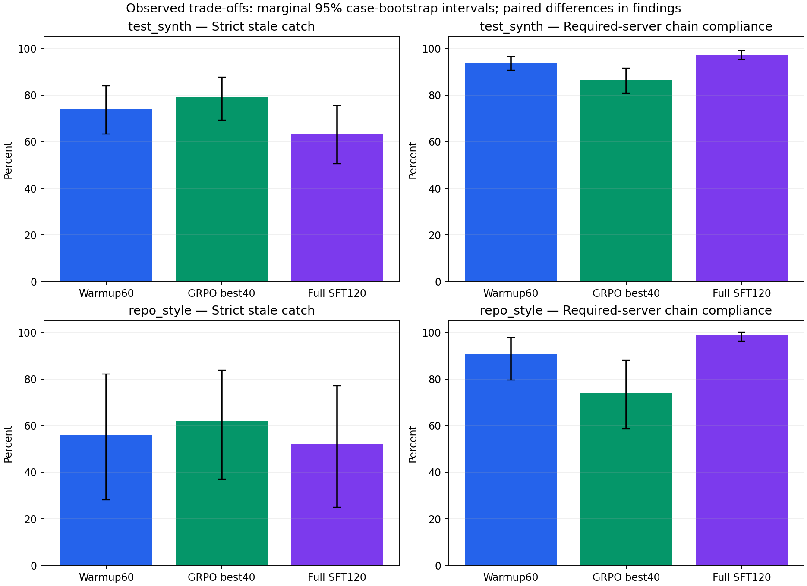

# Findings: warmup SFT and anti-collapse GRPO

The requested 40+40 active updates completed. Validation selected update 40; update 80 was also saved. All frozen data and the earlier four-epoch adapter/evaluations remain unchanged.

## What the run established

- Validation rose from 67.50% after warmup to 80.00% at update 40. Subsequent checks were 76.25% (60) and 78.75% (80), so Stage 2 did not improve the selected checkpoint. No abstention early-stop guard fired: predicted validation abstention stayed between 23.75% and 26.25%, versus a true 25% rate.
- Overall holdout point estimates rose from 72.50% to 75.75% on synthetic and 64.00% to 71.00% on OSS-style. Paired differences were +3.25 percentage points [95% CI -2.50, +9.00] and +7.00 [-5.00, +20.00]. Both intervals include zero; this run does not establish an overall generalization improvement over warmup.
- The preserved full four-epoch SFT still has higher overall holdout point estimates: 77.25% synthetic and 76.00% OSS-style. GRPO was lower by 1.50 points [-7.25, +4.25] and 5.00 [-18.63, +6.80], respectively; these intervals also include zero.
- Strict stale-document catch rate improved against the full SFT control: 63.50% to 79.00% synthetic (+15.50 points [5.50, 26.00]) and 52.00% to 62.00% OSS-style (+10.00 [1.96, 20.41]). This metric requires the correct status/value, correct stale-page ID, and every gold citation to have been retrieved and cited. It is stricter than conflict status/value accuracy.
- Required-server chain compliance regressed. Synthetic fell from 93.82% warmup to 86.47% GRPO; OSS-style fell from 90.59% to 74.12%. The full SFT control was higher still (97.35% / 98.82%). These are successful required-server-call checks, not a guarantee of causal arithmetic provenance.

All intervals are 10,000-resample semantic-case cluster bootstraps. They are exploratory comparisons on reviewed fixtures and repeated validation selection; no multiple-comparison adjustment or fresh confirmation set was used.

## Paired trade-offs

Values are percentages; differences are percentage points with 95% paired intervals. Only eligible semantic cases enter each metric (e.g. conflict cases for stale catch).

| Cohort / metric | Warmup | GRPO best | Full SFT | GRPO minus warmup | GRPO minus full SFT |
|---|---:|---:|---:|---:|---:|
| test_synth / exact_outcome | 72.50 | 75.75 | 77.25 | +3.25 [-2.50, +9.00] | -1.50 [-7.25, +4.25] |
| test_synth / stale_catch | 74.00 | 79.00 | 63.50 | +5.00 [-6.50, +17.00] | +15.50 [+5.50, +26.00] |
| test_synth / required_chain_compliance | 93.82 | 86.47 | 97.35 | -7.35 [-12.06, -3.53] | -10.88 [-16.47, -5.88] |
| repo_style / exact_outcome | 64.00 | 71.00 | 76.00 | +7.00 [-5.00, +20.00] | -5.00 [-18.63, +6.80] |
| repo_style / stale_catch | 56.00 | 62.00 | 52.00 | +6.00 [-8.16, +19.61] | +10.00 [+1.96, +20.41] |
| repo_style / required_chain_compliance | 90.59 | 74.12 | 98.82 | -16.47 [-28.40, -5.88] | -24.71 [-40.01, -10.84] |

## What improved and what still failed

The overall gains over warmup came mainly from consistent tasks: 32/80 to 59/80 synthetic and 6/20 to 15/20 OSS-style. Synthetic conflict scalar/status accuracy fell from 175/200 to 162/200, while stricter stale catch rose from 148/200 to 158/200 because evidence/stale-page completeness improved among solved cases. OSS-style incident accuracy fell from 9/15 to 8/15; abstention accuracy fell from 13/15 to 11/15. This does not demonstrate a general improvement in incident chaining.

Remaining failures include selecting staging records, incorrect answered/conflict_resolved classification, skipping a required deployment channel, false answers to absent/unplugged entities, and unnecessary abstention. For example, `holdout_repo_style-0022-en` returned the correct value 12 for `litellm-router-proxy`, citing Notion and Slack, but omitted the required GitHub PR check. It passes scalar/status accuracy and fails chain compliance/full stale-catch verification. The raw calls and citations are saved in [CHAIN_FAILURE_EXAMPLES.json](CHAIN_FAILURE_EXAMPLES.json).

The selected model abstained on 57/400 synthetic questions (14.25%) and 17/100 OSS-style (17.00%), close to the true 15% prevalence. That aggregate rate hides errors: synthetic had 38 correct abstentions, 19 unnecessary abstentions, and 22 missed required abstentions. OSS-style had 11 correct abstentions, six unnecessary abstentions, and four missed required abstentions. All 500 holdout outputs were format-valid, so the remaining failures are not explained by XML/JSON formatting alone.

## Sampling, entropy hypothesis and compute

The five-update smoke accepted 5/9 groups (55.56%). Full-run acceptance was 80/342 (23.39%): Stage 1 40/148 (27.03%), Stage 2 40/194 (20.62%). The historical four-epoch G4 pilot accepted 6/72 (8.33%). Warmup budget, group size and temperatures changed together; these measurements do not isolate a causal effect of shorter SFT on entropy. The early smoke rate overstated sustained throughput.

Of 262 skipped groups, 257 had all six scalar/status outcomes correct and five had all wrong. There were 260 zero-variance rejections and three all-non-positive rejections, with one overlap. Most wasted sampling therefore revisited already-correct outcomes. Equal reward does not prove identical text or full-distribution entropy collapse. The new run logs distinct assistant-token sequences and sampled-token surprisal; neither is a complete distribution-entropy measurement.

The retained journal contains 2,052 sampled episodes (342 groups × 6), with 480 episodes used in 80 optimizer groups. Preliminary Stage-2 work before the allocation handoff was archived and replayed; it is excluded from those retained counts. Both allocations were capped at three hours. No extra SFT or baseline evaluation was repeated for the handoff.

The frozen warmup reference had zero L1 parameter change. The Stage-2 policy adapter changed (L1 809.235549 from its Stage-1 initialization), and restored-best weights were verified against the selected saved checkpoint. Peak observed GRPO/validation reserved VRAM was about 13.51 GiB; the five-update smoke used 9.86 GiB.

## Interpretation

The recipe avoided the prior abstention mode collapse in this run and made substantially more active groups available. It improved the headline strict drift-detection metric against the full cloning control, while weakening general chain compliance and not beating that control on overall holdout point estimates. Stage 2 did not beat the validation-selected Stage-1 policy. These trade-offs should remain visible in a hackathon write-up.

Further work should be a separately declared experiment: compare 45/60/120-step warmups under identical G/temperature settings, inspect skipped solved-case sampling cost, and evaluate stronger chain-preserving objectives on a fresh confirmation cohort. No such follow-up or frozen-data regeneration was performed here.

## Local inference

Adapters are downloaded under `checkpoints_v2_2/`: `sft_warmup_adapter`, `grpo_best_val_adapter` (update 40), and `grpo_final_adapter` (update 80). The preserved four-epoch reference remains at `checkpoints_v2_1/sft_adapter`. These are LoRA adapters for the pinned base revision, not merged base weights.

From the project root, run a local NF4 deployment example:

```bash
.venv/bin/python -m src_v2_2.local_demo \
  --adapter checkpoints_v2_2/grpo_best_val_adapter
```

Local NF4/FP16 compute is separate from the cloud BF16 benchmark; the table above reports cloud results.


